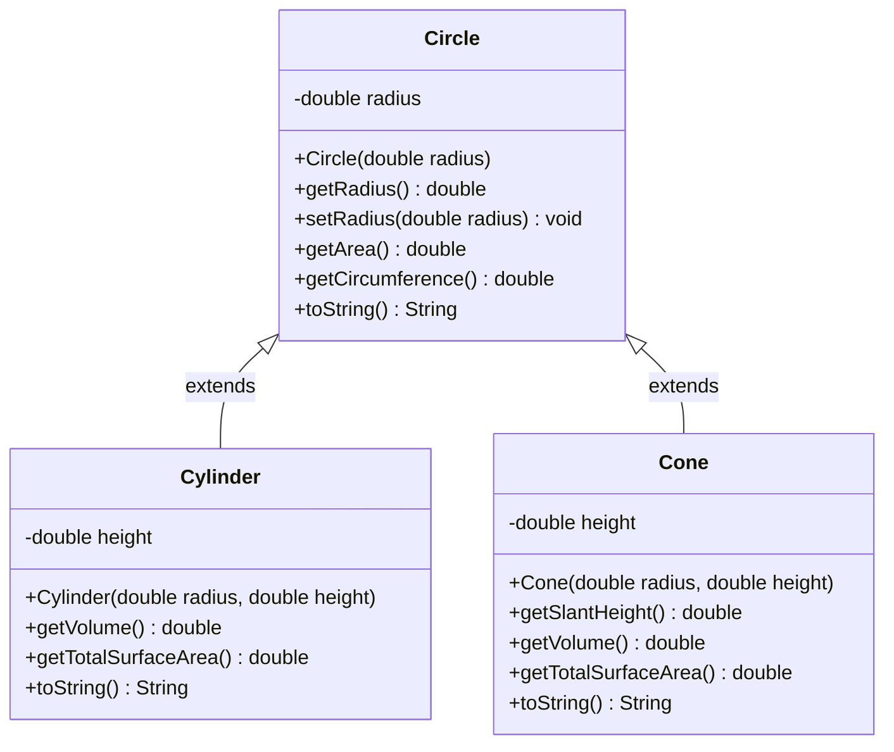
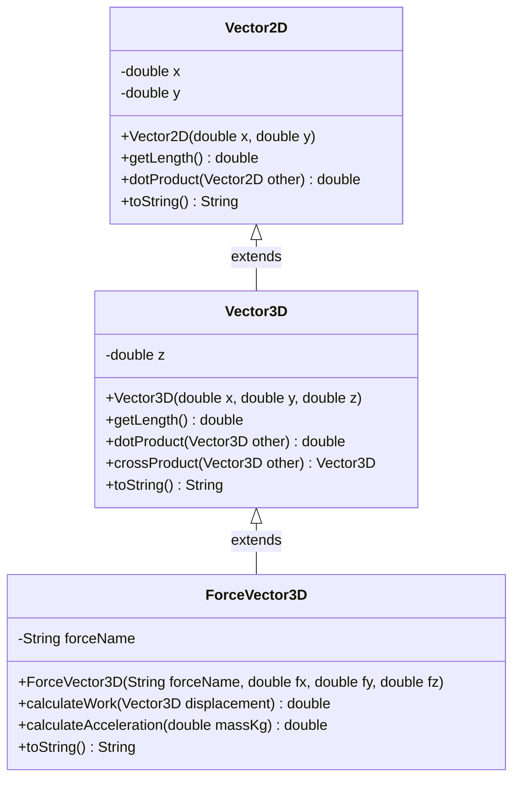
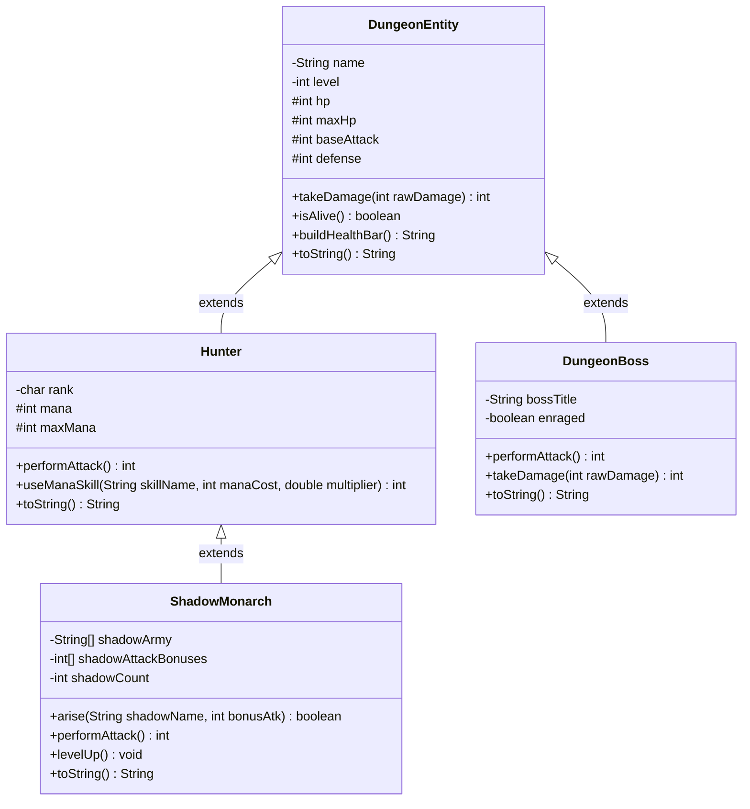

# Домашнє завдання до Практичної роботи №8
## Тема: Ключові концепції ООП: Інкапсуляція, Наслідування (`extends`, `super`) та Метод `toString()`

---

## 📌 Загальна інформація та правила виконання

### 🎯 Мета завдання
Закріпити на практиці фундаментальні стовпи Об'єктно-Орієнтованого Програмування на знайомих математичних, фінансових та ігрових задачах (без забігання у нові теми):
- **Поглиблена інкапсуляція:** використання модифікаторів `private` та `protected`, захист інваріантів класу через валідацію у конструкторах і сеттерах, безпечна робота з масивами всередині класів.
- **Наслідування (`extends`):** проєктування логічних ієрархій класів за принципом **IS-A** (однорівневих та трирівневих `A -> B -> C`).
- **Робота з `super` та `super(...)`:** делегування ініціалізації у конструктор батьківського класу та повторне використання батьківських методів розрахунку (`super.getArea()`, `super.withdraw()`, `super.toString()`) згідно з принципом **DRY**.
- **Перевизначення методів (`@Override`) та метод `toString()`:** заміна старих методів `printInfo()` на професійне перевизначення `@Override public String toString()` для автоматичного форматованого виведення об'єктів у консоль.
- **Культура роботи з Git та GitHub:** оформлення коду у власному репозиторії, виконання чистих комітів (`git commit`) та публікація розв'язків на **GitHub** (`git push`).

---

### ⚖️ Правила оцінювання та вибору завдань

1. **Максимальна оцінка за домашню роботу — 5 балів.**
2. **Обов'язковий мінімум:** виконати **хоча б 1 завдання** на власний вибір та завантажити його у свій GitHub-репозиторій.
3. **Гнучке сумування балів:**
   - Кожне завдання має свою фіксовану «вартість» у балах (від 2 до 5).
   - Якщо ви розв'язуєте декілька завдань, **отримані бали сумуються** (але підсумкова оцінка в журнал не перевищує **5 балів**).
   - Виконання додаткових завдань — це надійна «подушка безпеки» на випадок дрібних помилок або неточностей!
4. **Варіанти стратегій виконання:**
   - 🥉 **Базовий рівень (оцінка 2–3):** тільки **Завдання 1** (2 бали) або тільки **Завдання 2** (3 бали).
   - 🥈 **Рівень «Добре» (оцінка 4):** тільки **Завдання 3** (4 бали).
   - 🥇 **Рівень «Відмінно» (оцінка 5):**
     - *Шлях 1 (Експертний):* розв'язати **Завдання 4** (5 балів, Ієрархія матриць та метод Крамера) **АБО** творче **Завдання 5** (5 балів, Solo Leveling: Монарх Тіней).
     - *Шлях 2 (Комбінація базових):* **Завдання 1 + Завдання 2** ($2 + 3 = 5$ балів).
     - *Шлях 3 (Комбінація з запасом):* **Завдання 1 + Завдання 3** ($2 + 4 = 6 \to 5$ балів) або **Завдання 2 + Завдання 3** ($3 + 4 = 7 \to 5$ балів).

---

### 🐙 Обов'язкова вимога: Здача роботи через Git та GitHub

> [!IMPORTANT]
> **Починаючи з Практичної роботи №8, усі домашні завдання здаються через GitHub!**
> Файли, надіслані просто текстом або скріншотами у месенджер без посилання на GitHub-репозиторій, **не приймаються**.

#### Покроковий алгоритм здачі домашнього завдання на GitHub:
1. Створіть класи обраних завдань у пакеті `semester1.practice08.homework` (або `semester1.practice08`).
2. Переконайтеся, що код компілюється і коректно працює при запуску методу `main`.
3. Відкрийте термінал в IntelliJ IDEA (`Alt + F12` / `Option + F12`) і перевірте змінені файли:
   ```bash
   git status
   ```
4. Додайте файли домашньої роботи до індексу Git:
   ```bash
   git add src/main/java/semester1/practice08/
   ```
5. Створіть інформативний коміт:
   ```bash
   git commit -m "feat(hw08): implement OOP inheritance and encapsulation tasks"
   ```
6. Відправте зміни у свій віддалений репозиторій на GitHub:
   ```bash
   git push origin main
   ```
7. Надішліть викладачу **посилання на ваш GitHub-репозиторій** (або Pull Request / посилання на пакет `practice08` у репозиторії).

> [!CAUTION]
> **Перевірте перед `git push`:**
> - У вашому репозиторії на GitHub **не повинно бути** папки `target/` зі скомпільованими `.class` файлами (вона має бути в `.gitignore`).
> - Кожне обране завдання має власний клас із методом `public static void main(String[] args)`, який запускається без помилок компіляції.

---

### 📂 Організація класів та пакетів

- **Пакет:** розміщуйте класи у пакеті `semester1.practice08.homework` (або `semester1.practice08`). Назва пакету пишеться **виключно маленькими літерами**.
- **Окремий клас запуску для кожного завдання:** для кожного обраного завдання створіть окремий `.java` файл із фіксованою назвою з таблиці нижче. Допоміжні класи ієрархії (наприклад, `Circle`, `Cylinder`, `BankAccount`) можна розташовувати у тому самому файлі поруч із класом завдання (без модифікатора `public`) або в окремих `.java` файлах пакету.

**Закріплені назви класів для завдань:**
| Завдання | Вартість | Назва класу | Напрямок | Короткий зміст |
|:---:|:---:|:---|:---|:---|
| **Завдання 1** | **2 бали** | `Task1GeometryInheritance` | 📐 Математика 1 | Ієрархія тіл обертання: `Circle` $\to$ `Cylinder` та `Cone` (`super`, `toString`) |
| **Завдання 2** | **3 бали** | `Task2BankingHierarchy` | 💼 Практичний кейс | Ієрархія рахунків: `BankAccount` $\to$ `SavingsAccount` та `CreditAccount` |
| **Завдання 3** | **4 бали** | `Task3Vector3DHierarchy` | 📐 Математика 2 | Трирівнева векторна алгебра та фізика: `Vector2D` $\to$ `Vector3D` $\to$ `ForceVector3D` |
| **Завдання 4** | **5 балів** | `Task4MatrixHierarchy` | 📐 Математика 3 (2D Масиви) | Трирівнева ієрархія матриць: `Matrix2D` $\to$ `SquareMatrix` $\to$ `CramerMatrixSolver` |
| **Завдання 5** | **5 балів** | `Task5ShadowMonarchRpg` | 🎮 **Творче (Solo Leveling)** | Трирівневий симулятор Монарха Тіней: `DungeonEntity` $\to$ `Hunter` $\to$ `ShadowMonarch` |

---

## 🧠 5 домашніх завдань на вибір

---

### Рівень 1: Базовий (2 бали)
#### 📝 Завдання 1: Геометрія тіл обертання: від Кола до Циліндра та Конуса

- **Клас для виконання:** `Task1GeometryInheritance` (файл `Task1GeometryInheritance.java`)
- **Рекомендований пакет:** `semester1.practice08.homework` (або `semester1.practice08`)
- **Бали за завдання:** **2 бали**
- **Ключові теми:** інкапсуляція (`private`), валідація радіуса та висоти, наслідування (`extends`), виклик `super(radius)`, повторне використання `super.getArea()`, перевизначення `@Override public String toString()`.

**Контекст:** У попередніх практичних роботах ми окремо рахували площу круга та довжину кола. У просторовій геометрії (стереометрії) **Циліндр** і **Конус** мають у своїй основі те саме **Коло**, до якого додається третій вимір — висота $h$. Завдяки наслідуванню ми можемо не писати формулу площі основи $\pi r^2$ тричі, а успадкувати її від класу `Circle`!



**Що необхідно зробити:**
1. **Створіть базовий клас `Circle`:**
   - Приватне поле: `private double radius;`.
   - Конструктор `public Circle(double radius)` та сеттер `public void setRadius(double radius)` із валідацією: якщо `radius <= 0`, вивести попередження і встановити `1.0`.
   - Геттер `public double getRadius()`.
   - Методи:
     - `public double getArea()` — площа круга $S = \pi r^2$ (`Math.PI * radius * radius`).
     - `public double getCircumference()` — довжина кола $C = 2 \pi r$.
   - Перевизначте `@Override public String toString()`, який повертає:
     `String.format("Circle[r=%.2f, S=%.2f, C=%.2f]", radius, getArea(), getCircumference())`.
2. **Створіть клас-нащадок `Cylinder extends Circle`:**
   - Додаткове приватне поле: `private double height;` (валідація: якщо `height <= 0`, встановити `1.0`).
   - Конструктор `public Cylinder(double radius, double height)` — першим рядком викликає `super(radius);`.
   - Методи (обов'язково використовуйте методи суперкласу замість повторного написання `Math.PI`!):
     - `public double getVolume()` — об'єм циліндра: $V = S_{\text{осн}} \cdot h = \text{super.getArea()} \cdot \text{height}$.
     - `public double getTotalSurfaceArea()` — площа повної поверхні (дві основи + бічна поверхня):
       $$S_{\text{повн}} = 2 \cdot \text{super.getArea()} + \text{super.getCircumference()} \cdot \text{height}$$
   - Перевизначте `@Override public String toString()` з використанням `super.toString()`.
3. **Створіть клас-нащадок `Cone extends Circle`:**
   - Додаткове приватне поле: `private double height;` ($> 0$).
   - Конструктор `public Cone(double radius, double height)` $\to$ `super(radius);`.
   - Методи:
     - `public double getSlantHeight()` — твірна конуса за теоремою Піфагора: $l = \sqrt{r^2 + h^2}$ (`Math.sqrt(getRadius() * getRadius() + height * height)`).
     - `public double getVolume()` — об'єм конуса: $V = \frac{1}{3} \cdot \text{super.getArea()} \cdot \text{height}$ (увага: пишіть `/ 3.0`, щоб уникнути цілочисельного ділення!).
     - `public double getTotalSurfaceArea()` — площа повної поверхні: $S_{\text{повн}} = \text{super.getArea()} + \pi \cdot r \cdot l$.
   - Перевизначте `@Override public String toString()` через `super.toString()`.
4. У методі `Task1GeometryInheritance.main` створіть екземпляри `Circle(5.0)`, `Cylinder(5.0, 10.0)` та `Cone(3.0, 4.0)` і виведіть їх у консоль просто передавши об'єкти в `System.out.println(...)`.

**Очікуваний результат у консолі:**
```text
================ ГЕОМЕТРІЯ ТІЛ ОБЕРТАННЯ ================
Базове коло:
Circle[r=5.00, S=78.54, C=31.42]

Циліндр (успадковано від Circle):
Cylinder[base=Circle[r=5.00, S=78.54, C=31.42], h=10.00, V=785.40, TotalArea=471.24]

Конус (успадковано від Circle):
Cone[base=Circle[r=3.00, S=28.27, C=18.85], h=4.00, l=5.00, V=37.70, TotalArea=75.40]
=========================================================
```

---

### Рівень 2: Середній (3 бали)
#### 📝 Завдання 2: Банківська система: Ієрархія Ощадного та Кредитного рахунків

- **Клас для виконання:** `Task2BankingHierarchy` (файл `Task2BankingHierarchy.java`)
- **Рекомендований пакет:** `semester1.practice08.homework` (або `semester1.practice08`)
- **Бали за завдання:** **3 бали**
- **Ключові теми:** модифікатори `private` та `protected`, перевизначення бізнес-логіки `@Override withdraw()`, виклик `super(...)` та `super.toString()`, фінансові розрахунки.

**Контекст:** У кожному банку є базовий поточний рахунок (`BankAccount`), але клієнти відкривають спеціалізовані рахунки з різними правилами:
1. **Ощадний рахунок (`SavingsAccount`):** нараховує річні відсотки на залишок, але забороняє знімати кошти нижче обов'язкового незнижуваного залишку (`minBalance`).
2. **Кредитний рахунок (`CreditAccount`):** дозволяє клієнту витрачати більше, ніж є власних грошей, заходячи у «мінус» (овердрафт) у межах кредитного ліміту (`creditLimit`), але стягує комісію за користування кредитними коштами.

**Що необхідно зробити:**
1. **Створіть базовий клас `BankAccount`:**
   - Поля: `private String iban`, `private String ownerName`, `protected double balance`.
   - Конструктор `public BankAccount(String iban, String ownerName, double initialBalance)` (якщо початковий баланс $< 0$, встановити `0.0`).
   - Геттери для всіх полів.
   - Метод `public void deposit(double amount)`: якщо `amount > 0`, додає кошти до `balance`.
   - Метод `public boolean withdraw(double amount)`: якщо `amount > 0 && amount <= balance`, списує кошти й повертає `true`, інакше виводить повідомлення про відмову та повертає `false`.
   - Перевизначте `@Override public String toString()`:
     `String.format("Рахунок[%s | Власник: %s | Баланс: %.2f грн]", iban, ownerName, balance)`.
2. **Створіть підклас `SavingsAccount extends BankAccount`:**
   - Додаткові приватні поля: `private double interestRate` (річна ставка у %, наприклад `12.0`), `private double minBalance` (незнижуваний залишок, наприклад `1000.0`).
   - Конструктор `public SavingsAccount(String iban, String ownerName, double initialBalance, double interestRate, double minBalance)` $\to$ `super(...)`.
   - Перевизначте `@Override public boolean withdraw(double amount)`:
     - Зняття дозволено лише тоді, коли після списання на рахунку залишиться не менше ніж `minBalance` (`balance - amount >= minBalance`).
     - Якщо умова виконується — викличте `return super.withdraw(amount);`, інакше виведіть причину відмови і поверніть `false`.
   - Додайте метод `public void applyInterest()`: обчислює суму відсотків `balance * (interestRate / 100.0)` та поповнює рахунок через `deposit(...)`.
   - Перевизначте `@Override public String toString()` через `super.toString()`.
3. **Створіть підклас `CreditAccount extends BankAccount`:**
   - Додаткові приватні поля: `private double creditLimit` (наприклад, `15000.0`), `private double feePercent` (комісія на суму овердрафту у %, наприклад `2.0`).
   - Конструктор `public CreditAccount(String iban, String ownerName, double initialBalance, double creditLimit, double feePercent)` $\to$ `super(...)`.
   - Перевизначте `@Override public boolean withdraw(double amount)`:
     - Якщо клієнту вистачає власних коштів (`balance >= amount`), спишіть без жодної комісії через `super.withdraw(amount)`.
     - Якщо власних коштів не вистачає, порахуйте розмір дефіциту (позики): `double borrowed = amount - Math.max(0.0, balance);` та комісію банку: `double fee = borrowed * (feePercent / 100.0);`.
     - Перевірте, чи новий баланс `balance - amount - fee` не впаде нижче `-creditLimit`. Якщо в межах ліміту — оновіть `this.balance` і поверніть `true`, інакше відмовте у транзакції!
   - Додайте метод `public double getCurrentDebt()`, який повертає `balance < 0 ? Math.abs(balance) : 0.0`.
   - Перевизначте `@Override public String toString()` через `super.toString()`.
4. У `Task2BankingHierarchy.main` протестуйте роботу всіх трьох типів рахунків та виведіть їхні стани через `System.out.println(...)`.

**Очікуваний результат у консолі:**
```text
================ БАНКІВСЬКА ІЄРАРХІЯ РАХУНКІВ ================
1. Ощадний рахунок (початковий стан):
SavingsAccount{Рахунок[UA101 | Власник: Олена Коваль | Баланс: 5000.00 грн], Ставка: 12.0%, Мін.залишок: 1000.00 грн}
-> Спроба зняти 4500 грн: ВІДМОВА (порушення незнижуваного залишку 1000.00 грн)
-> Нарахування річних відсотків (+12%)...
SavingsAccount{Рахунок[UA101 | Власник: Олена Коваль | Баланс: 5600.00 грн], Ставка: 12.0%, Мін.залишок: 1000.00 грн}

2. Кредитний рахунок (початковий стан):
CreditAccount{Рахунок[UA202 | Власник: Максим Бондар | Баланс: 2000.00 грн], Ліміт: 10000.00 грн, Борг: 0.00 грн}
-> Покупка на 5000 грн (3000 грн у кредит з комісією 2% = 60 грн)... УСПІШНО!
CreditAccount{Рахунок[UA202 | Власник: Максим Бондар | Баланс: -3060.00 грн], Ліміт: 10000.00 грн, Борг: 3060.00 грн}
==============================================================
```

---

### Рівень 3: Поглиблений (4 бали)
#### 📝 Завдання 3: Трирівнева векторна геометрія та фізика (`Vector2D` $\to$ `Vector3D` $\to$ `ForceVector3D`)

- **Клас для виконання:** `Task3Vector3DHierarchy` (файл `Task3Vector3DHierarchy.java`)
- **Рекомендований пакет:** `semester1.practice08.homework` (або `semester1.practice08`)
- **Бали за завдання:** **4 бали**
- **Ключові теми:** трирівневе наслідування (`A -> B -> C`), інкапсуляція координат, перевизначення математичних методів `@Override getLength()`, взаємодія об'єктів, фізичне моделювання ІІ закону Ньютона та роботи сили.

**Контекст:** Поєднаємо векторну математику з Практичних №6–7 із фізикою та багаторівневим спадкуванням:
- На 1-му рівні живе плоский вектор **`Vector2D`** $(x, y)$.
- На 2-му рівні його розширює просторовий вектор **`Vector3D`** $(x, y, z)$.
- На 3-му рівні розташований фізичний вектор сили **`ForceVector3D`**, який діє на тіло в просторі, здатний виконувати механічну роботу $A = \vec{F} \cdot \vec{s}$ та надавати тілу масою $m$ прискорення $a = \frac{|\vec{F}|}{m}$.



**Що необхідно зробити:**
1. **Рівень 1 — Клас `Vector2D`:**
   - Приватні поля: `private double x`, `private double y`.
   - Конструктори: `public Vector2D(double x, double y)` та `public Vector2D()` (делегує до `this(0.0, 0.0)`).
   - Геттери та сеттери для `x` і `y`.
   - Метод `public double getLength()` — довжина вектора $\sqrt{x^2 + y^2}$.
   - Метод `public double dotProduct(Vector2D other)` — скалярний добуток 2D: $x_1 x_2 + y_1 y_2$.
   - Метод `@Override public String toString()` $\to$ `String.format("Vector2D(%.2f; %.2f) |L|=%.2f", x, y, getLength())`.
2. **Рівень 2 — Клас `Vector3D extends Vector2D`:**
   - Додаткове приватне поле: `private double z;`.
   - Конструктор `public Vector3D(double x, double y, double z)` $\to$ першим рядком викликає `super(x, y);`.
   - Геттер і сеттер для `z`.
   - Перевизначте `@Override public double getLength()`:
     $$\sqrt{x^2 + y^2 + z^2}$$
     *(Елегантний прийом: використайте `getX()`, `getY()` або `Math.hypot(super.getLength(), z)`)*.
   - Перевантажте/реалізуйте 3D скалярний добуток `public double dotProduct(Vector3D other)`:
     $$\text{super.dotProduct(other)} + this.z \cdot other.z$$
   - Додайте метод векторного добутку `public Vector3D crossProduct(Vector3D other)`, що повертає новий `Vector3D`:
     $$(y_1 z_2 - z_1 y_2, \; z_1 x_2 - x_1 z_2, \; x_1 y_2 - y_1 x_2)$$
   - Перевизначте `@Override public String toString()`.
3. **Рівень 3 — Клас `ForceVector3D extends Vector3D`:**
   - Додаткове приватне поле: `private String forceName;` (наприклад, `"Сила тяги двигуна"`, вимірюється у Ньютонах, Н).
   - Конструктор `public ForceVector3D(String forceName, double fx, double fy, double fz)` $\to$ `super(fx, fy, fz);`.
   - Метод обчислення механічної роботи сили (у Джоулях, Дж) при переміщенні точки на вектор $\vec{s}$:
     `public double calculateWork(Vector3D displacement)` $\to$ повертає скалярний добуток `super.dotProduct(displacement)`!
   - Метод обчислення модуля прискорення тіла (у $\text{м/с}^2$) за другим законом Ньютона ($a = \frac{|\vec{F}|}{m}$):
     `public double calculateAcceleration(double massKg)` (якщо `massKg <= 0`, повернути `0.0`, інакше `getLength() / massKg`).
   - Перевизначте `@Override public String toString()` через `super.toString()`.
4. У `Task3Vector3DHierarchy.main` продемонструйте роботу всіх трьох класів ієрархії.

**Очікуваний результат у консолі:**
```text
================ ІЄРАРХІЯ ВЕКТОРІВ (2D -> 3D -> FORCE) ================
1. Рівень 1 (2D): Vector2D(3.00; 4.00) |L|=5.00
2. Рівень 2 (3D): Vector3D(3.00; 4.00; 12.00) |L|=13.00
   Вектор переміщення S: Vector3D(2.00; 0.00; 5.00) |L|=5.39

3. Рівень 3 (Фізична сила):
   Force[name='Тяга ракети', Vector3D(3.00; 4.00; 12.00) |F|=13.00 Н]
   -> Виконана механічна робота A = F · S = 66.00 Дж
   -> Прискорення тіла масою 2.5 кг: a = 5.20 м/с²
=======================================================================
```

---

### Рівень 4: Високий / Експертний (5 балів)
#### 📝 Завдання 4: Трирівнева ієрархія матриць та розв'язувач СЛАР (`Matrix2D` $\to$ `SquareMatrix` $\to$ `CramerMatrixSolver`)

- **Клас для виконання:** `Task4MatrixHierarchy` (файл `Task4MatrixHierarchy.java`)
- **Рекомендований пакет:** `semester1.practice08.homework` (або `semester1.practice08`)
- **Бали за завдання:** **5 балів**
- **Ключові теми:** трирівневе наслідування, інкапсуляція двовимірного масиву `double[][]`, захисне копіювання, слід та визначник квадратної матриці, метод Крамера для систем рівнянь, багаторядковий табличний `@Override public String toString()`.

**Контекст:** Поєднаємо тему двовимірних масивів із Практичної №5 та матричної алгебри з Практичної №6 у струнку об'єктно-орієнтовану архітектуру:
- **Рівень 1 (`Matrix2D`):** будь-яка прямокутна таблиця чисел розміром $M \times N$.
- **Рівень 2 (`SquareMatrix extends Matrix2D`):** квадратна матриця $N \times N$ (є особливим випадком прямокутної!), для якої існують поняття головної діагоналі, сліду матриці (*trace*), симетричності та визначника (*determinant*).
- **Рівень 3 (`CramerMatrixSolver extends SquareMatrix`):** квадратна матриця коефіцієнтів системи лінійних рівнянь, доповнена стовпчиком вільних членів $B$, яка вміє знаходити невідомі корені за формулами Крамера!

**Що необхідно зробити:**
1. **Рівень 1 — Базовий клас `Matrix2D`:**
   - Поля: `protected double[][] data;`, `private int rows;`, `private int cols;`.
   - Конструктор `public Matrix2D(double[][] source)`: створює глибоку копію переданого 2D-масиву (щоб зовнішні зміни не псували інкапсульований стан).
   - Методи: `getRows()`, `getCols()`, `getElement(int r, int c)`, `setElement(int r, int c, double val)` (із перевіркою меж індексів), `getSum()` (сума всіх елементів), `getMaxElement()`.
   - Перевизначте `@Override public String toString()`, який збирає красиве багаторядкове табличне представлення матриці з вирівнюванням до 2 знаків після коми.
2. **Рівень 2 — Підклас `SquareMatrix extends Matrix2D`:**
   - Конструктор `public SquareMatrix(double[][] source)` $\to$ викликає `super(source);`. Якщо `getRows() != getCols()`, виводить попередження!
   - Методи:
     - `public int getDimension()` — розмірність $N$ квадратної матриці.
     - `public double getTrace()` — слід матриці (сума елементів головної діагоналі $\sum data[i][i]$).
     - `public boolean isSymmetric()` — перевіряє, чи $data[i][j] == data[j][i]$ для всіх елементів.
     - `public double getDeterminant()` — обчислює визначник $\Delta$:
       - якщо $N == 2$: $d_{00} d_{11} - d_{01} d_{10}$;
       - якщо $N == 3$: за правилом трикутників (Саррюса) з Практичної №6;
       - для інших розмірів повертає `0.0`.
   - Перевизначте `@Override public String toString()`: повертає `super.toString()` + рядок підсумку зі слідом, симетричністю та визначником $\det(A)$.
3. **Рівень 3 — Підклас `CramerMatrixSolver extends SquareMatrix`:**
   - Додаткове приватне поле: `private double[] freeTerms;` (масив вільних членів $c_1, c_2, \dots$).
   - Конструктор `public CramerMatrixSolver(double[][] coefficients, double[] freeTerms)` $\to$ викликає `super(coefficients)` та копіює масив `freeTerms`.
   - Метод `public double[] solve()` (для систем $2 \times 2$ або $3 \times 3$):
     - Отримує головний визначник $\Delta = \text{getDeterminant()}$.
     - Якщо $|\Delta| < 10^{-9}$, виводить повідомлення, що єдиного розв'язку немає, і повертає порожній масив `new double[0]`.
     - Інакше формує допоміжні об'єкти `SquareMatrix` із заміною відповідного стовпчика на `freeTerms`, бере їхній `.getDeterminant()` і повертає масив знайдених коренів!
   - Перевизначте `@Override public String toString()`, щоб він виводив розширену матрицю системи $[A | B]$, визначник та знайдені корені $x_1, x_2, \dots$.
4. У `Task4MatrixHierarchy.main` протестуйте роботу всіх трьох класів на матриці $2 \times 2$ (наприклад, система $\begin{cases} 2x + 3y = 8 \\ 4x - y = 2 \end{cases} \implies x = 1, y = 2$) та квадратній матриці $3 \times 3$.

**Очікуваний результат у консолі:**
```text
================ ІЄРАРХІЯ МАТРИЦЬ ТА СЛАР ================
--- 1. Квадратна матриця 3x3 (SquareMatrix) ---
[   2.00    1.00    0.00 ]
[   1.00    3.00    1.00 ]
[   0.00    1.00    2.00 ]
Характеристики SquareMatrix: Розмір = 3x3 | Слід (Trace) = 7.00 | Симетрична = true | det(A) = 8.00

--- 2. Розв'язувач системи Крамера (CramerMatrixSolver 2x2) ---
Розширена матриця системи [A | B]:
[   2.00    3.00  |   8.00 ]
[   4.00   -1.00  |   2.00 ]
Головний визначник det(A) = -14.00
Розв'язок системи: x1 = 1.00, x2 = 2.00 (Перевірка пройдена!)
==========================================================
```

---

### Рівень 5: Творчий (5 балів)
#### 🎮 Завдання 5: Епічний симулятор «Solo Leveling: Монарх Тіней та Підземелля S-Рангу»

- **Клас для виконання:** `Task5ShadowMonarchRpg` (файл `Task5ShadowMonarchRpg.java`)
- **Рекомендований пакет:** `semester1.practice08.homework` (або `semester1.practice08`)
- **Бали за завдання:** **5 балів**
- **Ключові теми:** трирівневе наслідування (`DungeonEntity` $\to$ `Hunter` $\to$ `ShadowMonarch`), інкапсуляція, масив об'єктів/рядків Тіньової Армії, перевизначення бойових методів `@Override`, візуальний `@Override public String toString()`, інтерактивний або симуляційний рейд проти Боса.

> [!TIP]
> **Творча свобода:** За замовчуванням завдання побудоване за мотивами культового всесвіту **«Solo Leveling» (Тільки я візьму новий рівень — Сон Джін-Ву)**. Якщо ви бажаєте, ви можете адаптувати назви персонажів та умінь під ваш улюблений всесвіт (**Dota 2**, **S.T.A.L.K.E.R. 2**, **Jujutsu Kaisen**, **Відьмак** чи **Cyberpunk 2077**), зберігши трирівневу ієрархію класів та механіку!



**Що необхідно зробити:**
1. **Рівень 1 — Базовий клас `DungeonEntity` (Сутність підземелля):**
   - Поля: `private String name`, `private int level`, `protected int hp`, `protected int maxHp`, `protected int baseAttack`, `protected int defense`.
   - Конструктор із повною валідацією параметрів та геттери.
   - Метод `public int takeDamage(int rawDamage)`:
     - Обчислює чисту шкоду з урахуванням броні: `int actual = Math.max(5, rawDamage - defense);`.
     - Зменшує `hp` (але не нижче `0`) та повертає отриману шкоду `actual`.
   - Метод `public int performAttack()`: повертає `baseAttack`.
   - Метод `public boolean isAlive()`: повертає `hp > 0`.
   - Допоміжний метод `protected String buildHealthBar()`: повертає ASCII-індикатор із 10 поділок, наприклад `[████████░░]`.
   - Перевизначте `@Override public String toString()`: виводить ім'я, рівень, смужку HP та базові характеристики.
2. **Рівень 2 — Клас `Hunter extends DungeonEntity` (Мисливець Асоціації) та `DungeonBoss extends DungeonEntity`:**
   - У класі **`Hunter`**:
     - Поля: `private char rank` (`'E'`, `'D'`, `'C'`, `'B'`, `'A'`, `'S'`), `protected int mana`, `protected int maxMana`.
     - Метод `public int useManaSkill(String skillName, int manaCost, double multiplier)`: якщо `mana >= manaCost`, списує ману і повертає `(int)(performAttack() * multiplier)`, інакше виводить повідомлення про нестачу мани і повертає звичайний удар `performAttack()`.
     - Перевизначає `@Override public String toString()` через `super.toString()` + ранг і шкалу мани.
   - У класі **`DungeonBoss`**:
     - Поля: `private String bossTitle` (наприклад, `"Кривавий Лицар Ігріс"` або `"Архітектор Системи"`), `private boolean enraged`.
     - Перевизначає `@Override public int takeDamage(int rawDamage)`: викликає `super.takeDamage(rawDamage)`. Якщо після удару `hp > 0 && hp <= maxHp * 0.4 && !enraged`, активує `enraged = true` та друкує: `"🔥 БОС ВПАДАЄ У ФАЗУ ЛЮТІ! Атака зросла на 50%!"`.
     - Перевизначає `@Override public int performAttack()`: якщо `enraged == true`, повертає `(int)(super.performAttack() * 1.5)`, інакше `super.performAttack()`.
3. **Рівень 3 — Клас `ShadowMonarch extends Hunter` (Сон Джін-Ву — Монарх Тіней):**
   - Додаткові приватні поля для інкапсульованої Тіньової Армії (масиви на 5 слотів):
     - `private String[] shadowNames = new String[5];`
     - `private int[] shadowBonuses = new int[5];`
     - `private int shadowCount = 0;`
   - Конструктор `public ShadowMonarch(String name, int level, int maxHp, int maxMana, int baseAttack, int defense)` $\to$ викликає `super(name, level, maxHp, baseAttack, defense, 'S', maxMana)`.
   - Унікальний метод некромантії **`public boolean arise(String shadowName, int bonusAtk)`** (*«Повстань! / Arise!»*):
     - Вимагає `30` мани та вільного слота в масиві (`shadowCount < shadowNames.length`).
     - Додає тінь у масив (наприклад, `"Ігріс (+85 ATK)"`, `"Беру (+140 ATK)"`, `"Танк (+60 ATK)"`), збільшує `shadowCount++` та виводить епічне повідомлення призову.
   - Метод `public int getTotalShadowBonus()`: сумує всі бонуси призваних тіней із масиву `shadowBonuses`.
   - Перевизначте `@Override public int performAttack()`:
     - Повертає суму базової атаки мисливця `super.performAttack()` та сумарної атаки його Тіньового Легіону `getTotalShadowBonus()`!
   - Додайте метод `public void levelUp()`: `[СИСТЕМА: РІВЕНЬ ПІДВИЩЕНО!]`, підвищує рівень, додає $+150$ до `maxHp` (та лікує), $+50$ до `maxMana` та $+25$ до `baseAttack`.
   - Перевизначте `@Override public String toString()`: виводить `super.toString()`, а нижче — повний перелік призваних тіней легіону та їхній сумарний бонус до атаки!
4. У методі `Task5ShadowMonarchRpg.main` проведіть яскраву симуляцію рейду (покрокову в циклі або інтерактивну через `Scanner`), де Сон Джін-Ву б'ється проти елітного лицаря та Головного Боса підземелля, піднімає переможених ворогів у свою Тіньову Армію командою `arise(...)`, підвищує рівень і виводить досьє через `System.out.println(monarch)`.

**Приклад роботи програми в консолі:**
```text
================ ⚔️ SOLO LEVELING: ПІДЗЕМЕЛЛЯ S-РАНГУ ⚔️ ================
[ДОСЬЄ МИСЛИВЦЯ]:
ShadowMonarch{Hunter{DungeonEntity{name='Сон Джін-Ву', lvl=45, HP=[██████████] 1200/1200, ATK=180, DEF=45} | Ранг: [S] | MP: 300/300}}
  👥 Тіньовий Легіон (1/5): [1. Лицар Ігріс (+90 ATK)] | Сумарний бонус тіней: +90 ATK

[БОС КАМЕРИ]:
DungeonBoss{DungeonEntity{name='Король Мурах Беру', lvl=80, HP=[██████████] 2500/2500, ATK=260, DEF=60} | Титул: 'Кошмар Острова Чеджу', Лють: false}

--- РАУНД 1 ---
⚡ Сон Джін-Ву закликає нову тінь: «ПОВСТАНЬ! (ARISE!)» (-30 MP)
🌑 Тінь [Залізний Танк (+70 ATK)] приєдналася до легіону! (Тіней: 2/5)
🗡️ Сон Джін-Ву та його Тіньовий Легіон атакують! База: 180 + Бонус тіней: 160 = 340!
💥 Король Мурах Беру отримує 280 чистої шкоди! (Залишок HP: 2220/2500)
...
🏆 ПЕРЕМОГА! Боса Король Мурах Беру подолано!
🔔 [СИСТЕМА]: Ви підняли рівень! Новий рівень: 46!
🌑 «ПОВСТАНЬ!» -> Генерал Беру (+180 ATK) стає на коліно перед Монархом Тіней!
=========================================================================
```

---

## 📊 Інструкція для викладача: Методика оцінювання

### 1. Зведена таблиця балів та вимог

| Завдання | Клас | Бали | Спрямування | Ключові компетенції, що перевіряються |
|:---|:---|:---:|:---|:---|
| **Завдання 1** | `Task1GeometryInheritance` | **2** | 📐 Математика 1 | `extends`, `private`, `super(radius)`, `super.getArea()`, `@Override toString()` |
| **Завдання 2** | `Task2BankingHierarchy` | **3** | 💼 Практичний кейс | `protected balance`, `@Override withdraw()`, овердрафт та комісії, `super.toString()` |
| **Завдання 3** | `Task3Vector3DHierarchy` | **4** | 📐 Математика 2 | 3 рівні наслідування (`2D -> 3D -> Force`), `@Override getLength()`, скалярний/векторний добуток |
| **Завдання 4** | `Task4MatrixHierarchy` | **5** | 📐 Математика 3 (Масиви) | 3 рівні наслідування з `double[][]`, захисне копіювання, слід, визначник, метод Крамера |
| **Завдання 5** | `Task5ShadowMonarchRpg` | **5** | 🎮 **Творче (RPG)** | 3 рівні наслідування, інкапсульовані масиви армії, динамічні бойові розрахунки, `toString()` |

---

### 2. Формула підсумкової оцінки

$$\text{Підсумкова оцінка} = \min\left(5,\; \sum \text{Бали за виконані завдання} - \text{Штрафи}\right)$$

---

### 3. Експрес-алгоритм перевірки GitHub-репозиторію (1–2 хвилини)

1. **Крок 1. Перевірка GitHub-репозиторію:**
   - Відкрийте посилання студента на GitHub (або виконайте `git pull`).
   - Перевірте історію комітів (`git log -n 5`) та відсутність сміттєвих папок `target/` у репозиторії.
2. **Крок 2. Аналіз ієрархії та інкапсуляції:**
   - Переконайтеся, що поля класів мають модифікатори `private` або `protected` (не відкриті `public`!).
   - Перевірте наявність ключового слова `extends` та викликів `super(...)` у конструкторах підкласів.
   - Перевірте наявність `@Override public String toString()` у кожному класі ієрархії.
3. **Крок 3. Запуск `main`:**
   - Запустіть метод `main` обраного завдання і переконайтеся, що виведення об'єктів здійснюється через їхній `toString()`, а розрахунки збігаються з контрольними тестами.

---

### 4. Чек-поінти: На що звертати увагу в кожному завданні

#### 🔍 Завдання 1 (`Task1GeometryInheritance`):
- [ ] Чи спадкуються `Cylinder` та `Cone` від `Circle` через `extends`.
- [ ] Чи викликають конструктори нащадків `super(radius)`.
- [ ] **КРИТИЧНО (Принцип DRY):** Чи використовують методи об'єму та поверхні виклики `super.getArea()` та `super.getCircumference()` замість дублювання формул із `Math.PI`.
- [ ] Чи написано `/ 3.0` (а не `/ 3`) при обчисленні об'єму конуса $\frac{1}{3} S h$.

#### 🔍 Завдання 2 (`Task2BankingHierarchy`):
- [ ] Чи перевизначено `@Override public boolean withdraw(double amount)` в обох підкласах.
- [ ] У `SavingsAccount`: чи блокується зняття, яке залишає менше ніж `minBalance`.
- [ ] У `CreditAccount`: чи коректно нараховується комісія **тільки на позичену (кредитну) частину** коштів, коли власний баланс вичерпано, і чи перевіряється межа `-creditLimit`.

#### 🔍 Завдання 3 (`Task3Vector3DHierarchy`):
- [ ] Чи вибудовано трирівневий ланцюжок: `ForceVector3D extends Vector3D`, `Vector3D extends Vector2D`.
- [ ] Чи перевизначено `@Override public double getLength()` у `Vector3D` з урахуванням третьої координати $z$.
- [ ] Чи обчислюється робота сили `calculateWork` через скалярний добуток, а прискорення — за формулою $a = |\vec{F}| / m$.

#### 🔍 Завдання 4 (`Task4MatrixHierarchy`):
- [ ] Чи виконується копіювання двовимірного масиву в конструкторі `Matrix2D`.
- [ ] Чи успадковує `SquareMatrix` клас `Matrix2D`, а `CramerMatrixSolver` — клас `SquareMatrix`.
- [ ] Чи повертає метод `toString()` відформатовану матрицю (а не системну адресу `[[D@...`).
- [ ] Чи правильно метод Крамера замінює стовпчики та знаходить корені $x_1, x_2$.

#### 🔍 Завдання 5 (`Task5ShadowMonarchRpg`):
- [ ] Чи присутня трирівнева ієрархія (`DungeonEntity -> Hunter -> ShadowMonarch`) та клас боса (`DungeonBoss extends DungeonEntity`).
- [ ] Чи зберігається Тіньова Армія в інкапсульованих масивах, і чи враховується її сумарний бонус у перевизначеному `@Override public int performAttack()`.
- [ ] Чи виводить `@Override public String toString()` повний стан героя та список його тіней.

---

### 5. Штрафна шкала (Penalty Guide)

| Порушення | Штраф | Причина застосування |
|:---|:---:|:---|
| **Код не компілюється або не завантажений на GitHub** | **0 за роботу** | Базова вимога здачі ДЗ починаючи з Практичної №8 |
| **Відсутнє наслідування (`extends`) там, де воно вимагається** | **-2.0** | Порушення головної теми практичної роботи |
| **Усі поля класів залишені відкритими (`public` або default)** | **-1.5** | Порушення принципу інкапсуляції |
| **Замість `@Override public String toString()` використано звичайний `void print()`** | **-1.0** | Невиконання вимоги опанування `Object.toString()` |
| **Дублювання батьківських полів у класі-нащадку (затінення полів)** | **-1.0** | Оголошення `private double radius` повторно у `Cylinder` замість `super(radius)` |
| **Залито папку `target/` або `.class` файли у GitHub** | **-0.5** | Порушення гігієни Git-репозиторію |
| **Порушення Java Naming Conventions (`camelCase`, `PascalCase`)** | **-0.5** | Недотримання стандартів оформлення коду Java |

---

### 6. Контрольні тестові кейси (Test Cases)

1. **Завдання 1 (`Task1GeometryInheritance`):**
   - `Circle(5.0)` $\implies S \approx \mathbf{78.54}$, $C \approx \mathbf{31.42}$.
   - `Cylinder(5.0, 10.0)` $\implies V \approx \mathbf{785.40}$, $S_{\text{повн}} \approx \mathbf{471.24}$.
   - `Cone(3.0, 4.0)` $\implies l = \mathbf{5.00}$, $V \approx \mathbf{37.70}$, $S_{\text{повн}} \approx \mathbf{75.40}$.
2. **Завдання 2 (`Task2BankingHierarchy`):**
   - `SavingsAccount`: баланс `5000`, мін. залишок `1000`, ставка `12%`. Спроба зняти `4500` $\implies$ `false` (баланс `5000`). Після `applyInterest()` $\implies$ баланс **`5600.00`**.
   - `CreditAccount`: баланс `2000`, ліміт `10000`, комісія `2%`. Зняття `5000` (позика `3000`, комісія `60`) $\implies$ баланс **`-3060.00`**, борг **`3060.00`**.
3. **Завдання 3 (`Task3Vector3DHierarchy`):**
   - Сила $\vec{F} = (3, 4, 12)$ $\implies |\vec{F}| = \mathbf{13.00\text{ Н}}$.
   - Переміщення $\vec{s} = (2, 0, 5)$ $\implies$ Робота $A = 3\cdot 2 + 4\cdot 0 + 12\cdot 5 = \mathbf{66.00\text{ Дж}}$.
   - Маса $m = 2.5\text{ кг}$ $\implies$ Прискорення $a = 13.0 / 2.5 = \mathbf{5.20\text{ м/с}^2}$.
4. **Завдання 4 (`Task4MatrixHierarchy`):**
   - Матриця $A = \begin{pmatrix} 2 & 3 \\ 4 & -1 \end{pmatrix}$, вільні члени $B = (8, 2)$ $\implies$ Слід $= \mathbf{1.00}$, $\det(A) = \mathbf{-14.00}$, корені: $\mathbf{x_1 = 1.00, \; x_2 = 2.00}$.
