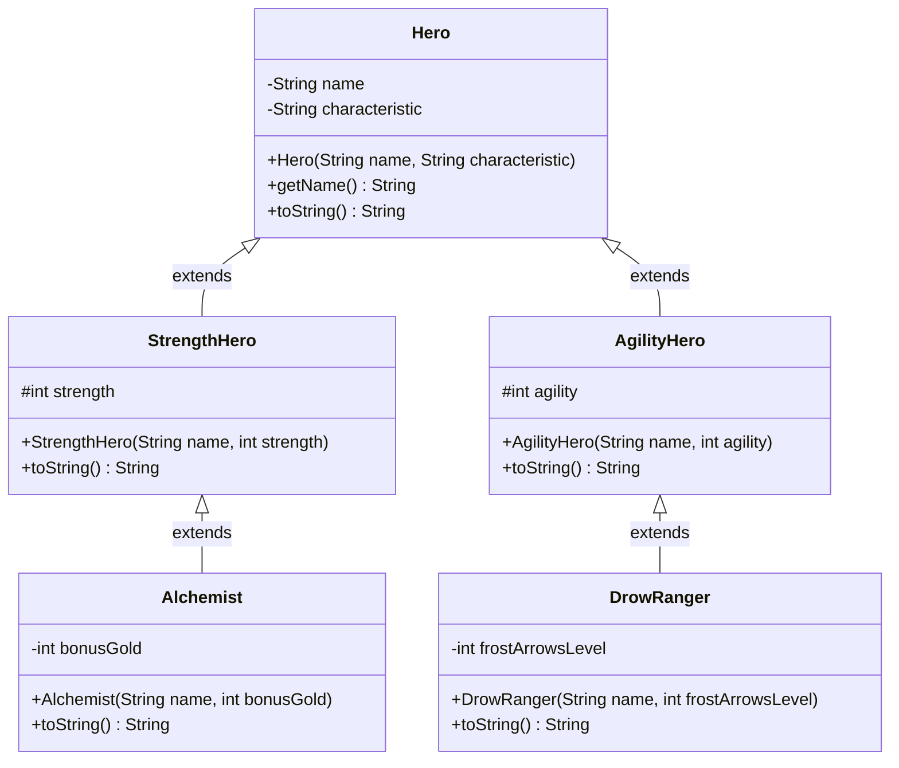
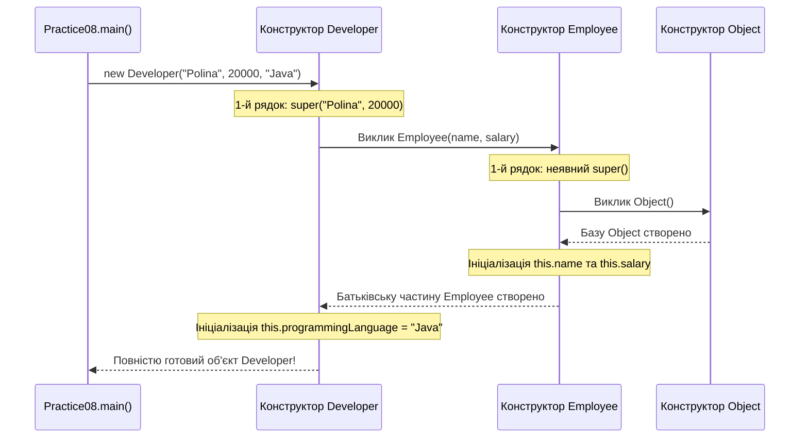
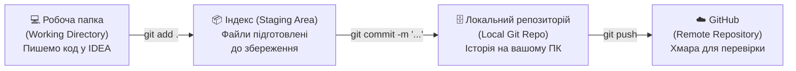

# Практична робота №8: Ключові концепції ООП: Інкапсуляція, Наслідування (`extends`, `super`) та Метод `toString()`

## 🎯 Мета роботи
- **Поглибити розуміння принципу Інкапсуляції (*Encapsulation*):**
  - Навчитися проєктувати класи із суворим захистом внутрішнього стану (`private`) та контрольованим доступом для класів-спадкоємців (`protected`).
  - Опанувати захист інваріантів об'єкта через валідацію у конструкторах і сеттерах, а також безпечну інкапсуляцію внутрішніх масивів.
- **Засвоїти фундаментальний механізм Наслідування (*Inheritance*):**
  - Зрозуміти природу ієрархічного зв'язку **IS-A** («Є різновидом») на противагу композиції **HAS-A** («Має у своєму складі»).
  - Опанувати створення базових класів (*Superclass / Parent*) та похідних класів-нащадків (*Subclass / Child*) за допомогою ключового слова `extends`.
  - Дослідити однорівневі та багаторівневі ієрархії класів (`A -> B -> C`), а також правило одиничного спадкування класів у Java.
- **Досконало опанувати ключове слово `super` та виклик `super(...)`:**
  - Зрозуміти порядок конструювання об'єкта-нащадка в пам'яті: чому конструктор батьківського класу **завжди** виконується першим.
  - Засвоїти правило виклику `super(...)` як найпершої інструкції конструктора підкласу.
  - Навчитися звертатися до методів та полів суперкласу через `super.methodName()` і розуміти, чому `private`-поля батька напряму недоступні в нащадку.
- **Опанувати перевизначення методів (`@Override`) та метод `toString()` класу `Object`:**
  - Усвідомити роль глобального суперкласу `java.lang.Object`, від якого неявно спадкується кожен клас у Java.
  - Зрозуміти, чому за замовчуванням `System.out.println(object)` виводить технічний рядок виду `ClassName@2a139a55`.
  - Навчитися грамотно перевизначати `@Override public String toString()`, використовуючи конкатенацію, `String.format()` та виклик `super.toString()` у класах-нащадках.
  - Чітко розрізняти **перевизначення методу** (*Method Overriding* у спадкуванні) та **перевантаження методу** (*Method Overloading* з Практичної №7).
  - Вивчити призначення модифікатора `final` для заборони наслідування класу (`final class`) або заборони перевизначення методу (`final method`).
- **Закріпити культуру роботи з Git та GitHub:** навчитися фіксувати зміни (`git add`, `git commit`) та відправляти виконані практичні й домашні завдання у віддалений репозиторій GitHub (`git push`).
- **Розв'язати 40 практичних завдань:** пройти шлях від базових інкапсульованих сутностей із `toString()` до багаторівневих ієрархій класів із математичними розрахунками та масивами.

---

## 📚 1. Теоретичні відомості

### 1.1. Поглиблена інкапсуляція: Інваріанти класу та модифікатор `protected`

У Практичних роботах №6 та №7 ми познайомилися з базовою ідеєю інкапсуляції: ховати поля за модифікатором `private` і відкривати доступ через `public` методи. Проте з появою **наслідування** картина модифікаторів доступу розкривається повністю.

> **Інкапсуляція (Encapsulation)** — це не просто «написати `private` і згенерувати геттери». Це архітектурний механізм об'єднання даних із методами їх обробки, який гарантує **цілісність стану об'єкта (інваріант класу)** протягом усього його життєвого циклу.

**Інваріант класу** — це умова, яка завжди залишається істинною для будь-якого екземпляра класу (наприклад: *знаменник дробу ніколи не дорівнює нулю*, *радіус кола завжди $> 0$*, *здоров'я героя завжди в межах $[0; \text{maxHp}]$*).

#### Повна таблиця модифікаторів доступу в Java:

| Модифікатор | У межах самого класу | У тому ж пакеті (`package-private`) | У класі-нащадку (навіть в іншому пакеті) | У будь-якому іншому класі проєкту | Головне призначення |
| :--- | :---: | :---: | :---: | :---: | :--- |
| **`private`** | ✅ Так | ❌ Ні | ❌ Ні | ❌ Ні | Повний захист полів та внутрішніх допоміжних методів |
| *(default / без слова)* | ✅ Так | ✅ Так | ❌ Ні | ❌ Ні | Доступ лише для «сусідів» усередині одного пакету |
| **`protected`** | ✅ Так | ✅ Так | ✅ **Так** | ❌ Ні | **Спеціально для наслідування:** відкриває доступ нащадкам, але ховає від зовнішнього світу |
| **`public`** | ✅ Так | ✅ Так | ✅ Так | ✅ Так | Публічний інтерфейс (API) класу для всіх |

#### Чому `private` поля батьківського класу невидимі в нащадку?
Якщо у базовому класі `Employee` поле оголошено як `private String name;`, то навіть клас-спадкоємець `Developer extends Employee` **не має права** звернутися до нього напряму як `this.name`.
У вас є два правильні архітектурні шляхи:
1. **Шлях 1 (Сувора інкапсуляція — рекомендовано):** залишити поле `private` у суперкласі, а в класі-нащадку звертатися до нього через публічний або захищений геттер: `super.getName()` (або `getName()`).
2. **Шлях 2 (Захищений доступ для спадкоємців):** оголосити поле або метод як **`protected`**, якщо класи-нащадки за задумом повинні напряму модифікувати чи читати це поле.

```java
public class BankAccount {
    private final String accountNumber; // Навіть нащадок не може підмінити номер рахунку!
    protected double balance;           // Нащадки (наприклад, CreditAccount) мають прямий доступ

    public BankAccount(String accountNumber, double balance) {
        this.accountNumber = (accountNumber == null || accountNumber.isBlank()) ? "UA000000" : accountNumber;
        this.balance = Math.max(0.0, balance);
    }

    public String getAccountNumber() {
        return accountNumber;
    }

    public double getBalance() {
        return balance;
    }
}
```

---

### 1.2. Наслідування (Inheritance): Відношення IS-A та ключове слово `extends`

У реальному світі поняття утворюють природні ієрархії від загального до конкретного:
- `Транспортний засіб` $\to$ `Автомобіль` $\to$ `Електромобіль`.
- `Працівник компанії (Employee)` $\to$ `Розробник (Developer)` / `Менеджер (Manager)`.
- `Герой Dota 2 (Hero)` $\to$ `Герой Сили (StrengthHero)` $\to$ `Alchemist`.

Якби в мові програмування не було наслідування, нам довелося б копіювати однакові поля (`name`, `salary`, `id`, `health`) та однакові методи у десятки схожих класів, грубо порушуючи принцип **DRY (*Don't Repeat Yourself*)**.

> **Наслідування (Inheritance)** — це механізм ООП, який дозволяє створити новий клас на основі вже існуючого. Новий клас автоматично отримує (успадковує) властивості та поведінку базового класу, а також може додавати власні поля й методи або змінювати існуючі.

#### Термінологія:
- **Базовий клас (Superclass / Parent class / Батьківський клас / Надклас)** — клас, від якого успадковують (наприклад, `Employee`, `Hero`, `Shape`).
- **Похідний клас (Subclass / Child class / Дочірній клас / Клас-нащадок / Підклас)** — клас, який розширює базовий за допомогою ключового слова **`extends`** (наприклад, `Developer extends Employee`).



#### Як перевірити, чи доречне наслідування? Тест «IS-A» проти «HAS-A»:
Перед тим як написати `class B extends A`, поставте собі запитання: **«Чи є об'єкт B різновидом об'єкта A?»**
- `Developer` **IS-A** (`є`) `Employee` $\to$ **Наслідування (`extends`)** доречне!
- `Circle` **IS-A** (`є`) `Shape` $\to$ **Наслідування (`extends`)** доречне!
- `Car` **HAS-A** (`має`) `Engine` (Автомобіль *не є* двигуном, він *містить* двигун!) $\to$ Тут потрібна **Композиція** (поле `private Engine engine;` з Практичної №7), а НЕ наслідування!

> [!IMPORTANT]
> **Правило одиничного наслідування в Java:**
> У мові Java клас може безпосередньо наслідувати **тільки ОДИН клас** (`class C extends A, B` — **заборонено!**). Проте ієрархія може мати скільки завгодно рівнів у глибину: `Object -> Hero -> StrengthHero -> Alchemist`.

---

### 1.3. Ключове слово `super`: Виклик конструктора `super(...)` та доступ до батька

Коли ви створюєте об'єкт класу-нащадка через `new Developer("Polina", 20000, "Java")`, у купі пам'яті (*Heap*) створюється **єдиний цілісний об'єкт**, який містить усередині як поля батьківського класу (`Employee`), так і поля самого нащадка (`Developer`).

Тому перед тим, як ініціалізувати поля нащадка, Java **зобов'язана спершу проініціалізувати батьківську частину об'єкта**, викликавши конструктор суперкласу!



#### Два способи використання слова `super`:

##### 1. Виклик конструктора суперкласу — `super(...)`:
```java
public class Employee {
    private String name;
    private int salary;

    public Employee(String name, int salary) {
        this.name = name;
        this.salary = Math.max(0, salary);
    }

    public String getName() {
        return name;
    }

    public int getSalary() {
        return salary;
    }
}

public class Developer extends Employee {
    private String programmingLanguage;

    public Developer(String name, int salary, String programmingLanguage) {
        super(name, salary); // ОБОВ'ЯЗКОВО 1-м рядком! Передаємо дані в конструктор Employee
        this.programmingLanguage = programmingLanguage;
    }
}
```

> [!WARNING]
> **Критичні правила виклику `super(...)`:**
> 1. Виклик `super(...)` **обов'язково має бути найпершою інструкцією** в конструкторі класу-нащадка.
> 2. Якщо ви не написали `super(...)` явно, компілятор автоматично вставить на перший рядок виклик порожнього конструктора **`super();`** без аргументів.
> 3. **Головна пастка:** Якщо у батьківському класі немає конструктора без параметрів (а є лише `Employee(String name, int salary)`), і ви в нащадку забули написати `super(name, salary);` — код **не скомпілюється** (*There is no default constructor available in 'Employee'*)!
> 4. В одному конструкторі не можна одночасно написати і `this(...)`, і `super(...)`, бо обидва вимагають першого рядка. Але один конструктор нащадка може викликати `this(...)`, який у свою чергу викличе `super(...)`.

##### 2. Звернення до методів або полів суперкласу — `super.метод()` / `super.поле`:
Використовується у будь-якому місці нестатичного методу нащадка, коли потрібно викликати оригінальну батьківську версію методу, яку ми перевизначили в нащадку:
```java
public double calculateBonus() {
    // Беремо базовий бонус із суперкласу і додаємо +5000 за знання мови програмування
    return super.calculateBonus() + 5000.0;
}
```

---

### 1.4. Клас `Object` та перевизначення методу `toString()`

У Java абсолютно кожен клас, навіть якщо ви не написали слово `extends`, **неявно наслідує системний клас `java.lang.Object`**:
```java
public class Car { ... } 
// Для компілятора це насправді:
public class Car extends java.lang.Object { ... }
```

Клас `Object` дарує кожному нашому об'єкту набір базових методів, найважливішим із яких для нас зараз є метод отримання текстового опису об'єкта:
```java
public String toString()
```

#### Чому без перевизначення `toString()` у консоль друкується «абракадабра»?
Якщо ви створите об'єкт `Car myCar = new Car("BMW", 240);` і передасте його у `System.out.println(myCar);`, метод `println` автоматично викликає під капотом `myCar.toString()`.
Стандартна реалізація `toString()` у класі `Object` виглядає так:
```java
return getClass().getName() + "@" + Integer.toHexString(hashCode());
// Результат у консолі: semester1.practice08.Car@2a139a55
```
Користувачеві або розробнику під час налагодження цей шістнадцятковий хеш-код нічого не каже про марку чи швидкість авто!

#### Як правильно перевизначити `@Override public String toString()`?
Щоб об'єкт сам умів перетворювати свій стан на зрозумілий рядок, ми **перевизначаємо (override)** метод `toString()` у нашому класі:

```java
public class Employee {
    private String name;
    private int salary;

    public Employee(String name, int salary) {
        this.name = name;
        this.salary = salary;
    }

    public String getName() {
        return name;
    }

    public int getSalary() {
        return salary;
    }

    @Override
    public String toString() {
        return "Employee{name='" + name + "', salary=" + salary + "}";
    }
}
```

А у класі-нащадку `Developer` ми можемо або використати геттери суперкласу, або елегантно викликати **`super.toString()`**:
```java
public class Developer extends Employee {
    private String programmingLanguage;

    public Developer(String name, int salary, String programmingLanguage) {
        super(name, salary);
        this.programmingLanguage = programmingLanguage;
    }

    @Override
    public String toString() {
        return String.format("Developer{%s, language='%s'}", super.toString(), programmingLanguage);
        // Або: "Developer{name='" + getName() + "', salary=" + getSalary() + ", language='" + programmingLanguage + "'}"
    }
}
```

Тепер у `main`:
```java
Developer dev = new Developer("Polina", 20000, "Java");
System.out.println(dev); 
// Більше не треба писати dev.printInfo()! 
// Консоль автоматично виведе: Developer{Employee{name='Polina', salary=20000}, language='Java'}
```

> [!TIP]
> **Навіщо писати анотацію `@Override`?**
> 1. **Перевірка компілятором:** Якщо ви випадково помилитеся в назві методу (наприклад, напишете `tostring()` з маленької літери або `toSting()`), без `@Override` Java мовчки сприйме це як новий метод, і при друці ви знову отримаєте `@2a139a55`. А з анотацією `@Override` компілятор миттєво підкреслить рядок червоним і захистить вас від помилки!
> 2. **Читабельність:** Інший програміст одразу бачить, що цей метод перевизначає поведінку суперкласу.
> 3. **Гаряча клавіша в IntelliJ IDEA:** Натисніть `Alt + Insert` (Windows/Linux) або `Cmd + N` (macOS) $\to$ оберіть **`toString()`** $\to$ виділіть потрібні поля та натисніть `OK`!

---

### 1.5. Перевизначення (`Overriding`) проти Перевантаження (`Overloading`) та слово `final`

Студенти часто плутають ці два терміни на співбесідах. Запам'ятайте цю таблицю:

| Критерій порівняння | Перевантаження (*Method Overloading* — Практична №7) | Перевизначення (*Method Overriding* — Практична №8) |
| :--- | :--- | :--- |
| **Де відбувається?** | В межах одного класу (або між класами) | **Тільки у класі-нащадку (`extends`)** відносно суперкласу |
| **Ім'я методу** | Однакове | Однакове |
| **Список параметрів** | **Обов'язково РІЗНИЙ** (кількість, типи або порядок) | **Обов'язково ТОЧНО ТАКИЙ САМИЙ** |
| **Тип повернення** | Може бути будь-яким (якщо змінено параметри) | Такий самий (або підтип — коваріантний тип) |
| **Модифікатор доступу** | Будь-який | Не може бути вужчим, ніж у суперкласі (наприклад, `public` не можна зробити `private`) |
| **Анотація `@Override`** | ❌ Не використовується (видасть помилку) | ✅ Обов'язково рекомендується |

#### Ключове слово `final` у наслідуванні:
Раніше ми знали `final` як константу для змінних (`final double PI = 3.14;`). У контексті наслідування `final` має ще два важливі застосування:
1. **`final` метод** (`public final void secureTransaction()`) — метод, який **заборонено перевизначати (`@Override`)** у класах-нащадках. Це гарантує, що жоден підклас не зламає критичну логіку безпеки.
2. **`final` клас** (`public final class SecurityToken`) — клас, який **взагалі не може мати спадкоємців** (ніхто не може написати `extends SecurityToken`). Приклад у самій Java — клас `public final class String` або `Math`.

---

### 1.6. Робота з Git та GitHub: Як зберігати код і здавати домашні завдання

Тепер, коли ви знайомі з системою контролю версій **Git** та платформою **GitHub**, усі практичні та домашні роботи виконуються та здаються через ваш репозиторій!



#### Шпаргалка базових команд Git для терміналу:
1. **Перевірити поточний стан файлів** (які файли змінено або створено):
   ```bash
   git status
   ```
2. **Додати нові та змінені `.java` файли до індексу (Staging Area):**
   ```bash
   git add src/main/java/semester1/practice08/
   # або додати всі поточні зміни проєкту:
   git add .
   ```
3. **Зафіксувати версію (створити осмислений коміт):**
   ```bash
   git commit -m "feat(practice08): complete encapsulation and inheritance tasks"
   ```
4. **Відправити коміти на сервер GitHub:**
   ```bash
   git push origin main
   ```

> [!CAUTION]
> **Золоті правила чистого Git-репозиторію:**
> - **Ніколи не пуште скомпільовані файли `.class` та папку `target/`!** Переконайтеся, що у корені проєкту є файл `.gitignore`, який ігнорує `target/`, `.idea/` та `.DS_Store`.
> - **Перед комітом перевірте компіляцію!** Запустіть ваш клас через `Run` або виконайте `mvn clean test-compile`. Код у репозиторії на GitHub завжди повинен компілюватися без жодної помилки!
> - **Пишіть зрозумілі повідомлення комітів (`commit messages`):** замість `"111"` або `"фікс"` пишіть `"Add Homework 8 Task 1-2 solutions"`.

---

### 1.7. Поширені помилки та підводні камені

1. **Відсутність виклику `super(...)`, коли у суперкласі немає порожнього конструктора:**
   ```java
   class Parent {
       public Parent(String name) { ... } // Конструктора Parent() без параметрів НЕМАЄ!
   }
   class Child extends Parent {
       public Child(String name) {
           // ПОМИЛКА КОМПІЛЯЦІЇ! Компілятор шукає super(), якого не існує.
           // Виправлення: додати першим рядком super(name);
       }
   }
   ```
2. **Спроба звернутися до `private` поля суперкласу напряму:**
   ```java
   // Якщо в Employee поле private String name;
   // То в Developer писати this.name або super.name НЕ МОЖНА! Використовуйте getName().
   ```
3. **Друкарська помилка у методі `toString()` або невірна сигнатура:**
   ```java
   public String toString(String prefix) { ... } 
   // УВАГА! Це НЕ перевизначення Object.toString(), а перевантаження (бо є параметр)!
   // System.out.println(obj) все одно викличе старий Object.toString() без параметрів!
   ```
4. **Рекурсивний виклик `this.toString()` замість `super.toString()`:**
   ```java
   @Override
   public String toString() {
       return "Child: " + toString(); // ФАТАЛЬНА ПОМИЛКА: StackOverflowError! Метод викликає сам себе нескінченно!
       // Треба писати: "Child: " + super.toString();
   }
   ```
5. **Звуження модифікатора доступу при перевизначенні:**
   У класі `Object` метод `public String toString()` є публічним (`public`). Якщо ви в своєму класі напишете `String toString()` без слова `public`, код не скомпілюється (*attempting to assign weaker access privileges*).

---

### 1.8. Q&A (Часті запитання на співбесідах)

#### Q1: Чому в Java заборонено множинне наслідування класів (`class C extends A, B`)?
**Відповідь:** Щоб уникнути так званої **«Ромбоподібної проблеми» (*Diamond Problem*)**. Якби класи `A` та `B` мали метод з однаковою назвою і різною реалізацією, а клас `C` успадковував би обидва, компілятор не знав би, яку саме версію методу викликати.

#### Q2: Чи успадковуються конструктори батьківського класу класом-нащадком?
**Відповідь:** Ні, конструктори **не є членами класу** і не успадковуються. Клас-нащадок повинен оголосити власні конструктори, але він зобов'язаний викликати конструктор батьківського класу через `super(...)`.

#### Q3: Чи існують `private` поля суперкласу всередині об'єкта підкласу в пам'яті?
**Відповідь:** Так! У пам'яті (Heap) об'єкт підкласу містить усі поля суперкласу, включно з приватними. Підклас просто не має до них прямого синтаксичного доступу за іменем, але може працювати з ними через публічні або `protected` геттери й сеттери суперкласу.

#### Q4: Від якого класу успадковується клас, якщо в його оголошенні немає слова `extends`?
**Відповідь:** Від кореневого класу `java.lang.Object`. Всі класи в Java утворюють єдине дерево ієрархії з вершиною в `Object`.

#### Q5: Коли метод `toString()` викликається автоматично?
**Відповідь:** У двох головних випадках:
1. Коли об'єкт передається у методи виведення `System.out.print(obj)` або `System.out.println(obj)`.
2. Коли об'єкт бере участь у конкатенації з рядком через оператор `+`, наприклад: `"Результат: " + myObject`.

---

## 💻 2. Практичні завдання (40 завдань)

Усі завдання виконуються у пакеті `semester1.practice08` та перевіряються у методі `main` класу `Practice08.java`.
> [!TIP]
> **Рекомендація щодо організації 40 вправ:**
> Щоб не створювати 80 окремих файлів у одному пакеті, ви можете створювати допоміжні класи безпосередньо у файлі `Practice08.java` (або групувати їх по підпакетах `block1`, `block2` тощо) і після виконання кожного блоку робити `git commit`!

---

### Блок 1: Поглиблена інкапсуляція, валідація стану та базовий `toString()` (Завдання 1–8)

#### Завдання 1: Інкапсульований студент із методом `toString()`
1. Створіть клас `Student` із приватними полями: `private String name`, `private int course`, `private double gpa`.
2. Реалізуйте конструктор із валідацією: курс у межах $[1; 6]$ (інакше `1`), середній бал у межах $[0.0; 100.0]$ (інакше `60.0`).
3. Додайте геттери та сеттери з тією ж валідацією (щоб неможливо було зламати стан через сеттер).
4. Перевизначте метод `@Override public String toString()`, який повертає рядок формату:
   `"Student{name='...', course=..., gpa=...}"`.
5. У `Practice08.main` створіть студента та виведіть його напряму через `System.out.println(student);`.

#### Завдання 2: Продукт магазину з форматованим `toString()`
1. Створіть клас `Product` із приватними полями: `String sku` (артикул), `String title`, `double price`, `int stock`.
2. У конструкторі та сеттерах захистіть `price >= 0.0` та `stock >= 0`.
3. Реалізуйте метод `public double getTotalCost()` (`price * stock`).
4. Перевизначте `@Override public String toString()` за допомогою `String.format()`, щоб ціна та загальна сума виводилися рівно з 2 знаками після коми:
   `"[SKU: A-101] Монітор | Ціна: 6499.50 грн | Залишок: 4 шт. | Разом: 25998.00 грн"`.
5. Протестуйте виведення кількох товарів у консоль.

#### Завдання 3: Геометричне коло з інваріантом радіуса
1. Створіть клас `Circle` із приватним полем `private double radius`.
2. Забезпечте інваріант класу: радіус **завжди строго більший за 0** (якщо передано $\le 0$, встановлювати `1.0`).
3. Реалізуйте методи `getArea()` ($\pi r^2$) та `getCircumference()` ($2\pi r$).
4. Перевизначте `@Override public String toString()`, який одразу включає радіус, площу та довжину кола.
5. Спробуйте передати від'ємний радіус у конструктор та сеттер, перевіривши збереження інваріанта.

#### Завдання 4: Безпечний банківський гаманець з маскуванням картки в `toString()`
1. Створіть клас `CardWallet` із приватними полями: `String cardNumber` (16 цифр), `String pinCode`, `double balance`.
2. Важной елемент безпеки: для `pinCode` **не повинно бути геттера**! Додайте лише метод `public boolean changePin(String oldPin, String newPin)`.
3. Перевизначте `@Override public String toString()` так, щоб він **ніколи не виводив PIN-код**, а номер картки маскував зірочками, залишаючи лише останні 4 цифри (наприклад, `"CardWallet{card='**** **** **** 4589', balance=12500.00 UAH}"`).
4. Перевірте роботу у `main`.

#### Завдання 5: Прихована координата та модифікатор `protected`
1. Створіть клас `SensorNode` із полями:
   - `private String sensorId;` (доступ тільки через геттер)
   - `protected double calibrationOffset;` (доступний для спадкоємців та класів пакету)
   - `private double rawValue;`
2. Додайте метод `public double getCalibratedValue()`, який повертає `rawValue + calibrationOffset`.
3. Перевизначте `toString()` для виведення сирого та відкаліброваного показника датчика.

#### Завдання 6: Інкапсуляція одновимірного масиву температур (`WeatherDay`)
1. Створіть клас `WeatherDay` із приватними полями `String date` та `double[] hourlyTemps`.
2. У конструкторі приймайте масив температур, але зберігайте **його копію** (створіть новий масив і скопіюйте елементи циклом), щоб зовнішній код не міг таємно змінити дані всередині об'єкта.
3. Реалізуйте методи `getMinTemp()`, `getMaxTemp()`, `getAverageTemp()`.
4. Перевизначте `@Override public String toString()`, щоб він виводив дату, усі значення масиву у квадратних дужках та середню температуру за день.

#### Завдання 7: Діапазон чисел (`IntRange`) та захист меж
1. Створіть клас `IntRange` із приватними полями `private int min` та `private int max`.
2. Інваріант класу: завжди має виконуватися `min <= max`. Якщо в конструктор або метод оновлення передано `min > max`, автоматично міняйте їх місцями!
3. Додайте методи: `public boolean contains(int value)`, `public int getLength()` (`max - min`).
4. Перевизначте `toString()` у форматі `"[min .. max] (довжина: L)"`.

#### Завдання 8: Рахунок-фактура (`InvoiceItem`) з автоматичним викликом `toString()` при конкатенації
1. Створіть клас `InvoiceItem` із приватними полями: `String description`, `int quantity`, `double unitPrice`, `double discountPercent` ($0..50\%$).
2. Реалізуйте метод `public double getFinalAmount()`.
3. Перевизначте `toString()`.
4. У `main` продемонструйте, що конкатенація `"Позиція чека: " + item` автоматично викликає ваш метод `toString()`.

---

### Блок 2: Однорівневе наслідування (`extends`), `protected` та конструктори `super(...)` (Завдання 9–16)

#### Завдання 9: Класична ієрархія `Employee` $\to$ `Developer` (База ІТ-компанії)
1. Створіть базовий клас `Employee` із приватним полем `private String name` та захищеним полем `protected double salary`.
2. Реалізуйте конструктор `Employee(String name, double salary)` та геттер `getName()`.
3. Створіть клас-нащадок `Developer extends Employee`, який додає приватне поле `private String programmingLanguage`.
4. У конструкторі `Developer(String name, double salary, String programmingLanguage)` викличте `super(name, salary)` першим рядком.
5. Перевизначте `@Override public String toString()` в обох класах та виведіть об'єкти у `main`.

#### Завдання 10: Ієрархія `Animal` $\to$ `Dog` та `Cat`
1. Створіть базовий клас `Animal` із приватними полями `String name`, `int age` та `double weight`.
2. Створіть підклас `Dog extends Animal`, який додає поле `String breed` (порода) та метод `public String fetchStick()`.
3. Створіть підклас `Cat extends Animal`, який додає поле `boolean isIndoor` (хатній чи вуличний) та метод `public String purr()`.
4. Обидва підкласи повинні коректно делегувати ініціалізацію у `super(name, age, weight)` та мати власний `toString()`.

#### Завдання 11: Транспортні засоби: `Vehicle` $\to$ `Car` та `Truck`
1. Створіть суперклас `Vehicle` із полями `protected String brand`, `protected int maxSpeed`, `protected double fuelTankCapacity`.
2. Створіть підклас `PassengerCar extends Vehicle` із додатковим полем `private int passengerSeats`.
3. Створіть підклас `CargoTruck extends Vehicle` із додатковим полем `private double maxLoadTons` (вантажопідйомність у тоннах).
4. Додайте в `CargoTruck` метод розрахунку витрати пального при повному завантаженні та виведіть обидва види транспорту через `toString()`.

#### Завдання 12: Геометрія фігур: `Rectangle` $\to$ `Box3D` (Паралелепіпед)
1. Створіть клас `Rectangle` із приватними полями `width` та `height`, конструктором, геттерами та методом `getArea()`.
2. Створіть клас `Box3D extends Rectangle`, який додає приватне поле глибини `private double depth`.
3. У конструкторі `Box3D(double width, double height, double depth)` викличте `super(width, height)`.
4. Реалізуйте в `Box3D` метод `public double getVolume()`, який множить площу основи `super.getArea()` на `depth`!
5. Перевизначте `toString()` для обох класів.

#### Завдання 13: Персонажі університету: `Person` $\to$ `UniversityStudent` та `Professor`
1. Створіть базовий клас `Person` (`private String fullName`, `private int birthYear`). Додайте метод `public int getAge(int currentYear)`.
2. Створіть підклас `UniversityStudent extends Person` (`private String studentId`, `private String major`, `private int scholarship`).
3. Створіть підклас `Professor extends Person` (`private String academicTitle`, `private int publicationsCount`).
4. Продемонструйте у `main`, що метод `getAge(2026)` працює для обох підкласів без дублювання коду!

#### Завдання 14: Перевантаження конструкторів у спадкоємці (`this(...)` + `super(...)`)
1. Створіть суперклас `Gadget` із полями `private String brand`, `private double price`.
2. Створіть підклас `Smartphone extends Gadget` із полями `private int memoryGb`, `private boolean has5G`.
3. Реалізуйте у `Smartphone` **три конструктори**:
   - Повний: `Smartphone(String brand, double price, int memoryGb, boolean has5G)` $\to$ викликає `super(brand, price)`;
   - Середній: `Smartphone(String brand, double price, int memoryGb)` $\to$ викликає `this(brand, price, memoryGb, true)`;
   - Мінімальний: `Smartphone(String brand)` $\to$ викликає `this(brand, 9999.0, 128, false)`.
4. Створіть три смартфони різними конструкторами та виведіть їх через `toString()`.

#### Завдання 15: Книжковий фонд: `Publication` $\to$ `PrintedBook` та `AudioBook`
1. Створіть суперклас `Publication` (`private String title`, `private String author`, `private int releaseYear`).
2. Створіть підклас `PrintedBook extends Publication` (`private int pageCount`, `private String coverType`).
3. Створіть підклас `AudioBook extends Publication` (`private int durationMinutes`, `private String narrator`).
4. У класі `AudioBook` додайте метод форматування тривалості у вигляді `"X год Y хв"` і використайте його всередині `@Override public String toString()`.

#### Завдання 16: Кіберспортивний гравець: `Gamer` $\to$ `ProEsportsPlayer`
1. Створіть клас `Gamer` (`private String nickname`, `private int hoursPlayed`).
2. Створіть підклас `ProEsportsPlayer extends Gamer` (`private String teamName`, `private double prizeMoneyUSD`, `private int tournamentsWon`).
3. Додайте метод `public double getAveragePrizePerWin()` із захистом від ділення на нуль.
4. Перевизначте `toString()` для обох класів.

---

### Блок 3: Перевизначення методів (`@Override`), кастомізація `toString()` та `super.method()` (Завдання 17–24)

#### Завдання 17: Розрахунок зарплати: `StaffMember` $\to$ `Manager` та `SalesPerson`
1. Створіть базовий клас `StaffMember` із полями `String name`, `double baseSalary` та методом `public double calculateMonthlyPay()`, який просто повертає `baseSalary`.
2. Створіть підклас `Manager extends StaffMember` із полем `double teamBonus`. Перевизначте `@Override public double calculateMonthlyPay()`, викликавши `super.calculateMonthlyPay() + teamBonus`.
3. Створіть підклас `SalesPerson extends StaffMember` із полями `double salesVolume` та `double commissionRate` (відсоток від продажів). Перевизначте `@Override public double calculateMonthlyPay()`: `super.calculateMonthlyPay() + salesVolume * (commissionRate / 100.0)`.
4. У методі `toString()` кожного класу виводьте як базову ставку, так і фінальну нараховану суму до виплати.

#### Завдання 18: Банківські комісії: `StandardTransfer` $\to$ `InternationalTransfer`
1. Створіть клас `StandardTransfer` із полем `protected double amount`.
2. Реалізуйте метод `public double getFee()`, який рахує стандартну комісію $1\%$ від `amount`, та метод `public double getTotalWithFee()`, який повертає `amount + getFee()`.
3. Створіть підклас `InternationalTransfer extends StandardTransfer` із полем `private String countryCode` та фіксованим SWIFT-збором `15.0` одиниць.
4. Перевизначте `@Override public double getFee()`: комісія становить `super.getFee() * 2 + 15.0` (тобто $2\%$ + 15).
5. Переконайтеся, що виклик `getTotalWithFee()` у нащадку автоматично використовує новий перевизначений `getFee()`, і відобразіть це в `toString()`.

#### Завдання 19: Квитки на подію: `Ticket` $\to$ `StudentTicket` та `VipTicket`
1. Створіть клас `Ticket` (`private String eventName`, `private double basePrice`). Метод `public double getFinalPrice()` повертає `basePrice`.
2. Створіть підклас `StudentTicket extends Ticket` (`private String studentCardNumber`). Перевизначте `@Override public double getFinalPrice()`, надаючи знижку $50\%$ (`super.getFinalPrice() * 0.5`).
3. Створіть підклас `VipTicket extends Ticket` (`private boolean includesBackstage`, `private double loungeFee`). Перевизначте `@Override public double getFinalPrice()`, додаючи `loungeFee`.
4. Реалізуйте охайний `toString()` для кожного виду квитка через `super.toString()`.

#### Завдання 20: Ігрова зброя: `Weapon` $\to$ `EnchantedSword`
1. Створіть клас `Weapon` (`private String title`, `private int baseDamage`). Метод `public int calculateDamage()` повертає `baseDamage`.
2. Створіть підклас `EnchantedSword extends Weapon` (`private String element`, `private int magicPower`, `private int enchantmentLevel`).
3. Перевизначте `@Override public int calculateDamage()`: `super.calculateDamage() + magicPower * enchantmentLevel`.
4. Перевизначте `@Override public String toString()` так, щоб виводився повний розбір фізичної та магічної шкоди меча.

#### Завдання 21: Відправлення пошти: `Parcel` $\to$ `FragileParcel` (Крихка посилка)
1. Створіть клас `Parcel` (`private String trackingCode`, `private double weightKg`). Метод `public double calculateShippingCost()` рахує: `50.0 + weightKg * 12.0`.
2. Створіть підклас `FragileParcel extends Parcel` (`private boolean requiresWoodenBox`, `private double insuranceValue`).
3. Перевизначте `@Override public double calculateShippingCost()`:
   - Викликає `super.calculateShippingCost()`;
   - Додає $1.5\%$ від `insuranceValue` (страховий збір);
   - Якщо `requiresWoodenBox == true`, додає ще `120.0` грн за обрешітку.
4. Виведіть накладну посилки через `toString()`.

#### Завдання 22: Електроспоживання приладів: `Appliance` $\to$ `Heater` та `AirConditioner`
1. Створіть клас `Appliance` (`private String model`, `private double powerWatts`).
2. Додайте метод `public double getDailyConsumptionKWh(int hours)`: `(powerWatts * hours) / 1000.0`.
3. Створіть підклас `EcoHeater extends Appliance` із булевим полем `boolean ecoModeActive`.
4. Перевизначте `@Override public double getDailyConsumptionKWh(int hours)`: якщо `ecoModeActive == true`, споживання зменшується на $25\%$ відносно `super.getDailyConsumptionKWh(hours)`.
5. Перевизначте `toString()` з інформацією про поточний режим економії.

#### Завдання 23: Координатна точка: `Point2D` $\to$ `Point3D` (Перевизначення відстані до початку координат)
1. Створіть клас `Point2D` із полями `private double x`, `private double y` та методом `public double distanceToOrigin()` ($\sqrt{x^2 + y^2}$).
2. Створіть підклас `Point3D extends Point2D` із полем `private double z`.
3. Перевизначте `@Override public double distanceToOrigin()`:
   $$\sqrt{x^2 + y^2 + z^2}$$
   *(Підказка: використайте `getX()`, `getY()` або теорему Піфагора через `Math.pow(super.distanceToOrigin(), 2) + z * z`)!*
4. Перевизначте `toString()`: у `Point2D` формат `"(x; y)"`, у `Point3D` — `"(x; y; z)"`.

#### Завдання 24: Кавовий напій: `Coffee` $\to$ `LatteWithAddons`
1. Створіть клас `Coffee` (`private String roastType`, `private int volumeMl`, `private double basePrice`).
2. Створіть підклас `LatteWithAddons extends Coffee` (`private String milkType`, `private int syrupPumps`).
3. Перевизначте метод розрахунку калорійності та метод розрахунку ціни (рослинне молоко `+20 грн`, кожне натискання сиропу `+12 грн`).
4. Перевизначте `toString()` у стилі чека кав'ярні.

---

### Блок 4: Багаторівневе наслідування (`A -> B -> C`), ключове слово `final` та захищена логіка (Завдання 25–32)

#### Завдання 25: Трирівнева ієрархія Dota 2: `Hero` $\to$ `AttributeHero` $\to$ `ConcreteHero`
1. За зразком пакету `semester1.dota2` побудуйте повноцінну інкапсульовану трирівневу ієрархію:
   - Рівень 1: `DotaHero` (`private String name`, `private String primaryAttribute`, `private int baseHp`).
   - Рівень 2: `StrengthHero extends DotaHero` (`private int strength`, де кожна одиниця сили додає $+22$ до HP у перевизначеному методі `@Override public int getMaxHp()`).
   - Рівень 3: `AlchemistHero extends StrengthHero` (`private int greevilsGreedBonusGold`, унікальний метод ультимейту `chemicalRage()`).
2. На кожному з 3 рівнів перевизначте `@Override public String toString()` через `super.toString()`.

#### Завдання 26: Трирівнева ієрархія транспорту: `Vehicle` $\to$ `Car` $\to$ `ElectricCar`
1. Побудуйте ланцюжок наслідування:
   - `BaseVehicle` (`String brand`, `int year`)
   - `MotorCar extends BaseVehicle` (`int horsePower`, `int doorsCount`)
   - `ElectricCar extends MotorCar` (`double batteryCapacityKWh`, `int rangeKm`)
2. Прослідкуйте, як конструктор `ElectricCar` передає параметри вгору через `super(...)` до `MotorCar`, а той — до `BaseVehicle`.
3. Виведіть об'єкт `ElectricCar` у консоль, показавши дані всіх трьох рівнів ієрархії через `toString()`.

#### Завдання 27: Трирівнева банківська карта: `PaymentCard` $\to$ `DebitCard` $\to$ `CashbackPlatinumCard`
1. Рівень 1: `PaymentCard` (`String cardHolder`, `protected double balance`). Метод `public boolean pay(double amount)`.
2. Рівень 2: `DebitCard extends PaymentCard` (`double dailyLimit`). Перевизначає `@Override public boolean pay(double amount)`, перевіряючи, щоб сума не перевищувала `dailyLimit`.
3. Рівень 3: `CashbackPlatinumCard extends DebitCard` (`double cashbackPercent`, `double accumulatedCashback`). Перевизначає `@Override public boolean pay(double amount)`: викликає `super.pay(amount)`, і якщо оплата пройшла успішно (`true`), нараховує кешбек у `accumulatedCashback`!
4. Протестуйте покупку та виведіть стан картки через `toString()`.

#### Завдання 28: Захищений від перевизначення `final` метод безпеки
1. Створіть клас `SecurityTerminal` із методом `public final String generateAuthHash(String user)`:
   - Метод є **`final`** і повертає захищений підпис `"AUTH-SHA-" + user.toUpperCase()`.
2. Створіть підклас `CustomTerminal extends SecurityTerminal`, який перевизначає звичайний метод `public String getWelcomeBanner()`, але використовує успадкований фінальний метод `generateAuthHash()`.
3. У коментарі поясніть, чому спроба написати `@Override public String generateAuthHash(...)` у підкласі викличе помилку компіляції.

#### Завдання 29: Незмінний `final` клас конфігурації (`ImmutableServerCredentials`)
1. Створіть клас `public final class ImmutableServerCredentials` із полями `private final String host`, `private final int port`, `private final String apiKey`.
2. Реалізуйте конструктор, геттери (без жодного сеттера!) та безпечний `toString()` (де `apiKey` приховано як `"***SECRET***"`).
3. Переконайтеся, що від цього класу неможливо створити спадкоємця.

#### Завдання 30: Геометрична еволюція: `Shape1D` (Відрізок) $\to$ `Square2D` (Квадрат) $\to$ `Cube3D` (Куб)
1. Рівень 1: `Segment1D` із полем `protected double length`.
2. Рівень 2: `Square2D extends Segment1D` — використовує `length` як сторону квадрата, додає методи `getPerimeter()` ($4a$) та `getArea()` ($a^2$).
3. Рівень 3: `Cube3D extends Square2D` — перевизначає `@Override public double getArea()` як площу повної поверхні куба ($6 \cdot \text{super.getArea()}$) та додає метод `getVolume()` ($a^3$).
4. Перевизначте `toString()` на всіх трьох рівнях.

#### Завдання 31: Академічна ієрархія: `User` $\to$ `StudentUser` $\to$ `PostgraduateStudent` (Аспірант)
1. Рівень 1: `User` (`int id`, `String email`).
2. Рівень 2: `StudentUser extends User` (`String groupCode`, `double gpa`).
3. Рівень 3: `PostgraduateStudent extends StudentUser` (`String thesisTopic`, `String supervisorName`).
4. Додайте метод перевірки допуску до захисту дисертації (`gpa >= 85.0` та тема дисертації не порожня) і виведіть повне досьє аспіранта через `toString()`.

#### Завдання 32: Ієрархія медичних препаратів: `Medicine` $\to$ `PrescriptionMedicine` $\to$ `ControlledSubstance`
1. Рівень 1: `Medicine` (`String name`, `double price`, `boolean isExpired`).
2. Рівень 2: `PrescriptionMedicine extends Medicine` (`String doctorLicense`). Додає метод `public boolean canSell(boolean hasPrescription)` (не прострочено І є рецепт).
3. Рівень 3: `ControlledSubstance extends PrescriptionMedicine` (`int patientAge`). Перевизначає `canSell`: викликає `super.canSell(hasPrescription)` І додатково перевіряє `patientAge >= 18`.
4. Протестуйте всі умови продажу та `toString()`.

---

### Блок 5: Комплексні практичні та математичні кейси (Інкапсуляція + Наслідування + Масиви + `toString()`) (Завдання 33–40)

#### Завдання 33: Математична прогресія: `Progression` $\to$ `ArithmeticProgression` та `GeometricProgression`
1. Створіть базовий клас `Progression` із захищеними полями `protected double firstTerm` ($a_1$) та `protected double step` ($d$ або $q$).
2. Реалізуйте в базовому класі метод `public double[] generateFirstN(int n)`, який створює масив із $n$ елементів, викликаючи у циклі метод `getTerm(int index)` (для $i = 1 \dots n$).
3. Створіть підклас `ArithmeticProgression extends Progression`:
   - Перевизначає `@Override public double getTerm(int n)` за формулою $a_n = a_1 + (n - 1) \cdot d$.
4. Створіть підклас `GeometricProgression extends Progression`:
   - Перевизначає `@Override public double getTerm(int n)` за формулою $b_n = b_1 \cdot q^{n - 1}$ (`Math.pow`).
5. Перевизначте `toString()`, щоб він виводив формулу прогресії та перші 5 її членів!

#### Завдання 34: Статистика оцінок: `GradeSheet` $\to$ `WeightedGradeSheet` (Зважений рейтинг)
1. Створіть клас `GradeSheet` із полями `private String studentName` та `protected int[] grades`.
2. Реалізуйте метод `public double calculateScore()`, який повертає звичайне середнє арифметичне масиву `grades`, та `toString()`.
3. Створіть підклас `WeightedGradeSheet extends GradeSheet`, який додатково зберігає масив вагових коефіцієнтів `private double[] weights` (тієї ж довжини, що й `grades`).
4. Перевизначте `@Override public double calculateScore()` для обчислення зваженого середнього:
   $$\frac{\sum (\text{grades}[i] \cdot \text{weights}[i])}{\sum \text{weights}[i]}$$
5. Порівняйте звичайний та зважений бал у консолі через `toString()`.

#### Завдання 35: Многочлени: `LinearFunction` ($kx + b$) $\to$ `QuadraticFunction` ($ax^2 + kx + b$)
1. Створіть клас `LinearFunction` із полями `protected double k`, `protected double b`.
   - Метод `public double evaluate(double x)` обчислює $y = kx + b$.
   - Метод `toString()` повертає `"f(x) = " + k + "x + " + b`.
2. Створіть підклас `QuadraticFunction extends LinearFunction`, який додає старший коефіцієнт `private double a`.
   - Перевизначте `@Override public double evaluate(double x)`: `a * x * x + super.evaluate(x)`!
   - Додайте метод знаходження вершини параболи $x_0 = \frac{-k}{2a}$.
   - Перевизначте `@Override public String toString()`.

#### Завдання 36: Складський облік з історією цін: `WarehouseItem` $\to$ `DiscountedWarehouseItem`
1. Створіть клас `WarehouseItem` (`String name`, `int quantity`, `double[] priceHistory` — масив останніх цін закупівлі).
2. Реалізуйте метод `public double getAveragePurchasePrice()` за масивом `priceHistory`.
3. Створіть підклас `DiscountedWarehouseItem extends WarehouseItem` (`String markdownReason` — причина уцінки, `double discountPercent`).
4. Додайте метод розрахунку вартості розпродажу відносно середньої закупівельної ціни та перевизначте `toString()`.

#### Завдання 37: Кінотеатр: `CinemaHall` $\to$ `VipCinemaHall` (Інкапсуляція 2D-масиву місць)
1. Створіть клас `CinemaHall` із полями: `String hallName`, `protected boolean[][] seats` (`true` — зайнято, `false` — вільно), `protected double baseTicketPrice`.
2. Реалізуйте методи `bookSeat(int row, int col)`, `getOccupiedCount()`, `calculateRevenue()` та багаторядковий `@Override public String toString()`, який малює схему залу (`[X]` та `[O]`).
3. Створіть підклас `VipCinemaHall extends CinemaHall` із полем `private double complimentaryBarCost` (вартість напоїв, що входить у кожен квиток останнього ряду).
4. Перевизначте `@Override public double calculateRevenue()`, додаючи націнку для квитків останнього ряду залу!

#### Завдання 38: Командний проєкт в ІТ: `Employee` $\to$ `TeamLead` (Наслідування + Масив підлеглих)
1. Використайте класи `Employee` та `Developer` (із Завдання 9).
2. Створіть клас `TeamLead extends Developer`, який додатково має приватний масив розробників своєї команди: `private Developer[] teamMembers` та лічильник `private int memberCount`.
3. Реалізуйте метод `public void addTeamMember(Developer dev)` та метод `public double getTotalTeamBudget()` (зарплата тімліда + сума зарплат усіх розробників у масиві).
4. Перевизначте `@Override public String toString()` у `TeamLead`, щоб він виводив дані ліда, загальний бюджет та перелік учасників команди!

#### Завдання 39: Енергетичний щит у RPG: `CharacterUnit` $\to$ `ShieldedPaladin`
1. Створіть клас `CharacterUnit` (`String name`, `protected int hp`, `protected int maxHp`, `protected int armor`).
2. Реалізуйте метод `public void takeDamage(int rawDamage)` (віднімає `Math.max(1, rawDamage - armor)` від `hp`) та `@Override public String toString()` із ASCII-смужкою здоров'я `[██████░░░░]`.
3. Створіть підклас `ShieldedPaladin extends CharacterUnit` із полем магічного щита `private int shieldPoints`.
4. Перевизначте `@Override public void takeDamage(int rawDamage)`:
   - Спочатку шкода поглинається полем `shieldPoints`.
   - Лише якщо щит повністю пробито (`shieldPoints == 0`), залишок шкоди передається у `super.takeDamage(remainingDamage)`!
5. Відобразіть у `toString()` паладина як смужку HP, так і стан щита.

#### Завдання 40: Фінальне завдання практики: Коміт та Push у GitHub
1. Перевірте, що всі створені вами класи у `Practice08.java` компілюються без помилок та виводять результати у консоль.
2. Відкрийте термінал у корені проєкту та виконайте перевірку статусу репозиторію:
   ```bash
   git status
   ```
3. Додайте напрацьовані файли практичної роботи №8 в індекс, зробіть коміт і відправте зміни на свій GitHub-репозиторій:
   ```bash
   git add src/main/java/semester1/practice08/
   git commit -m "Complete Practice 08 tasks on encapsulation, inheritance and toString"
   git push
   ```
4. Переконайтеся у браузері на GitHub, що ваші файли з'явилися у віддаленому репозиторії.
