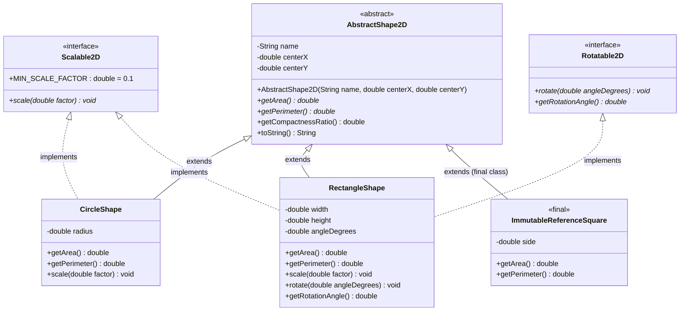
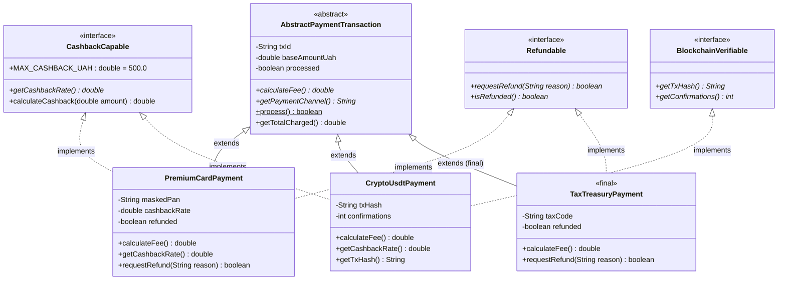
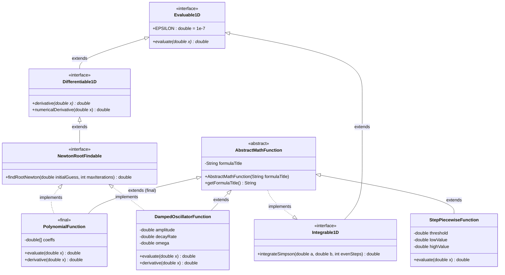
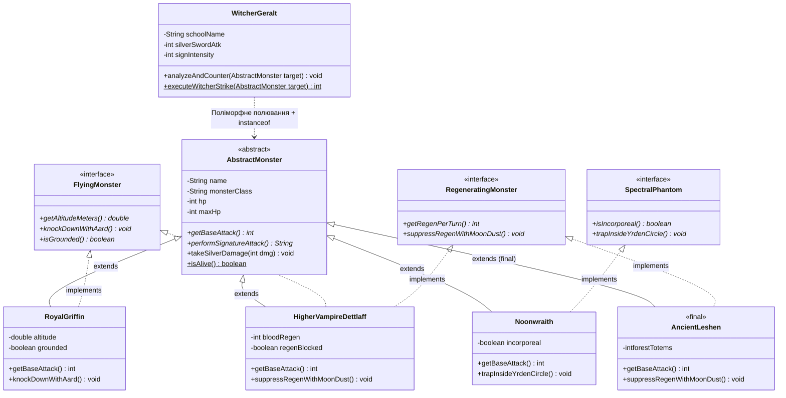

# Домашнє завдання до Практичної роботи №10
## Тема: Поліморфізм та інтерфейси (`Polymorphism`, `interface`, `instanceof`, `abstract` vs `interface`, `final`)

---

## 📌 Загальна інформація та правила виконання

### 🎯 Мета завдання
Закріпити на практичних інженерних, фінансових, математичних та ігрових задачах ключові механізми поліморфного ООП-проєктування в Java:
- **Динамічний поліморфізм (*Runtime Polymorphism*) та Upcasting:** обробка різнорідних об'єктів через єдині базові посилання в поліморфних масивах без прив'язки до конкретних класів.
- **Інтерфейси (`interface`, `implements`):** проєктування чистих контрактів поведінки (`CAN-DO`), використання констант інтерфейсів (`public static final`), `default` та `static` методів, а також множинна реалізація декількох інтерфейсів одним класом.
- **Архітектурний баланс `abstract class` (`IS-A`) проти `interface` (`CAN-DO`):** поєднання успадкування стану й конструкторів від абстрактного класу (`extends`) із підключенням гнучких ролей через інтерфейси (`implements`).
- **Оператор `instanceof` та Pattern Matching (Java 16+ / 21):** безпечна ідентифікація конкретних підкласів та інтерфейсів у поліморфних колекціях/масивах (`if (unit instanceof Rechargeable r)`) без ризику `ClassCastException`.
- **Модифікатор `final` у трьох вимірах:** захист незмінних полів (`private final`), бронювання скелета алгоритму від перевизначення у шаблонних методах (`public final ...`) та створення фінальних класів (`public final class`), що реалізують інтерфейси.

---

### ⏰ Дедлайн та обов'язкова здача через GitHub-репозиторій

> [!IMPORTANT]
> - **Спосіб здачі:** Робота здається **виключно через ваш GitHub-репозиторій** (`git add`, `git commit`, `git push`).
> - **Кінцевий термін (Дедлайн):** **до наступного четверга (12 листопада 2026 року, до 23:59)**.
> - Переконайтеся, що всі файли ваших завдань закомічені, запушені на GitHub та компілюються без жодної помилки (`mvn clean test-compile`).

#### Покроковий алгоритм відправки ДЗ на GitHub:
1. Реалізуйте обрані завдання у пакеті `semester1.practice10.homework` (або `semester1.practice10`).
2. Запустіть метод `main` кожного виконаного завдання і перевірте коректність виведення у консоль.
3. Відкрийте термінал в IntelliJ IDEA (`Alt + F12` / `Option + F12`) та виконайте команди:
   ```bash
   git status
   git add src/main/java/semester1/practice10/
   git commit -m "feat(hw10): implement polymorphism, interfaces, instanceof and final homework"
   git push origin main
   ```
4. Перевірте у браузері на GitHub, що ваші файли з'явилися у репозиторії, і надішліть посилання викладачу до настання дедлайну (четверга).

---

### ⚖️ Правила оцінювання та вибору завдань

1. **Максимальна оцінка за домашню роботу — 5 балів.**
2. **Обов'язковий мінімум:** виконати **хоча б 1 завдання** на власний вибір та завантажити його у свій GitHub-репозиторій до четверга.
3. **Гнучке сумування балів:**
   - Кожне завдання має свою фіксовану «вартість» у балах (від 2 до 5).
   - Якщо ви розв'язуєте декілька завдань, **бали сумуються** (максимальна підсумкова оцінка в журнал — **5 балів**; додаткові бали слугують «подушкою безпеки» на випадок дрібних недоліків).
4. **Варіанти стратегій виконання:**
   - 🥉 **Базовий рівень (оцінка 2–3):** тільки **Завдання 1** (2 бали) або тільки **Завдання 2** (3 бали).
   - 🥈 **Рівень «Добре» (оцінка 4):** тільки **Завдання 3** (4 бали).
   - 🥇 **Рівень «Відмінно» (оцінка 5):**
     - *Шлях 1 (Експертний):* розв'язати **Завдання 4** (5 балів, Спектральний конвеєр матричних перетворень) **АБО** творче **Завдання 5** (5 балів, Відьмак 3: Бестіарій та Поліморфне Полювання).
     - *Шлях 2 (Комбінація базових):* **Завдання 1 + Завдання 2** ($2 + 3 = 5$ балів).
     - *Шлях 3 (Комбінація з запасом):* **Завдання 1 + Завдання 3** ($2 + 4 = 6 \to 5$ балів) або **Завдання 2 + Завдання 3** ($3 + 4 = 7 \to 5$ балів).

---

### 📂 Організація класів та пакетів

- **Пакет:** розміщуйте класи у пакеті `semester1.practice10.homework` (або `semester1.practice10`).
- **Окремий клас запуску для кожного завдання:** створіть `.java` файл із назвою з таблиці нижче та власним методом `public static void main(String[] args)`. Допоміжні класи, абстрактні класи та інтерфейси можна розміщувати у тому самому файлі поруч із класом запуску (без модифікатора `public`) або в окремих `.java` файлах пакету.

**Закріплені назви класів для завдань:**
| Завдання | Вартість | Назва класу | Напрямок | Короткий зміст |
|:---:|:---:|:---|:---|:---|
| **Завдання 1** | **2 бали** | `Task1PolymorphicShapesAndTransforms` | 📐 Математично-геометричний 1 | `AbstractShape2D`, інтерфейси `Scalable2D` та `Rotatable2D`, `final class`, поліморфізм і `instanceof` |
| **Завдання 2** | **3 бали** | `Task2SmartPaymentAndAuditGateway` | 💼 Фінансово-інженерний кейс | `AbstractPayment` з `final` шаблонним методом, інтерфейси `Refundable`, `CashbackCapable`, аудит через `instanceof` |
| **Завдання 3** | **4 бали** | `Task3NumericalCalculusAndRootPolymorphism` | 📐 Математичний аналіз 2 | `AbstractAnalyticFunction`, інтерфейси `Differentiable`, `Integrable` (`default`), `RootFindable` (метод Ньютона) |
| **Завдання 4** | **5 балів** | `Task4PolymorphicMatrixSpectralEngine` | 📐 Лінійна алгебра та Матриці | `final class ImmutableMatrix2D`, `AbstractMatrixOperator`, інтерфейси `InvertibleOperator`, `OrthogonalOperator` |
| **Завдання 5** | **5 балів** | `Task5WitcherBestiaryAndMutagenSim` | 🎮 **Творче (The Witcher 3)** | Відьмачий Бестіарій: `AbstractMonster`, інтерфейси здатностей монстрів, `final` розрахунок удару та тактика через `instanceof` |

---

## 🧠 5 домашніх завдань на вибір (4 технічні/математичні + 1 творче)

---

### Рівень 1: Базовий (2 бали) — Математично-геометричний напрям
#### 📝 Завдання 1: Поліморфна геометрія: Абстрактні фігури, Інтерфейси трансформацій (`Scalable2D`, `Rotatable2D`), `instanceof` та `final`

- **Клас для виконання:** `Task1PolymorphicShapesAndTransforms` (файл `Task1PolymorphicShapesAndTransforms.java`)
- **Рекомендований пакет:** `semester1.practice10.homework` (або `semester1.practice10`)
- **Бали за завдання:** **2 бали**
- **Ключові теми:** розмежування `abstract class` (`IS-A`) та `interface` (`CAN-DO`), множинна реалізація інтерфейсів, `final` метод і `final` клас, поліморфний масив фігур та вибіркова трансформація за допомогою Pattern Matching `instanceof`.

**Контекст:** У векторному графічному редакторі всі геометричні об'єкти походять від спільного абстрактного класу **`AbstractShape2D`** (мають назву, координати центра $(x, y)$, площу та периметр). Проте їхні **здатності до трансформації (`CAN-DO`)** відрізняються:
- **Прямокутник (`RectangleShape`)** та **Трикутник (`RightTriangleShape`)** можна і масштабувати (`Scalable2D`), і повертати на кут (`Rotatable2D`).
- А от **Коло (`CircleShape`)** при обертанні навколо власного центра не змінюється, тому воно реалізує лише `Scalable2D` (і не потребує `Rotatable2D`)!
- Крім того, в системі є еталонний штамп **`ImmutableReferenceSquare`** — це **`final` клас**, який не можна ні масштабувати, ні повертати, ні успадковувати, але він є повноправним спадкоємцем `AbstractShape2D`!



**Що необхідно зробити:**
1. **Створіть два інтерфейси геометричних можливостей (`CAN-DO`):**
   - Інтерфейс **`Scalable2D`**:
     - Константа: `double MIN_SCALE_FACTOR = 0.1;` (неявно `public static final`).
     - Метод: `void scale(double factor);` (якщо `factor < MIN_SCALE_FACTOR`, притискати до `MIN_SCALE_FACTOR`).
   - Інтерфейс **`Rotatable2D`**:
     - Методи: `void rotate(double deltaDegrees);` (додає кут і нормалізує за модулем $360^\circ$) та `double getRotationAngle();`.
2. **Створіть абстрактний клас `AbstractShape2D` (`IS-A`):**
   - Приватні поля: `private final String name`, `private double centerX`, `private double centerY`.
   - Оголосіть абстрактні методи: `public abstract double getArea();` та `public abstract double getPerimeter();`.
   - Оголосіть **фінальний метод** (який заборонено перевизначати у нащадках!):
     `public final double getIsoperimetricQuotient()` — обчислює коефіцієнт компактності фігури за формулою:
     $$Q = \frac{4 \pi \cdot S}{P^2}$$
     *(Для ідеального кола $Q = 1.00$, для квадрата $Q = \frac{\pi}{4} \approx 0.7854$).*
   - Перевизначте `@Override public String toString()`.
3. **Створіть 3 конкретні класи-нащадки `AbstractShape2D`:**
   - **`CircleShape extends AbstractShape2D implements Scalable2D`**: поле `private double radius` ($> 0$). При `scale(factor)` множить радіус на `factor`.
   - **`RectangleShape extends AbstractShape2D implements Scalable2D, Rotatable2D`**: поля `private double width`, `private double height`, `private double rotationAngle`. Реалізує обидва інтерфейси!
   - **`public final class ImmutableReferenceSquare extends AbstractShape2D`**: оголошений як **`final`**, поле `private final double side`. Не реалізує ні `Scalable2D`, ні `Rotatable2D` (його розмір абсолютно незмінний).
4. **Реалізуйте в `Task1PolymorphicShapesAndTransforms` статичні методи обробки поліморфного масиву `AbstractShape2D[]`:**
   - `public static double calculateTotalArea(AbstractShape2D[] shapes)` — сумарна площа всіх фігур через чистий поліморфізм;
   - `public static void transformScene(AbstractShape2D[] shapes, double scaleFactor, double rotateDeg)` — обходить масив:
     - якщо фігура `instanceof Scalable2D s` $\to$ викликає `s.scale(scaleFactor)`;
     - якщо фігура `instanceof Rotatable2D r` $\to$ викликає `r.rotate(rotateDeg)`.
5. У `main` створіть масив із цих фігур, виведіть стан до і після `transformScene(shapes, 2.0, 45.0)`, покажіть, що площа масштабованих фігур зросла в $2^2 = 4$ рази, а `ImmutableReferenceSquare` залишився незмінним!

**Очікуваний результат у консолі:**
```text
================ ПОЛІМОРФНА ГЕОМЕТРІЯ ТА ІНТЕРФЕЙСИ ТРАНСФОРМАЦІЙ ================
[СТАН СЦЕНИ ДО ТРАНСФОРМАЦІЇ]:
  1. CircleShape['Коло-Лінза', center=(0.0; 0.0), r=5.00 | S=78.54, P=31.42, Q=1.0000]
  2. RectangleShape['Рамка-А', center=(2.0; 3.0), 4.00x6.00, angle=0.0° | S=24.00, P=20.00, Q=0.7540]
  3. ImmutableReferenceSquare['Еталон-Квадрат', center=(10.0; 10.0), side=5.00 | S=25.00, P=20.00, Q=0.7854]
Сумарна площа сцени: 127.54 кв.од.

-> Виконуємо пакетну трансформацію (scale x2.0, rotate +45.0°) через instanceof...
   [Scalable2D] 'Коло-Лінза' масштабовано в 2.0 разів (новий r=10.00)
   [Scalable2D] 'Рамка-А' масштабовано в 2.0 разів (8.00x12.00)
   [Rotatable2D] 'Рамка-А' повернуто на +45.0° (поточний кут: 45.0°)
   [Info] 'Еталон-Квадрат' (final class) пропущено — не підтримує трансформації.

[СТАН СЦЕНИ ПІСЛЯ ТРАНСФОРМАЦІЇ]:
  1. CircleShape['Коло-Лінза', center=(0.0; 0.0), r=10.00 | S=314.16, P=62.83, Q=1.0000]
  2. RectangleShape['Рамка-А', center=(2.0; 3.0), 8.00x12.00, angle=45.0° | S=96.00, P=40.00, Q=0.7540]
  3. ImmutableReferenceSquare['Еталон-Квадрат', center=(10.0; 10.0), side=5.00 | S=25.00, P=20.00, Q=0.7854]
Нова сумарна площа сцени: 435.16 кв.од.
==================================================================================
```

---

### Рівень 2: Середній (3 бали) — Фінансово-інженерний напрям (FinTech)
#### 📝 Завдання 2: Процесинговий центр FinTech: Шаблонний `final`-метод транзакцій, Інтерфейси (`Refundable`, `CashbackCapable`) та Аудит

- **Клас для виконання:** `Task2SmartPaymentAndAuditGateway` (файл `Task2SmartPaymentAndAuditGateway.java`)
- **Рекомендований пакет:** `semester1.practice10.homework` (або `semester1.practice10`)
- **Бали за завдання:** **3 бали**
- **Ключові теми:** `abstract class` з захищеним **`final` шаблонним методом** (`executeTransaction()`), інтерфейси ролей з константами та `default`-методами (`CashbackCapable`, `Refundable`, `BlockchainVerifiable`), множинна реалізація інтерфейсів та фінансовий аудит масиву платежів за допомогою Pattern Matching `instanceof`.

**Контекст:** Розробляємо ядро банківського процесингу. Усі платежі спадкуються від **`AbstractPaymentTransaction`** (`IS-A`), де залізобетонний **`public final boolean process()`** гарантує незмінний порядок фінансової безпеки: перевірка суми $\to$ обчислення комісії (`calculateFee()`) $\to$ перевірка ліміту $\to$ фіксація статусу.
При цьому різні види платежів мають різні фінансові можливості (`CAN-DO`):
- Оплата **Преміальною карткою (`PremiumCardPayment`)** підтримує і повернення коштів клієнту (`Refundable`), і нарахування кешбеку (`CashbackCapable`).
- **Криптовалютний переказ (`CryptoUsdtPayment`)** у блокчейні неможливо скасувати (він НЕ є `Refundable`!), зате він реалізує `BlockchainVerifiable` та має мінімальний мережевий кешбек у токенах (`CashbackCapable`).
- **Державне мито / Податковий платіж (`TaxTreasuryPayment`)** є **`final` класом** — не дає кешбеку, але допускає офіційне бюджетне повернення (`Refundable`).



**Що необхідно зробити:**
1. **Створіть три інтерфейси фінансових можливостей (`CAN-DO`):**
   - **`CashbackCapable`**:
     - Константа ліміту: `double MAX_CASHBACK_UAH = 500.0;`.
     - Абстрактний метод: `double getCashbackRate();` (частка, наприклад `0.03` для $3\%$).
     - **`default` метод**: `default double calculateCashback(double baseAmount)` — повертає `Math.min(MAX_CASHBACK_UAH, baseAmount * getCashbackRate())`!
   - **`Refundable`**:
     - Методи: `boolean requestRefund(String reason);` та `boolean isRefunded();`.
   - **`BlockchainVerifiable`**:
     - Методи: `String getTxHash();`, `int getConfirmations();` та `default boolean isFinalized()` (`getConfirmations() >= 12`).
2. **Створіть абстрактний клас `AbstractPaymentTransaction`:**
   - Приватні поля: `private final String txId`, `private final double baseAmountUah`, `private boolean processed`.
   - Абстрактні методи: `public abstract double calculateFee();` та `public abstract String getPaymentChannel();`.
   - **Фінальний шаблонний метод** `public final boolean process()`:
     - Якщо `baseAmountUah <= 0` або `processed == true`, повертає `false`;
     - Інакше встановлює `processed = true` і повертає `true`.
   - Фінальний метод `public final double getTotalCharged()`: повертає `baseAmountUah + calculateFee()`.
3. **Створіть 3 конкретні класи транзакцій:**
   - **`PremiumCardPayment extends AbstractPaymentTransaction implements CashbackCapable, Refundable`**:
     - Комісія: $1.0\%$ від суми; кешбек: $3\%$ (але обмежений константою `MAX_CASHBACK_UAH = 500.0` через `default`-метод!).
     - Метод `requestRefund` працює тільки якщо `isProcessed() && !refunded`.
   - **`CryptoUsdtPayment extends AbstractPaymentTransaction implements CashbackCapable, BlockchainVerifiable`**:
     - Фіксована комісія мережі: `40.0` грн; бонусний крипто-кешбек `0.01` ($1\%$).
   - **`public final class TaxTreasuryPayment extends AbstractPaymentTransaction implements Refundable`**:
     - Державний платіж: комісія $0.0$ грн (безкоштовно), без кешбеку, клас оголошений як **`final`**.
4. **У `Task2SmartPaymentAndAuditGateway` напишіть метод фінансового аудиту** для масиву `AbstractPaymentTransaction[] ledger`:
   - Проводить усі платежі через поліморфний виклик `tx.process()`;
   - Підраховує загальний оборот і суму комісій банку;
   - За допомогою **Pattern Matching `instanceof`** автоматично нараховує кешбек усім транзакціям, що реалізують `CashbackCapable`, перевіряє блокчейн-статус для `BlockchainVerifiable` та виконує тестове повернення коштів для `Refundable`.

**Очікуваний результат у консолі:**
```text
================ ПРОЦЕСИНГОВИЙ ЦЕНТР FINTECH (POLYMORPHISM & INTERFACES) ================
[1. ПРОВЕДЕННЯ ПАКЕТУ ТРАНЗАКЦІЙ (final process())]:
  ✅ [TX-101 | Visa Infinite] Сума: 20000.00 грн | Комісія: 200.00 грн | Всього: 20200.00 грн
  ✅ [TX-102 | USDT TRC-20]   Сума:  8500.00 грн | Комісія:  40.00 грн | Всього:  8540.00 грн
  ✅ [TX-103 | ДержКазначейство] Сума: 5000.00 грн | Комісія: 0.00 грн | Всього:  5000.00 грн

[2. АВТОМАТИЧНИЙ АУДИТ МОЖЛИВОСТЕЙ (Pattern Matching instanceof)]:
  💰 [CashbackCapable] TX-101: розрахунковий 3% = 600 грн -> нараховано 500.00 грн (Ліміт MAX_CASHBACK_UAH!)
  💰 [CashbackCapable] TX-102: нараховано 1% крипто-бонусу = 85.00 грн
  ⛓️ [BlockchainVerifiable] TX-102: Hash=0x9f8a...c4, Підтверджень=18 (Finalized: true)
  🔄 [Refundable] Спроба повернення TX-101 ('Подвійне списання'): УСПІШНО ПОВЕРНЕНО!

[ПІДСУМКОВИЙ ЗВІТ ШЛЮЗУ]:
  Сумарний базовий оборот:  33500.00 грн
  Сумарна комісія шлюзу:      240.00 грн
  Сумарний виплачений кешбек: 585.00 грн
=========================================================================================
```

---

### Рівень 3: Поглиблений (4 бали) — Вища математика та Чисельні методи
#### 📝 Завдання 3: Чисельний аналіз функцій: Інтерфейси Диференціювання, Інтегрування Сімпсона (`default`) та Пошук коренів методом Ньютона

- **Клас для виконання:** `Task3NumericalCalculusAndRootPolymorphism` (файл `Task3NumericalCalculusAndRootPolymorphism.java`)
- **Рекомендований пакет:** `semester1.practice10.homework` (або `semester1.practice10`)
- **Бали за завдання:** **4 бали**
- **Ключові теми:** багаторівнева архітектура математичних інтерфейсів (`Evaluable1D`, `Differentiable1D`, `Integrable1D`, `NewtonRootFindable`), нетривіальні **`default`-методи** в інтерфейсах (чисельна формула парабол Сімпсона та ітераційний метод дотичних Ньютона), захисне копіювання у **`final class PolynomialFunction`**, поліморфне дослідження сімейства функцій.

**Контекст:** У математичних пакетах (MATLAB, SciPy, Wolfram) функції поділяються за їхніми аналітичними властивостями:
1. Будь-яку неперервну функцію можна **проінтегрувати чисельно на відрізку $[a; b]$** за надточною **формулою парабол Сімпсона** (для парного числа розбиттів $N$, де крок $h = \frac{b-a}{N}$):
   $$\int_a^b f(x)\,dx \approx \frac{h}{3} \left( f(a) + f(b) + 4 \sum_{i=1,3,5\dots}^{N-1} f(a + i h) + 2 \sum_{i=2,4,6\dots}^{N-2} f(a + i h) \right)$$
2. Якщо функція є **диференційовною** (має похідну $f'(x) \neq 0$), то ми можемо автоматично знаходити корінь рівняння $f(x) = 0$ за допомогою швидкого ітераційного **методу Ньютона (методу дотичних)**:
   $$x_{k+1} = x_k - \frac{f(x_k)}{f'(x_k)}$$
3. І найголовніше: оскільки формула Сімпсона потребує лише викликів `evaluate(x)`, а метод Ньютона — лише `evaluate(x)` та `derivative(x)`, обидва ці потужні чисельні алгоритми можна реалізувати прямо як **`default`-методи всередині інтерфейсів**!



**Що необхідно зробити:**
1. **Створіть ієрархію математичних інтерфейсів:**
   - **`Evaluable1D`**:
     - Константа точності: `double EPSILON = 1e-7;`.
     - Абстрактний метод: `double evaluate(double x);`.
   - **`Integrable1D extends Evaluable1D`**:
     - Реалізуйте **`default` метод** `default double integrateSimpson(double a, double b, int n)`:
       якщо $n < 2$, взяти $100$; якщо $n$ непарне (`n % 2 != 0`), збільшити `n++`. Обчислити визначений інтеграл за формулою Сімпсона!
   - **`Differentiable1D extends Evaluable1D`**:
     - Абстрактний метод аналітичної похідної: `double derivative(double x);`.
     - **`default` метод** чисельної перевірки: `default double numericalDerivative(double x)` за центральною різницею $\frac{evaluate(x+h)-evaluate(x-h)}{2h}$ ($h = 10^{-5}$).
   - **`NewtonRootFindable extends Differentiable1D`**:
     - **`default` метод** `default double findRootNewton(double x0, int maxIter)`:
       виконує ітерації $x_{k+1} = x_k - \frac{evaluate(x_k)}{derivative(x_k)}$, поки $|evaluate(x_k)| > \text{EPSILON}$ (якщо $|derivative(x_k)| < 10^{-12}$, зупинити поділ на нуль).
2. **Створіть абстрактний клас `AbstractMathFunction implements Integrable1D`:**
   - Приватне поле `private final String formulaTitle`, конструктор та метод `public final String getFormulaTitle()`.
3. **Створіть 3 конкретні класи функцій з різним набором інтерфейсів:**
   - **`public final class PolynomialFunction extends AbstractMathFunction implements NewtonRootFindable`**:
     - Оголошений як **`final`**. Зберігає масив коефіцієнтів `private final double[] coeffs` ($c_0 + c_1 x + c_2 x^2 + \dots$) із **захисним копіюванням**!
     - Має точні формули для `evaluate(x)` та `derivative(x)`, тому підтримує і інтеграл Сімпсона, і пошук коренів методом Ньютона!
   - **`DampedHarmonyFunction extends AbstractMathFunction implements NewtonRootFindable`**:
     - Затухаюче коливання $f(x) = A \cdot e^{-\gamma x} \cdot \cos(\omega x)$.
     - Похідна за правилом добутку: $f'(x) = -A e^{-\gamma x} \left( \gamma \cos(\omega x) + \omega \sin(\omega x) \right)$.
   - **`StepHeavisideFunction extends AbstractMathFunction`**:
     - Кусково-стала сходинка (наприклад, $f(x) = 2.0$ при $x < 1.5$ та $f(x) = 5.0$ при $x \ge 1.5$). Вона інтегрована (`Integrable1D`), але має розрив і **НЕ реалізує** `Differentiable1D` чи `NewtonRootFindable`!
4. У `Task3NumericalCalculusAndRootPolymorphism.main` помістіть усі три функції у поліморфний масив `AbstractMathFunction[]`:
   - Для кожної функції обчисліть інтеграл Сімпсона на $[0.0; 3.0]$;
   - За допомогою **Pattern Matching `if (fn instanceof NewtonRootFindable rf)`** знайдіть похідну та корінь рівняння $f(x) = 0$ (наприклад, для кубічного многочлена $x^3 - 2x - 5 = 0$ корінь $x \approx 2.094551$, а інтеграл $\int_0^3 (x^3 - 2x - 5)\,dx = [\frac{x^4}{4} - x^2 - 5x]_0^3 = 20.25 - 9 - 15 = -3.7500$!).

**Очікуваний результат у консолі:**
```text
================ ЧИСЕЛЬНИЙ АНАЛІЗ: ІНТЕРФЕЙСИ ТА ПОЛІМОРФІЗМ ================
Дослідження поліморфного масиву AbstractMathFunction[3] на відрізку [0.00; 3.00]:

1. Функція: P(x) = -5.00 - 2.00*x + 0.00*x^2 + 1.00*x^3 [final PolynomialFunction]
   -> Інтеграл Сімпсона на [0.0; 3.0] (N=100): -3.750000 (Точне значення: -3.750000)
   -> [Differentiable1D] Похідна P'(2.0): аналітична = 10.000000 | чисельна = 10.000000
   -> [NewtonRootFindable] Корінь P(x) = 0 (старт x0=2.0): x* = 2.0945515 (Перевірка P(x*) = 0.00e+00)

2. Функція: D(x) = 4.00 * exp(-0.50*x) * cos(2.00*x) [DampedHarmonyFunction]
   -> Інтеграл Сімпсона на [0.0; 3.0] (N=100): 0.255483
   -> [Differentiable1D] Похідна D'(1.0): аналітична = -4.088671 | чисельна = -4.088671
   -> [NewtonRootFindable] Корінь D(x) = 0 (старт x0=0.7): x* = 0.7853982 (pi/4 = 0.7853982)

3. Функція: Step(x) = {2.0 при x < 1.5; 5.0 при x >= 1.5} [StepHeavisideFunction]
   -> Інтеграл Сімпсона на [0.0; 3.0] (N=1000): 10.500000
   -> [Info] Функція розривна (не реалізує Differentiable1D / NewtonRootFindable) — пошук дотичних пропущено.
==============================================================================
```

---

### Рівень 4: Високий / Експертний (5 балів) — Лінійна алгебра та Спектральні оператори
#### 📝 Завдання 4: Спектральний конвеєр матриць: `final class ImmutableMatrix2D`, Поліморфні оператори та Інтерфейси оборотності (`InvertibleOperator`, `OrthogonalOperator`)

- **Клас для виконання:** `Task4PolymorphicMatrixSpectralEngine` (файл `Task4PolymorphicMatrixSpectralEngine.java`)
- **Рекомендований пакет:** `semester1.practice10.homework` (або `semester1.practice10`)
- **Бали за завдання:** **5 балів**
- **Ключові теми:** глибоке захисне копіювання 2D-масиву у **`public final class ImmutableMatrix2D`**, абстрактний клас `AbstractMatrixOperator` із **`final` шаблонним методом**, спеціалізовані інтерфейси алгебраїчних властивостей (`InvertibleOperator`, `OrthogonalOperator`, `NormPreserving`), перевірка оборотного відновлення матриці $X_{\text{віднов}} = T_1^{-1}(T_2^{-1}(\dots))$ через Pattern Matching `instanceof`!

**Контекст:** У криптографії, обробці зображень та квантових обчисленнях дані представлені матрицями $A$, які проходять крізь ланцюжок операторів перетворення $T_1, T_2, \dots, T_k$.
Деякі матричні оператори є **оборотними (`InvertibleOperator`)** — знаючи вихідну матрицю $Y = T(X)$, ми можемо застосувати обернений оператор $T^{-1}(Y)$ і **без жодної втрати інформації повернути початкову матрицю $X$**!
А деякі з них є ще й **ортогональними (`OrthogonalOperator`)** — вони не змінюють норму Фробеніуса $\|X\|_F = \sqrt{\sum a_{ij}^2}$ та абсолютне значення визначника $|\det(X)|$.

```mermaid
classDiagram
    class ImmutableMatrix2D {
        <<final>>
        -int rows
        -int cols
        -double[][] data
        +ImmutableMatrix2D(double[][] source)
        +getTrace() double
        +getDeterminant() double
        +getFrobeniusNorm() double
        +maxAbsDiff(ImmutableMatrix2D other) double
    }
    class InvertibleOperator {
        <<interface>>
        +applyInverse(ImmutableMatrix2D matrix)* ImmutableMatrix2D
    }
    class OrthogonalOperator {
        <<interface>>
        +verifyNormInvariance(ImmutableMatrix2D before, ImmutableMatrix2D after) boolean
    }
    class AbstractMatrixOperator {
        <<abstract>>
        -String name
        +canApply(ImmutableMatrix2D input)* boolean
        +transform(ImmutableMatrix2D input)* ImmutableMatrix2D
        +execute(ImmutableMatrix2D input)$ ImmutableMatrix2D
    }
    class NonZeroScaleOperator {
        -double factor
        +transform(ImmutableMatrix2D input) ImmutableMatrix2D
        +applyInverse(ImmutableMatrix2D input) ImmutableMatrix2D
    }
    class TransposeOperator {
        +transform(ImmutableMatrix2D input) ImmutableMatrix2D
        +applyInverse(ImmutableMatrix2D input) ImmutableMatrix2D
    }
    class GivensRotation2x2Operator {
        -double angleRadians
        +transform(ImmutableMatrix2D input) ImmutableMatrix2D
        +applyInverse(ImmutableMatrix2D input) ImmutableMatrix2D
    }
    class UpperTriangularProjectionOperator {
        +transform(ImmutableMatrix2D input) ImmutableMatrix2D
    }

    AbstractMatrixOperator <|-- NonZeroScaleOperator : extends
    AbstractMatrixOperator <|-- TransposeOperator : extends
    AbstractMatrixOperator <|-- GivensRotation2x2Operator : extends
    AbstractMatrixOperator <|-- UpperTriangularProjectionOperator : extends
    InvertibleOperator <|.. NonZeroScaleOperator : implements
    InvertibleOperator <|.. TransposeOperator : implements
    OrthogonalOperator <|.. TransposeOperator : implements
    InvertibleOperator <|.. GivensRotation2x2Operator : implements
    OrthogonalOperator <|.. GivensRotation2x2Operator : implements
```



**Що необхідно зробити:**
1. **Створіть фінальний незмінний клас матриці `public final class ImmutableMatrix2D`:**
   - Приватні `final` поля: `rows`, `cols`, `private final double[][] data`.
   - Глибоке захисне копіювання `double[][]` у конструкторі та в методі `getDataCopy()`.
   - Математичні методи:
     - `public double get(int r, int c)`;
     - `public double getTrace()` — слід матриці $\sum a_{ii}$;
     - `public double getFrobeniusNorm()` — норма Фробеніуса $\|A\|_F = \sqrt{\sum_{i,j} a_{ij}^2}$;
     - `public double getDeterminant()` — визначник для матриць $2\times 2$ ($a_{00}a_{11} - a_{01}a_{10}$) та $3\times 3$ (правило Саррюса);
     - `public double maxAbsDifference(ImmutableMatrix2D other)` — максимальна похибка $\max_{i,j} |A_{ij} - B_{ij}|$ (для перевірки точності відновлення матриці!).
2. **Створіть два інтерфейси властивостей операторів (`CAN-DO`):**
   - **`InvertibleOperator`**:
     - Метод `ImmutableMatrix2D applyInverse(ImmutableMatrix2D transformed);` — виконує обернене перетворення $T^{-1}(Y)$.
   - **`OrthogonalOperator extends InvertibleOperator`**:
     - **`default` метод** `default boolean verifyNormInvariance(ImmutableMatrix2D before, ImmutableMatrix2D after)` — перевіряє, що норма Фробеніуса до і після перетворення збереглася з точністю $10^{-6}$ (`Math.abs(before.getFrobeniusNorm() - after.getFrobeniusNorm()) < 1e-6`).
3. **Створіть абстрактний клас `AbstractMatrixOperator`:**
   - Приватне поле `private final String operatorName`.
   - Абстрактні методи: `public abstract boolean canApply(ImmutableMatrix2D m);` та `protected abstract ImmutableMatrix2D transform(ImmutableMatrix2D m);`.
   - **Фінальний шаблонний метод** `public final ImmutableMatrix2D execute(ImmutableMatrix2D m)`: перевіряє `m != null && canApply(m)`, викликає `transform(m)`, а якщо цей оператор `instanceof OrthogonalOperator ort`, автоматично перевіряє збереження норми через `ort.verifyNormInvariance(m, result)`!
4. **Створіть 4 конкретні класи операторів:**
   - **`NonZeroScaleOperator extends AbstractMatrixOperator implements InvertibleOperator`**: множить матрицю на скаляр $k \neq 0$ (`transform`), а в `applyInverse` ділить кожен елемент на $k$ (multiply by $1/k$).
   - **`TransposeOperator extends AbstractMatrixOperator implements OrthogonalOperator`**: транспонує матрицю $A^T$ (`transform`), а оберненим до транспонування є повторне транспонування $(A^T)^T = A$! Зберігає норму Фробеніуса!
   - **`GivensRotationOperator extends AbstractMatrixOperator implements OrthogonalOperator`**: множить матрицю зліва на ортогональну матрицю повороту $R(\theta) = \begin{pmatrix} \cos\theta & -\sin\theta \\ \sin\theta & \cos\theta \end{pmatrix}$ (для рядків 0 та 1). Обернене перетворення `applyInverse` — це поворот на кут $-\theta$, тобто множення на $R(-\theta) = R(\theta)^T$! Зберігає і норму Фробеніуса, і визначник!
   - **`UpperTriangularProjection extends AbstractMatrixOperator`**: обнуляє всі елементи нижче головної діагоналі ($a_{ij} = 0$ при $i > j$). Оскільки інформація втрачається безповоротно, цей оператор **НЕ реалізує** `InvertibleOperator`!
5. **У `Task4PolymorphicMatrixSpectralEngine.main`:**
   - Створіть початкову матрицю $X_0 = \begin{pmatrix} 3.0 & 4.0 \\ 0.0 & 5.0 \end{pmatrix}$ ($\|X_0\|_F = \sqrt{9+16+25} = \sqrt{50} \approx 7.0711, \; \det(X_0) = 15.0$).
   - Пропустіть її вперед крізь масив оборотних операторів (`Scale(2.0)` $\to$ `Transpose` $\to$ `GivensRotation(60°)`), а потім пройдіться по масиву **у зворотному порядку** і через `if (op instanceof InvertibleOperator inv)` викличте `inv.applyInverse(...)`.
   - Доведіть, що відновлена матриця $X_{\text{віднов}}$ збігається з початковою $X_0$ з точністю $10^{-14}$ (`maxAbsDifference == 0.00e+00`)!

**Очікуваний результат у консолі:**
```text
================ СПЕКТРАЛЬНИЙ КОНВЕЄР МАТРИЧНИХ ОПЕРАТОРІВ ================
[ПОЧАТКОВА МАТРИЦЯ X0 (2x2 | Норма: 7.0711 | Слід: 8.00 | det: 15.00)]:
  [   3.0000    4.0000 ]
  [   0.0000    5.0000 ]

--- ПРЯМИЙ ХІД КОНВЕЄРА (Forward Pass через final execute()) ---
1. Оператор 'Scale(x2.0)' -> Норма: 14.1421 | det: 60.00
2. Оператор 'Transpose(A^T)' [Orthogonal: Норма 14.1421 збережена ✅] -> det: 60.00
3. Оператор 'GivensRotation(60.0°)' [Orthogonal: Норма 14.1421 збережена ✅] -> det: 60.00
[ЗАШИФРОВАНА МАТРИЦЯ Y ПІСЛЯ 3 ЕТАПІВ]:
  [  -3.9282   -8.6603 ]
  [   9.1962    5.0000 ]

--- ЗВОРОТНИЙ ХІД ВІДНОВЛЕННЯ (Inverse Pass через instanceof InvertibleOperator) ---
<- Декодування 'GivensRotation(-60.0°)' виконано...
<- Декодування 'Transpose((A^T)^T)' виконано...
<- Декодування 'Scale(x0.5)' виконано...

[ВІДНОВЛЕНА МАТРИЦЯ X_restored]:
  [   3.0000    4.0000 ]
  [   0.0000    5.0000 ]
Максимальна похибка відновлення |X0 - X_restored|: 8.88e-16 (БЕЗВТРАТНА ОБОРОТНІСТЬ ДОТРИМАНА!)
===========================================================================
```

---

### Рівень 5: Творчий (5 балів) — На ваш вибір!
#### 🎮 Завдання 5: «Відьмак 3: Дикий Гін — Бестіарій Монстрів, Інтерфейси Здатностей та Поліморфне Полювання»

- **Клас для виконання:** `Task5WitcherBestiaryAndMutagenSim` (файл `Task5WitcherBestiaryAndMutagenSim.java`)
- **Рекомендований пакет:** `semester1.practice10.homework` (або `semester1.practice10`)
- **Бали за завдання:** **5 балів**
- **Ключові теми:** синергія `abstract class AbstractMonster` (`IS-A`) та бойових інтерфейсів (`FlyingCreature`, `RegeneratingBeast`, `MagicCaster`, `CursedEntity`), захищений **`final` метод** розрахунку комбо-удару у Відьмака (`executeWitcherStrike`), динамічний аналіз бестіарію та автоматичний підбір меча, знаку й мастила через **Pattern Matching `instanceof`**!

> [!TIP]
> **Повна творча свобода сетингу:**
> За замовчуванням завдання оформлене за всесвітом **«Відьмак 3: Дикий Гін» (Ґеральт із Рівії проти чудовиськ Континенту)**.
> Ви можете вільно змінити всесвіт і назви класів під свою улюблену гру чи аніме, зберігши ООП-архітектуру **«Абстрактний Ворог + Множинні Інтерфейси Здатностей + Мисливець із тактичним аналізом через `instanceof` та `final`-методом бою»**:
> - ⚔️ **Dota 2 / League of Legends:** Абстрактний Герой `AbstractHero` + інтерфейси `InvisibleUnit` (Потрібен Dust of Appearance), `SpellImmuneUnit` (BKB), `IllusionSummoner`, `LifestealCapable`;
> - ☢️ **S.T.A.L.K.E.R. 2:** Мутанти Зони `AbstractMutant` (Кровосос, Контролер, Псевdogігант, Хімера) + інтерфейси `StealthCamouflage`, `PsiEmitter`, `ArmorPlated`, `JumpingPredator`;
> - 🍥 **Наруто / Бліч / Магічна Битва (Jujutsu Kaisen) / Demon Slayer:** Прокляття або Готей-13 із інтерфейсами `DomainExpansionUser`, `RegeneratingDemon`, `ElementalAffinity`;
> - 🚀 **Warhammer 40,000 / Mass Effect / Helldivers 2:** Тираніди чи Автоматони з інтерфейсами броні, кислотної крові та енергощитів.



**Що необхідно зробити:**
1. **Створіть 3 інтерфейси особливих властивостей монстрів (`CAN-DO`):**
   - **`FlyingMonster`** (Літаюча потворо):
     - Методи: `boolean isAirborne();` та `void knockDownToGround();` (відьмачий знак **Аард** або арбалет збиває монстра на землю, позбавляючи бонусу ухилення!).
   - **`RegeneratingMonster`** (Регенеруюча істота):
     - Методи: `int regenerateHealth();` та `void applyMoonDustBomb();` (бомба **«Місячний пил»** блокує регенерацію!).
   - **`SpectralPhantom`** (Примарна істота):
     - Методи: `boolean isIncorporeal();` (поки привид безтілесний, він поглинає $80\%$ шкоди!) та `void bindWithYrdenSign();` (магічна пастка знаку **Ірден** робить привида матеріальним і вразливим!).
2. **Створіть абстрактний клас `AbstractMonster` (`IS-A`):**
   - Поля: `private final String name`, `private final String bestiaryCategory`, `protected int hp`, `protected final int maxHp`.
   - Абстрактні методи: `public abstract int calculateMonsterAttack();` та `public abstract String getBattleCry();`.
   - Фінальні методи: `public final boolean isAlive()` (`hp > 0`) та метод отримання шкоди `public void receiveDamage(int dmg)`.
   - Перевизначте `@Override public String toString()` із красивою шкалою здоров'я.
3. **Створіть щонайменше 3–4 класи монстрів із різними комбінаціями інтерфейсів:**
   - **`RoyalGriffin extends AbstractMonster implements FlyingMonster`**: королівський грифон (поки в повітрі `isAirborne() == true`, отримує вдвічі менше шкоди від меча).
   - **`Noonwraith extends AbstractMonster implements SpectralPhantom`**: Полудниця (поки не спіймана в коло знаку **Ірден**, майже невразлива).
   - **`HigherVampire extends AbstractMonster implements FlyingMonster, RegeneratingMonster`**: Вищий Вампір Детлафф — **множинна реалізація**: вміє і злітати в туман, і регенерувати по $+120$ HP щоходу!
   - **`public final class AncientLeshen extends AbstractMonster implements RegeneratingMonster`**: Прадавній Лісовик — оголошений як **`final` клас** (вершина еволюції реліктів).
4. **Створіть клас мисливця `WitcherHunter` (Ґеральт із Рівії):**
   - Тактичний метод `public void applyBestiaryTactics(AbstractMonster target)` — використовує **Pattern Matching `instanceof`**:
     - якщо `target instanceof SpectralPhantom sp && sp.isIncorporeal()` $\to$ кастує знак **Ірден** (`sp.bindWithYrdenSign()`);
     - якщо `target instanceof FlyingMonster fm && fm.isAirborne()` $\to$ збиває знаком **Аард** на землю (`fm.knockDownToGround()`);
     - якщо `target instanceof RegeneratingMonster rm` $\to$ кидає бомбу **«Місячний пил»** (`rm.applyMoonDustBomb()`).
   - **Фінальний метод удару** `public final int executeSilverStrike(AbstractMonster target)`: спочатку застосовує тактику бестіарію, а потім завдає потужного удару срібним мечем!
5. У `Task5WitcherBestiaryAndMutagenSim.main` створіть поліморфний масив замовлень з дошки оголошень `AbstractMonster[] contracts` і проведіть симуляцію полювання Відьмака!

**Очікуваний результат у консолі:**
```text
================ 🐺 ВІДЬМАК 3: БЕСТІАРІЙ ТА ПОЛІМОРФНЕ ПОЛЮВАННЯ 🐺 ================
Мисливець: Ґеральт із Рівії (Школа Вовка | Срібний меч: 220 ATK | Інтенсивність Знаків: 150%)

--- КОНТРАКТ №1: Королівський Грифон [Гібриди | HP: 400/400 | В повітрі: true] ---
🦅 Грифон ширяє високо в небі! Удар мечем без підготовки завдав би лише 50% шкоди.
💨 [instanceof FlyingMonster] Ґеральт складає пальці у Знак ААРД! Грифона збито на землю!
⚔️ [final executeSilverStrike] Вихор срібного меча завдає 250 шкоди! (Залишок HP: 150/400)

--- КОНТРАКТ №2: Полудниця з Білого Саду [Примари | HP: 300/300 | Безтілесна: true] ---
👻 Примара нематеріальна (поглинає 80% ударів).
🟣 [instanceof SpectralPhantom] Ґеральт креслить на землі магічне коло Знаку ІРДЕН! Примару матеріалізовано!
⚔️ [final executeSilverStrike] Срібний клинок з мастилом проти примар завдає 260 шкоди! (Залишок HP: 40/300)

--- КОНТРАКТ №3: Вищий Вампір Детлафф [Вампіри | HP: 650/650 | Літає + Регенерує] ---
🦇 Множинний контракт (FlyingMonster + RegeneratingMonster)!
💨 [instanceof FlyingMonster] Телеїнетичний імпульс Аарду перериває піке вампіра!
💣 [instanceof RegeneratingMonster] Ґеральт підриває бомбу 'Місячний Пил'! Срібні ошурки блокують регенерацію!
⚔️ [final executeSilverStrike] Критичний випад школи Вовка завдає 330 шкоди! (Залишок HP: 320/650)
====================================================================================
```

---

## 📊 Інструкція для викладача: Методика оцінювання

### 1. Зведена таблиця балів та охоплення компетенцій

| Завдання | Клас для перевірки | Макс. бал | Напрям | Які компетенції теми №10 перевіряються |
|:---|:---|:---:|:---|:---|
| **Завдання 1** | `Task1PolymorphicShapesAndTransforms` | **2** | 📐 Геометрія | `abstract class` vs `interface`, константи інтерфейсу, `final` метод і `final` клас, `instanceof` |
| **Завдання 2** | `Task2SmartPaymentAndAuditGateway` | **3** | 💼 FinTech | `final` шаблонний метод, `default`-метод у `CashbackCapable`, множинний `implements`, `instanceof` аудит |
| **Завдання 3** | `Task3NumericalCalculusAndRootPolymorphism` | **4** | 📐 Мат. аналіз | Спадкування інтерфейсів (`extends`), `default`-методи Сімпсона та Ньютона, захисне копіювання у `final class` |
| **Завдання 4** | `Task4PolymorphicMatrixSpectralEngine` | **5** | 📐 Лінійна алгебра | `final class ImmutableMatrix2D`, `InvertibleOperator`, `OrthogonalOperator`, зворотне відновлення матриці |
| **Завдання 5** | `Task5WitcherBestiaryAndMutagenSim` | **5** | 🎮 **Творче (RPG)** | `AbstractMonster`, 3+ інтерфейси здатностей, множинна реалізація, динамічна тактика через `instanceof` |

---

### 2. Формула підсумкової оцінки та приклади розрахунку

$$\text{Підсумкова оцінка} = \min\left(5,\; \sum \text{Бали за виконані завдання} - \text{Штрафи}\right)$$

- **Приклад А:** Студент виконав **Завдання 4** (`Task4PolymorphicMatrixSpectralEngine`, 5 балів) без зауважень $\implies \mathbf{5.0\text{ балів}}$.
- **Приклад Б:** Студент виконав **Завдання 1** (2 бали) + **Завдання 2** (3 бали) $= \mathbf{5.0\text{ балів}}$.
- **Приклад В:** Студент виконав **Завдання 2** (3 бали) + **Завдання 3** (4 бали), але забув зробити захисне копіювання масиву в многочлені (штраф $-0.5$) $\implies \min(5, 3 + 4 - 0.5) = \mathbf{5.0\text{ балів}}$ («подушка безпеки» спрацювала!).

---

### 3. Експрес-алгоритм перевірки GitHub-репозиторію (1–2 хвилини)

1. **Крок 1. Перевірка GitHub та компіляції:**
   - Відкрийте репозиторій студента на GitHub, перевірте час останнього коміту (до четверга, 12.11.2026, 23:59) та виконайте `mvn clean test-compile`.
2. **Крок 2. Перевірка інтерфейсів та абстрактних класів:**
   - Переконайтеся, що інтерфейси оголошені через `interface`, а класи підключають їх через `implements` (і комбінують з `extends Abstract...`).
   - Перевірте наявність `default`-методів у інтерфейсах (Завдання 2, 3, 4).
3. **Крок 3. Перевірка `instanceof` та `final`:**
   - Знайдіть у коді використання оператора `instanceof` (бажано у сучасному форматі Pattern Matching `if (obj instanceof Role r)`) для виклику специфічних методів інтерфейсів.
   - Перевірте доречне використання модифікатора `final` (для полів, шаблонних методів та кінцевих класів).
4. **Крок 4. Запуск `main` та звірка чисел:**
   - Запустіть метод `main` і звірте результати в консолі з контрольними тестовими кейсами нижче.

---

### 4. Чек-поінти: На що звертати увагу в кожному завданні

#### 🔍 Завдання 1 (`Task1PolymorphicShapesAndTransforms`):
- [ ] Чи оголошено окремі інтерфейси `Scalable2D` та `Rotatable2D`.
- [ ] Чи реалізує `RectangleShape` **обидва** інтерфейси (`implements Scalable2D, Rotatable2D`), а `CircleShape` — тільки `Scalable2D`.
- [ ] Чи оголошено метод компактності `getIsoperimetricQuotient()` як `public final`, а клас еталонного квадрата — як `final class`.
- [ ] Чи використовується `instanceof` у методі `transformScene` без виникнення `ClassCastException`.

#### 🔍 Завдання 2 (`Task2SmartPaymentAndAuditGateway`):
- [ ] Чи є метод `process()` у `AbstractPaymentTransaction` **фінальним (`public final`)**.
- [ ] Чи містить інтерфейс `CashbackCapable` константу `MAX_CASHBACK_UAH = 500.0` та `default`-метод розрахунку кешбеку з обмеженням `Math.min(...)`.
- [ ] Чи реалізує `PremiumCardPayment` одночасно `CashbackCapable` та `Refundable`, а `CryptoUsdtPayment` — `CashbackCapable` та `BlockchainVerifiable`.
- [ ] Чи коректно аудитор обходить поліморфний масив і фільтрує транзакції за інтерфейсами через `instanceof`.

#### 🔍 Завдання 3 (`Task3NumericalCalculusAndRootPolymorphism`):
- [ ] Чи вибудовано спадкування між самими інтерфейсами (`Integrable1D extends Evaluable1D`, `NewtonRootFindable extends Differentiable1D`).
- [ ] Чи реалізовано формулу Сімпсона та метод Ньютона як **`default`-методи** прямо всередині відповідних інтерфейсів.
- [ ] Чи оголошено `PolynomialFunction` як `final class` із захисним копіюванням масиву коефіцієнтів `Arrays.copyOf`.
- [ ] Чи перевіряється `if (fn instanceof NewtonRootFindable rf)` перед пошуком кореня (щоб не викликати його на розривній сходинці `StepHeavisideFunction`).

#### 🔍 Завдання 4 (`Task4PolymorphicMatrixSpectralEngine`):
- [ ] Чи є клас `ImmutableMatrix2D` **фінальним (`final class`)** і чи виконує він глибоке копіювання кожного рядка двовимірного масиву `double[][]`.
- [ ] Чи реалізовано в `InvertibleOperator` точне обернене перетворення `applyInverse(...)` для масштабування ($1/k$), транспонування та повороту Ґівенса ($-\theta$).
- [ ] Чи перевіряє шаблонний метод `public final execute(...)` збереження норми Фробеніуса для `OrthogonalOperator`.
- [ ] Чи збігається матриця після прямого і зворотного проходу конвеєра з початковою матрицею $X_0$ з точністю $< 10^{-9}$.

#### 🔍 Завдання 5 (`Task5WitcherBestiaryAndMutagenSim`):
- [ ] Чи є базовий абстрактний клас `AbstractMonster` (`IS-A`) та щонайменше 3 інтерфейси бойових особливостей (`CAN-DO`).
- [ ] Чи є хоча б один клас-бос (наприклад, `HigherVampire`), який реалізує **декілька інтерфейсів одночасно**.
- [ ] Чи використовує мисливець оператор `instanceof` для автоматичного вибору контрзаходу (Аард проти літаючих, Ірден проти примар, Місячний пил проти регенерації).
- [ ] Чи оформлено бойовий метод мисливця або метод перевірки живучості як `final`.

---

### 5. Штрафна шкала (Penalty Guide)

| Порушення | Штраф | Причина застосування |
|:---|:---:|:---|
| **Код не компілюється або не завантажений на GitHub до дедлайну** | **0 за роботу** | Базова вимога здачі ДЗ |
| **Замість інтерфейсів (`interface` / `implements`) усе зліплено в один клас** | **-2.0** | Ігнорування ключової теми практичної роботи №10 |
| **Виконано «сліпий» Downcasting `(SubClass) obj` без перевірки `instanceof`** | **-1.0** | Потенційний `ClassCastException` у Runtime |
| **Відсутні модифікатори `final` там, де вони прямо вимагаються умовою** | **-1.0** | Невиконання вимоги захисту методів / класів / полів |
| **Відсутнє захисне копіювання масивів у `PolynomialFunction` або `ImmutableMatrix2D`** | **-0.5** | Порушення інкапсуляції та незмінності (`Immutability`) |
| **Поля класів залишені відкритими (`public` замість `private` / `protected`)** | **-1.0** | Порушення інкапсуляції |
| **Залито папку `target/` або `.idea/` у GitHub** | **-0.5** | Порушення гігієни Git-репозиторію |

---

### 6. Контрольні тестові випадки (Test Cases) для швидкої перевірки

1. **Завдання 1 (`Task1PolymorphicShapesAndTransforms`):**
   - `CircleShape(r = 5.0)` $\implies S \approx \mathbf{78.54}$, $P \approx \mathbf{31.42}$, компактність $Q = \mathbf{1.0000}$. Після `scale(2.0)` $\implies r = \mathbf{10.00}$, $S \approx \mathbf{314.16}$ (зросла в $4$ рази!).
   - `RectangleShape(4.0, 6.0)` $\implies S = \mathbf{24.00}$, $P = \mathbf{20.00}$, $Q \approx \mathbf{0.7540}$. Після `scale(2.0)` та `rotate(45°)` $\implies S = \mathbf{96.00}$, кут $= \mathbf{45.0^\circ}$.
   - `ImmutableReferenceSquare(side = 5.0)` $\implies S = \mathbf{25.00}$, $Q \approx \mathbf{0.7854}$ (не змінюється після `transformScene`).
2. **Завдання 2 (`Task2SmartPaymentAndAuditGateway`):**
   - `PremiumCardPayment(20000.0)` при комісії $1\%$ та кешбеку $3\%$ $\implies$ комісія $= \mathbf{200.00\text{ грн}}$, розрахунковий кешбек $600\text{ грн}$, але через константу інтерфейсу `MAX_CASHBACK_UAH` нараховується рівно **`500.00 грн`**.
   - `CryptoUsdtPayment(8500.0)` $\implies$ комісія $= \mathbf{40.00\text{ грн}}$, кешбек $1\% = \mathbf{85.00\text{ грн}}$.
3. **Завдання 3 (`Task3NumericalCalculusAndRootPolymorphism`):**
   - Многочлен $P(x) = x^3 - 2x - 5$:
     - Інтеграл Сімпсона на $[0; 3]$: $\int_0^3 (x^3 - 2x - 5)\,dx = \mathbf{-3.750000}$.
     - Похідна в точці $x = 2.0$: $P'(2) = 3(2^2) - 2 = \mathbf{10.000000}$.
     - Корінь рівняння $P(x) = 0$ методом Ньютона: $x^* \approx \mathbf{2.0945515}$.
4. **Завдання 4 (`Task4PolymorphicMatrixSpectralEngine`):**
   - Початкова матриця $X_0 = \begin{pmatrix} 3 & 4 \\ 0 & 5 \end{pmatrix}$ $\implies \|X_0\|_F = \sqrt{50} \approx \mathbf{7.0711}$, $\det(X_0) = \mathbf{15.00}$.
   - Після `Scale(2.0)` $\implies \|X\|_F \approx \mathbf{14.1421}$, $\det = 2^2 \cdot 15 = \mathbf{60.00}$.
   - Після ортогональних `Transpose` та `GivensRotation(60°)` норма залишається незмінною (**`14.1421`**).
   - Після зворотного проходу `applyInverse` матриця повністю повертається до $\begin{pmatrix} 3 & 4 \\ 0 & 5 \end{pmatrix}$ з похибкою $< 10^{-14}$.

---

### 7. Шаблони швидкого зворотного зв'язку (Feedback Snippets)

- 🌟 **Відмінно (5/5):** *«Чудова архітектурна робота! Бездоганно розділено відповідальність між абстрактним класом (`IS-A`) та інтерфейсами (`CAN-DO`), грамотно застосовано `default`-методи, захист через `final` та сучасний Pattern Matching для `instanceof`. Код чистий, добре інкапсульований і вчасно завантажений на GitHub. Оцінка: 5/5!»*
- 👍 **Добре (з незначними зауваженнями):** *«Завдання виконано добре, поліморфізм та інтерфейси працюють коректно. Зверніть увагу на безпеку типів: перед приведенням базового посилання до конкретного інтерфейсу чи підкласу завжди використовуйте перевірку `if (obj instanceof TargetType t)`, щоб уникнути `ClassCastException`, а для незмінних класів із масивами не забувайте про захисне копіювання `Arrays.copyOf`.»*
- ⚠️ **Потребує доопрацювання:** *«У роботі не розкрито головну ідею поліморфізму: замість виклику віртуальних методів через спільний інтерфейс або базовий абстрактний клас використано громіздкі гілки `if-else` для базових операцій. Будь ласка, винесіть спільну поведінку в методи інтерфейсу/абстрактного класу та оновіть коміт у GitHub.»*
