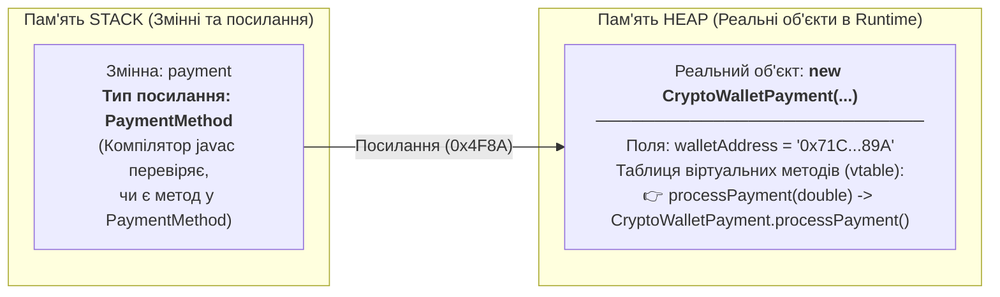
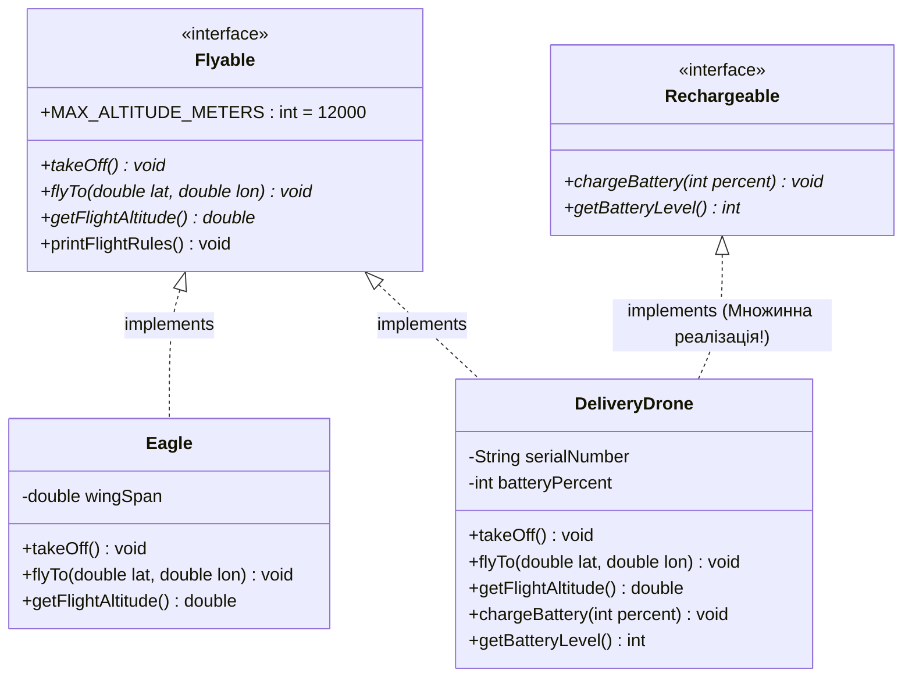
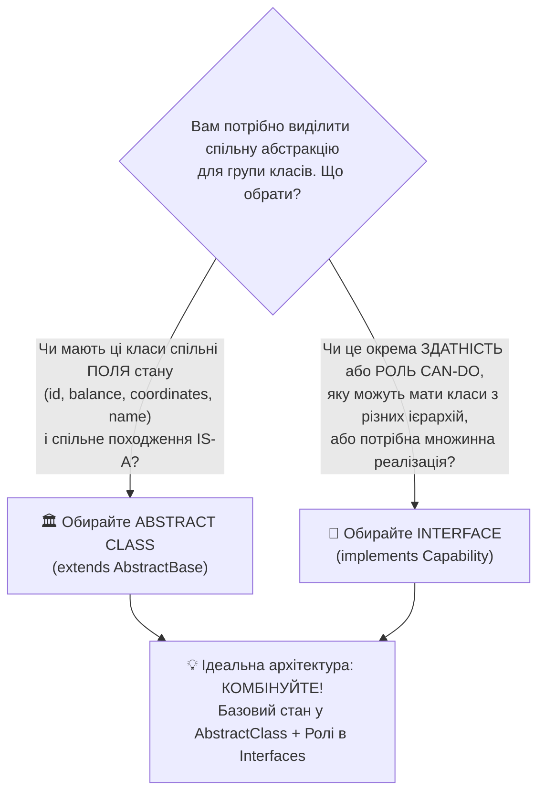
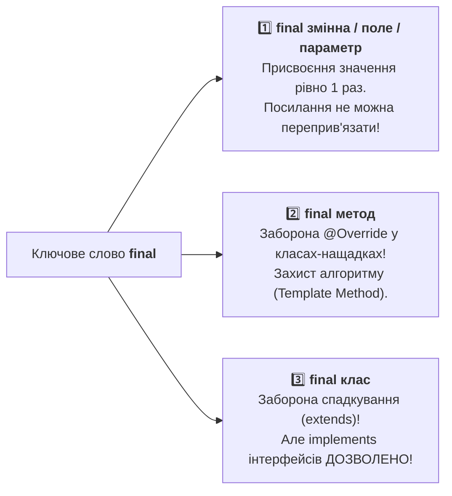

# Практична робота №10: Поліморфізм та інтерфейси (`Polymorphism`, `interface`, `instanceof`, `abstract` vs `interface`, `final`)

## 🎯 Мета роботи
- **Глибоко опанувати концепцію Поліморфізму (*Polymorphism*):**
  - Зрозуміти фундаментальний принцип ООП «Один інтерфейс — багато реалізацій» та навчитися писати універсальний код, який працює з цілими сімействами об'єктів без прив'язки до їхніх конкретних класів.
  - Чітко розрізняти **статичний поліморфізм (*Compile-time Polymorphism / Method Overloading*)** та **динамічний поліморфізм (*Runtime Polymorphism / Method Overriding*)**.
  - Розібратися, як поліморфізм працює «під капотом» у пам'яті **Stack** та **Heap**: чим відрізняється **тип посилання (*Reference Type*)** від **фактичного типу об'єкта (*Actual Object Type*)** і як віртуальна машина Java (JVM) виконує **динамічне (пізнє) зв'язування (*Dynamic Method Dispatch / vtable*)**.
- **Досконало вивчити Інтерфейси (`interface`, `implements`):**
  - Усвідомити роль інтерфейсу як чистого контракту поведінки або здатності об'єкта (**відношення `CAN-DO`** — «Вміє робити»: `Flyable`, `Payable`, `Renderable`, `Encryptable`).
  - Засвоїти неявні модифікатори в інтерфейсах: чому всі поля інтерфейсу автоматично є константами **`public static final`**, а звичайні методи без тіла — **`public abstract`**.
  - Опанувати сучасні можливості інтерфейсів: **`default`-методи** (методи з реалізацією за замовчуванням), **`static`-методи** та вирішення проблеми ромбовидного спадкування (*Diamond Problem*) при **множинній реалізації інтерфейсів** (`implements A, B, C`).
- **Навчитися безпомилково розрізняти Інтерфейси та Абстрактні класи (`interface` vs `abstract class`):**
  - Зрозуміти архітектурну межу між **природою/сутністю об'єкта (`IS-A` $\to$ `abstract class`)** зі спільним станом і конструкторами та **роллю/здатністю (`CAN-DO` $\to$ `interface`)** з множинною реалізацією.
- **Побудувати Поліморфізм через поєднання Абстрактних класів та Інтерфейсів:**
  - Навчитися створювати гнучкі ієрархії вигляду `public class SmartDrone extends AbstractAerialVehicle implements Autonomous, Rechargeable, TelemetryProvider` та обробляти різнорідні об'єкти в єдиних поліморфних масивах (`Payable[]`, `AbstractSensor[]`, `MathOperator[]`).
- **Опанувати оператор `instanceof`, безпечний Downcasting та Pattern Matching:**
  - Зрозуміти різницю між безпечним **Upcasting** (розширення типу вгору по ієрархії) та ризикованим **Downcasting** (звуження типу вниз із ризиком `ClassCastException`).
  - Навчитися перевіряти приналежність об'єкта до класу чи інтерфейсу за допомогою оператора **`instanceof`** (включно із сучасним синтаксисом **Pattern Matching в Java 16+ / 21**: `if (device instanceof Rechargeable r)`).
- **Всебічно вивчити модифікатор `final` у контексті ООП та поліморфізму:**
  - Засвоїти всі три сфери дії `final`: **`final` змінні/поля** (константи та пастка `final`-посилання на масив), **`final` методи** (заборона `@Override` та захист скелета алгоритму в патерні *Template Method*) і **`final` класи** (повна заборона `extends`, але збереження здатності реалізовувати інтерфейси `implements`!).
- **Закріпити культуру роботи з Git та GitHub:** розв'язати 40 практичних завдань і вчасно відправити код у власний репозиторій (дедлайн — **до наступного четверга, 12 листопада 2026 року, 23:59**).

---

## 📚 1. Теоретичні відомості

### 1.1. Поліморфізм (Polymorphism): Природа, Пам'ять (Stack / Heap) та Динамічне зв'язування

Слово **Поліморфізм** походить із грецької мови (*poly* — багато, *morphe* — форма) і буквально означає **«багатоформність»**.
У програмуванні це здатність **одного й того самого програмного коду (методу або посилання) працювати з об'єктами різних типів**, причому кожен об'єкт реагує на один і той самий виклик **по-своєму**, відповідно до своєї реальної природи.

#### 🔌 Аналогія з реального життя: Порт USB-C або Педаль газу
Уявіть педаль акселератора («газу») в автомобілі. Водій натискає одну й ту саму педаль (викликає метод `accelerate()`):
- У **бензиновому спорткарі** відкривається дросельна заслінка і подається паливо у двигун внутрішнього згоряння.
- В **електромобілі Tesla** інвертор миттєво подає більший струм з батареї на електродвигун.
- У **гібриді** бортовий комп'ютер одночасно вмикає електротягу і ДВЗ.

Інтерфейс взаємодії для водія **один** (`accelerate()`), але внутрішня реалізація дії — **різна** залежно від того, в якому саме автомобілі ми сидимо!

---

#### Два види поліморфізму в Java: Статичний vs Динамічний

У Java розрізняють два механізми, які часто називають поліморфізмом, але працюють вони у абсолютно різний момент часу:

| Характеристика | Статичний поліморфізм (*Compile-time / Ad-hoc*) | Динамічний поліморфізм (*Runtime / Справжній ООП-поліморфізм*) |
| :--- | :--- | :--- |
| **Механізм у Java** | **Перевантаження методів (*Method Overloading*)** | **Перевизначення методів (*Method Overriding*, `@Override`)** |
| **Де відбувається?** | Зазвичай усередині одного класу | Між базовим класом / інтерфейсом та класами-нащадками |
| **Сигнатура методу** | Однакова назва, але **різний список параметрів** (`add(int, int)` vs `add(double, double)`) | **Абсолютно ідентична сигнатура** (назва + параметри + сумісний тип повернення) |
| **Коли обирається метод?** | **На етапі компіляції (`javac`)** за типом переданих аргументів (*Early / Static Binding*) | **Під час виконання програми (`JVM Runtime`)** за реальним типом об'єкта у Heap (*Late / Dynamic Binding*) |
| **Гнучкість** | Зручність виклику, але компілятор наперед жорстко знає, який метод викликати | Дозволяє обробляти нові класи, про які базовий код навіть не здогадувався під час написання! |

---

#### Як працює Динамічний поліморфізм у пам'яті Stack та Heap? (Upcasting та Dynamic Method Dispatch)

Розглянемо класичну ієрархію: абстрактний клас `PaymentMethod` та його конкретні нащадки `CreditCardPayment`, `CryptoWalletPayment`, `ApplePayPayment`.
Подивіться на цей рядок коду:

```java
PaymentMethod payment = new CryptoWalletPayment("0x71C...89A", 0.05);
```

Тут відбувається **Upcasting (Висхідне приведення типів)** — ми записуємо посилання на об'єкт конкретного підкласу (`CryptoWalletPayment`) у змінну базового типу (`PaymentMethod`). Upcasting завжди **безпечний і відбувається автоматично (неявно)**, бо кожен крипто-гаманець *є* способом оплати (`IS-A`).

Але тепер у нашому рядку коду є **ДВА типи**:
1. **Тип посилання у Stack (*Reference Type / Compile-time Type*)** — це тип змінної ліворуч: `PaymentMethod`.
2. **Фактичний тип об'єкта у Heap (*Actual Object Type / Runtime Type*)** — це те, що реально створено праворуч через `new`: `CryptoWalletPayment`.



> [!IMPORTANT]
> **Золоте правило поліморфізму в Java (Запам'ятайте назавжди!):**
> - **Які саме методи ДОЗВОЛЕНО викликати** через змінну `payment`, вирішує **компілятор (`javac`)** виключно за **типом посилання (ліворуч)**. Якщо методу немає в `PaymentMethod`, компілятор видасть помилку, навіть якщо цей метод є в `CryptoWalletPayment`!
> - **Яка саме РЕАЛІЗАЦІЯ (`@Override`) цього методу реально виконається**, вирішує **JVM у Runtime** виключно за **фактичним типом об'єкта у Heap (праворуч)**! Це називається **пізнім (динамічним) зв'язуванням (*Dynamic Method Dispatch*)**.

Перевіримо це на коді:

```java
public abstract class PaymentMethod {
    private final String owner;

    public PaymentMethod(String owner) {
        this.owner = owner;
    }

    public abstract boolean process(double amountUah);
}

public class CryptoPayment extends PaymentMethod {
    private final String txHash;

    public CryptoPayment(String owner, String txHash) {
        super(owner);
        this.txHash = txHash;
    }

    @Override
    public boolean process(double amountUah) {
        System.out.printf("[Blockchain] Переказ %.2f грн (Hash: %s)%n", amountUah, txHash);
        return true;
    }

    // Специфічний метод, який є ТІЛЬКИ у CryptoPayment:
    public String getBlockchainExplorerUrl() {
        return "https://etherscan.io/tx/" + txHash;
    }
}
```

Якщо у `main` ми напишемо:
```java
PaymentMethod pay = new CryptoPayment("Олександр", "0x99abc");

// 1. Чи є метод process(double) у типі посилання PaymentMethod? ТАК!
// Чия реалізація виконається у Runtime? Об'єкта у Heap -> CryptoPayment.process()!
pay.process(2500.0); // ✅ Виведе: [Blockchain] Переказ 2500.00 грн (Hash: 0x99abc)

// 2. Чи є метод getBlockchainExplorerUrl() у типі посилання PaymentMethod? НІ!
// pay.getBlockchainExplorerUrl(); // ❌ ПОМИЛКА КОМПІЛЯЦІЇ: Cannot resolve method in 'PaymentMethod'
```

#### Навіщо це потрібно? Сила поліморфних масивів та методів!
Завдяки поліморфізму ми можемо створити **єдиний масив базового типу** `PaymentMethod[]` і покласти туди банківські картки, крипто-гаманці, PayPal, подарункові сертифікати, а потім обробити їх **одним циклом у 3 рядки коду**:

```java
PaymentMethod[] checkoutQueue = {
    new CardPayment("Іван", "4149-xxxx-1234"),
    new CryptoPayment("Олена", "0xAF31...99"),
    new ApplePayPayment("Максим", "iPhone-16-Pro")
};

// Цей цикл НЕ ЗНАЄ і НЕ ХОЧЕ ЗНАТИ, який саме спосіб оплати лежить у комірці m!
// Якщо завтра ми додамо 10 нових класів оплати, цей цикл НЕ зміниться ні на літеру!
for (PaymentMethod m : checkoutQueue) {
    m.process(1000.0); // Динамічне зв'язування викликає правильний @Override для кожного елемента!
}
```

---

### 1.2. Інтерфейси (`interface`, `implements`): Чисті контракти здатностей (`CAN-DO`)

У Практичній роботі №9 ми вивчили абстрактні класи (`abstract class`), які об'єднують споріднені об'єкти за їхнім походженням (**відношення `IS-A` — «Хто я є?»**).
Але в реальних інженерних системах об'єкти з **абсолютно різних ієрархій** часто повинні вміти виконувати **однакову дію (роль)**:
- Птах (`Bird extends Animal`), Пасажирський літак (`Airplane extends Vehicle`) та Квадрокоптер (`Quadcopter extends ElectronicDevice`) належать до трьох абсолютно різних біологічних і технічних світів. У них немає спільного батьківського класу, окрім `Object`. Але всі троє **вміють літати (`Flyable`)**!
- Матриця (`Matrix2D`), Банківський чек (`Receipt`) та 3D-креслення (`Blueprint`) — абсолютно різні сутності, але всі вони **можуть бути експортовані у PDF або виведені на друк (`Printable`)**!

У Java клас не може успадкувати декілька класів одночасно (`class Drone extends Device, Aircraft` — ❌ заборонено!). Проте клас може реалізувати **скільки завгодно ІНТЕРФЕЙСІВ**!

> **Інтерфейс (`interface`)** — це повністю абстрактний тип даних, який задає **контракт поведінки (набір методів)** та відповідає на питання **«Що об'єкт УМІЄ робити?» (відношення `CAN-DO`)**, не нав'язуючи об'єкту, ким він має бути за походженням і як зберігати свої внутрішні поля.



#### Синтаксис та приховані (неявні) модифікатори в інтерфейсі

Коли ви оголошуєте інтерфейс за допомогою ключового слова `interface`, компілятор Java автоматично підставляє певні модифікатори, навіть якщо ви їх не написали вручну:

```java
public interface TelemetrySensor {

    // 1. КОНСТАНТИ ІНТЕРФЕЙСУ:
    // Будь-яке поле в інтерфейсі ЗАВЖДИ є НЕЯВНО public static final!
    // В інтерфейсі НЕ МОЖНА створити звичайне поле стану об'єкта (private int x; — ПОМИЛКА!).
    int DEFAULT_POLLING_MS = 1000; // Компілятор читає як: public static final int DEFAULT_POLLING_MS = 1000;

    // 2. АБСТРАКТНІ МЕТОДИ (Основа контракту):
    // Будь-який метод без тіла в інтерфейсі ЗАВЖДИ є НЕЯВНО public abstract!
    double readMetric();           // Компілятор читає як: public abstract double readMetric();
    String getUnitName();          // Компілятор читає як: public abstract String getUnitName();

    // 3. DEFAULT МЕТОД (з Java 8+):
    // Має ключове слово default і власне тіло { ... }.
    // Усі класи, що роблять implements TelemetrySensor, отримують цей метод автоматично,
    // але за бажанням можуть перевизначити (@Override) його!
    default String formatTelemetry() {
        return String.format("[Датчик: %.2f %s (інтервал: %d мс)]",
                readMetric(), getUnitName(), DEFAULT_POLLING_MS);
    }

    // 4. STATIC МЕТОД ІНТЕРФЕЙСУ (з Java 8+):
    // Допоміжний утилітарний метод. Належить самому інтерфейсу, НЕ успадковується класами!
    // Викликається ТІЛЬКИ через ім'я інтерфейсу: TelemetrySensor.isValidReading(val)
    static boolean isValidReading(double value) {
        return !Double.isNaN(value) && !Double.isInfinite(value);
    }
}
```

> [!WARNING]
> **Капкан №1 на співбесідах та тестах — Модифікатор доступу при `@Override` методу інтерфейсу!**
> Оскільки всі методи контракту в інтерфейсі автоматично є **`public`**, то в класі, який реалізує інтерфейс (`implements`), ви **ЗОБОВ'ЯЗАНІ явно написати слово `public`** перед методом!
> ```java
> class TempSensor implements TelemetrySensor {
>     @Override
>     double readMetric() { return 36.6; } // ❌ ПОМИЛКА КОМПІЛЯЦІЇ!
>     // Attempted to assign weaker access privileges ('package-private'); was 'public'
>
>     @Override
>     public double readMetric() { return 36.6; } // ✅ ПРАВИЛЬНО: тільки public!
> }
> ```

#### Множинна реалізація інтерфейсів та проблема ромба (*Diamond Problem*)

Клас може одночасно реалізовувати декілька інтерфейсів через кому:
```java
public class CombatRobot extends AbstractMachine implements Movable, Attackable, Repairable {
    // Клас зобов'язаний реалізувати (@Override) усі абстрактні методи з УСІХ трьох інтерфейсів!
}
```
Також один інтерфейс може розширювати декілька інших інтерфейсів за допомогою слова **`extends`**:
```java
public interface AmphibiousVehicle extends LandTransport, WaterTransport {
    void switchMode();
}
```

**А що станеться, якщо клас реалізує два інтерфейси `A` і `B`, у яких є `default`-метод з абсолютно однаковою сигнатурою `default void start()`?**
Це знаменита **Проблема Ромба (*Diamond Problem*)**. У Java компілятор не гадає, який із двох методів обрати, а **вимагає від програміста явно перевизначити `@Override public void start()`** у класі! При цьому всередині свого методу ви можете звернутися до конкретної версії через спеціальний синтаксис `Ім'яІнтерфейсу.super.метод()`:

```java
interface GasolinePower {
    default void ignite() { System.out.println("Запуск бензинового ДВЗ..."); }
}

interface ElectricPower {
    default void ignite() { System.out.println("Активація високовольтної батареї..."); }
}

public class HybridCar implements GasolinePower, ElectricPower {
    // Якби ми не перевизначили ignite(), код би НЕ скомпілювався!
    @Override
    public void ignite() {
        ElectricPower.super.ignite(); // Явний виклик default-методу з першого інтерфейсу
        GasolinePower.super.ignite(); // Явний виклик default-методу з другого інтерфейсу
    }
}
```

---

### 1.3. Відмінності між Інтерфейсами (`interface`) та Абстрактними класами (`abstract class`)

Це одне з найважливіших архітектурних питань у всій мові Java. Обидва механізми не дозволяють створити екземпляр напряму через `new` і обидва задають контракт для нащадків. То в чому ж фундаментальна різниця?

#### 📊 Повна порівняльна таблиця: `abstract class` проти `interface`

| Критерій порівняння | Абстрактний клас (`abstract class`) | Інтерфейс (`interface`) |
| :--- | :--- | :--- |
| **1. Філософія та зв'язок** | **`IS-A` (Хто об'єкт є за своєю суттю?)**<br>Спільне походження та спільний фундамент (`AbstractSensor`, `AbstractBankAccount`, `AbstractMatrix`). | **`CAN-DO` (Що об'єкт вміє робити / яка його роль?)**<br>Здатність або поведінка, спільна навіть для неспоріднених класів (`Serializable`, `Comparable`, `Flyable`, `Auditable`). |
| **2. Поля та внутрішній стан** | **Має будь-які поля екземпляра** (`private`, `protected`, змінні стану, масиви). Зберігає стан кожного об'єкта! | **НЕ МОЖЕ зберігати стан об'єкта!** Будь-яке поле в інтерфейсі — це лише глобальна константа **`public static final`**. |
| **3. Конструктори** | **Обов'язково має конструктори** (викликаються класами-нащадками через `super(...)` для ініціалізації полів). | **Категорично НЕ МАЄ конструкторів!** Інтерфейс не ініціалізує стан об'єкта. |
| **4. Множинне спадкування** | **Одинарне (`extends`):** клас може успадкувати **лише ОДИН** абстрактний (або звичайний) клас. | **Множинне (`implements`):** клас може реалізувати **СКІЛЬКИ ЗАВГОДНО** інтерфейсів одночасно (`implements A, B, C`). |
| **5. Модифікатори доступу методів** | Абстрактні методи можуть бути `public`, `protected` або *package-private*; звичайні методи — також і `private`. | Усі абстрактні та `default` методи контракту є виключно **`public`** (з Java 9 дозволені внутрішні допоміжні `private` методи з тілом). |
| **6. Ключове слово підключення** | Клас розширює абстрактний клас через **`extends`**. | Клас реалізує інтерфейс через **`implements`** (а інтерфейс розширює інший інтерфейс через `extends`). |
| **7. Наявність методів з тілом** | Може містити звичайні методи, `final` шаблонні методи та `static` методи з повним доступом до полів `this`. | Може містити `default` та `static` методи, але вони **не мають полів стану** (працюють лише через виклик інших методів контракту). |



---

### 1.4. Поліморфізм через інтерфейси та абстрактні класи (Синергія `extends` + `implements`)

У реальних промислових системах абстрактні класи та інтерфейси **не воюють між собою, а працюють у парі**!
Правило порядку у заголовку класу завжди суворе: **спочатку `extends` (один батьківський клас), а потім `implements` (список інтерфейсів через кому)**:

```java
// Єдина потужна архітектура:
public class AutonomousMarsRover extends AbstractSpaceProbe implements Rechargeable, Movable, RadioTransmitter {
    // 1. Від AbstractSpaceProbe ровер успадкував захищені поля missionId, launchYear та конструктор super(...)
    // 2. Від Rechargeable — обов'язок реалізувати chargeFromSolarPanels()
    // 3. Від Movable — обов'язок реалізувати driveTo(double x, double y)
    // 4. Від RadioTransmitter — обов'язок реалізувати sendDataToEarth()
}
```

#### Одне тіло у Heap — багато поліморфних «облич» у Stack!
Коли ми створюємо один об'єкт `AutonomousMarsRover` у купі (Heap), ми можемо передавати посилання на нього в **чотири абсолютно різні підсистеми**, і кожна бачитиме його лише крізь призму свого контракту:

```java
AutonomousMarsRover perseverance = new AutonomousMarsRover("NASA-Perseverance", 2020);

// Один і той самий об'єкт у Heap, але 5 різних типів посилань (Upcasting):
AbstractSpaceProbe probe   = perseverance; // Підсистема каталогу космічних місій бачить тільки методи зонда
Rechargeable batteryTarget = perseverance; // Зарядна станція бачить тільки метод chargeFromSolarPanels()
Movable navigationUnit     = perseverance; // Навігатор бачить тільки метод driveTo(x, y)
RadioTransmitter radio     = perseverance; // Антена зв'язку бачить тільки метод sendDataToEarth()
```

Зверніть увагу на масштаб:
- **Поліморфізм через абстрактний клас (`AbstractSpaceProbe[]`)** дозволяє зібрати в один масив усі космічні апарати (супутники, зонди, марсоходи) і розрахувати бюджет місії.
- **Поліморфізм через інтерфейс (`Rechargeable[]`)** дозволяє одній зарядній станції в одному циклі зарядити і марсохід `AutonomousMarsRover`, і смартфон астронавта `AstronautPhone`, і акумуляторний ліхтарик `Flashlight`, хоча вони взагалі не мають спільного предка!

---

### 1.5. Оператор `instanceof`, Безпечний Downcasting та Pattern Matching

Іноді під час обходу поліморфного масиву базового типу (`AbstractEmployee[]` або `SpaceProbe[]`) нам потрібно перевірити: *«А чи вміє цей конкретний об'єкт у комірці масиву перезаряджатися від сонця (`Rechargeable`) або чи є він саме класом `CombatDrone`?»*

Якщо ми спробуємо виконати пряме **низхідне приведення типів (*Downcasting*)** навмання, ми ризикуємо аварійно покласти програму:

```java
AbstractSpaceProbe probe = new VoyagerSatellite("Voyager-1"); // Цей супутник НЕ є марсоходом!

// ❌ НЕБЕЗПЕЧНИЙ DOWNCASTING НАОСЛІП:
// Компілятор пропустить, але у Runtime вилетить фатальна помилка ClassCastException!
AutonomousMarsRover rover = (AutonomousMarsRover) probe;
```

#### Як працює оператор `instanceof`?
Бінарний оператор **`об'єкт instanceof Тип`** у режимі реального часу (Runtime) перевіряє фактичний об'єкт у пам'яті Heap і повертає `true`, якщо:
1. Об'єкт є прямим екземпляром класу `Тип`;
2. АБО об'єкт є екземпляром будь-якого підкласу (нащадка) класу `Тип`;
3. АБО клас об'єкта (чи його предок) реалізує інтерфейс `Тип` (`implements Тип`).

> [!TIP]
> **Важливий захист від `NullPointerException`:**
> Якщо змінна `obj` дорівнює `null`, то вираз **`null instanceof БудьЯкийТип`** ніколи не викидає помилку, а завжди безпечно повертає **`false`**!

#### Еволюція синтаксису: Класичний `instanceof` vs Pattern Matching (Java 16+ / Java 21)

Раніше програмістам доводилося писати назву типу тричі (перевірити, оголосити змінну, привести тип у дужках). Починаючи з Java 16 (і в нашій Java 21), працює елегантний **Pattern Matching for `instanceof`**:

```java
// 🔹 СПОСІБ 1: Класичний синтаксис (до Java 16) — громіздкий:
for (AbstractSpaceProbe p : fleet) {
    if (p instanceof Rechargeable) {
        Rechargeable r = (Rechargeable) p; // Ручний Downcasting
        r.chargeFromSolarPanels();
    }
}

// 🔹 СПОСІБ 2: Сучасний Pattern Matching (Java 16+ / Java 21) — ЧИСТИЙ КОД!
for (AbstractSpaceProbe p : fleet) {
    // Перевірка + автоматичний Downcasting у змінну 'r' в один рядок!
    if (p instanceof Rechargeable r && r.getBatteryLevel() < 20) {
        r.chargeFromSolarPanels();
    }
}
```

> [!CAUTION]
> **Коли `instanceof` — це антипатерн (погана архітектура)?**
> Якщо ви пишете метод розрахунку площі фігури через ланцюжок:
> `if (s instanceof Circle c) { ... } else if (s instanceof Rectangle r) { ... }` — **ви вбили поліморфізм!**
> Для дій, спільних для всієї ієрархії, завжди створюйте абстрактний або інтерфейсний метод `s.getArea()`. Використовуйте `instanceof` **тільки тоді**, коли потрібно викликати унікальну специфічну можливість окремого підкласу чи додаткового інтерфейсу (наприклад, зарядити лише ті пристрої на складі, які реалізують `Rechargeable`).

---

### 1.6. Ключове слово `final` у трьох вимірах ООП

Модифікатор **`final`** у Java означає **«остаточний, незмінний, захищений від модифікації»**. У контексті ООП, спадкування та поліморфізму він застосовується у **трьох різних місцях**, і кожне має свій точний зміст:



#### 1️⃣ `final` для змінних, полів та параметрів методів
- **Примітивний тип (`final int maxRetries = 3;`):** значення стає константою, змінити його неможливо.
- **Неініціалізоване поле (`Blank final field` — `private final String iban;`):** не має значення при оголошенні, але компілятор суворо стежить, щоб йому було присвоєно значення **рівно один раз у кожному конструкторі класу**.
- **⚠️ Головна пастка з посиланнями (`final int[] data` або `final Point2D center`):**
  Слово `final` перед масивом або об'єктом заморожує **саме посилання у Stack** (змінній не можна присвоїти інший масив `data = new int[10]`), але **НЕ заморожує вміст об'єкта у Heap**!
  ```java
  final int[] scores = {10, 20, 30};
  scores[0] = 999;        // ✅ КОМПІЛЮЄТЬСЯ! Елемент усередині масиву в Heap змінився!
  // scores = new int[5]; // ❌ ПОМИЛКА КОМПІЛЯЦІЇ: Cannot assign a value to final variable 'scores'
  ```

#### 2️⃣ `final` для методів (`public final double processTransaction()`)
Якщо оголосити метод зі словом `final`, жоден клас-нащадок **не зможе перевизначити (`@Override`) цей метод**!
**Навіщо це роблять архітектори?**
- **Захист критичних бізнес-правил та безпеки:** уявіть абстрактний клас `AbstractBankTransfer`. У ньому є метод `executeTransfer()`, який спочатку перевіряє ліміт фінмоніторингу, списує комісію (через абстрактний метод `calculateFee()`) і записує аудит-лог. Якщо зробити `public final boolean executeTransfer()`, жоден недобросовісний підклас не зможе перевизначити його й вимкнути перевірку безпеки!
- Це основа патерна **Шаблонний метод (*Template Method*)**: сам шаблонний метод роблять **`final`**, а змінні кроки всередині нього — **`abstract`** або поліморфними.

#### 3️⃣ `final` для класів (`public final class ImmutableMatrix implements MathOperable`)
Якщо поставити `final` перед `class`, цей клас стає **листовим (кінцевим) в ієрархії**: жоден інший клас у світі не зможе написати `extends ImmutableMatrix`!
- Саме так у стандартній бібліотеці Java захищені класи `String`, `Math`, `Integer`, `Double`, `System`. Якби хтось міг успадкувати `String` і перевизначити його методи, зробивши рядок змінним, уся система безпеки та кешування рядків у JVM була б зруйнована.
- **Важливий інсайт:** `final` клас не може мати *нащадків*, але він **прекрасно може мати батьківський клас (`extends AbstractBase`) та реалізовувати будь-яку кількість інтерфейсів (`implements Printable, Comparable`)** і повноцінно працювати в поліморфних масивах!

> [!WARNING]
> **Абсолютно несумісна комбінація: `abstract` + `final`**
> Клас або метод **НІКОЛИ** не може бути одночасно `abstract` і `final` (`abstract final class` або `public abstract final void run()`).
> Чому? Бо `abstract` *зобов'язує* створити підклас і перевизначити метод, а `final` *категорично забороняє* спадкування і перевизначення!

---

### 1.7. Поширені помилки та підводні камені

1. **Втрата `public` при реалізації методів інтерфейсу:**
   ```java
   interface Switchable {
       void turnOn(); // Неявно public abstract!
   }
   class Lamp implements Switchable {
       @Override
       void turnOn() { } // ❌ ПОМИЛКА КОМПІЛЯЦІЇ: звуження модифікатора доступу з public до package-private!
   }
   ```
2. **Виклик специфічного методу підкласу через базове посилання без `instanceof`:**
   ```java
   Flyable f = new PassengerPlane("Boeing-747");
   // f.serveMealsToPassengers(); // ❌ ПОМИЛКА: у контракті Flyable немає роздачі обідів!
   if (f instanceof PassengerPlane plane) {
       plane.serveMealsToPassengers(); // ✅ Безпечно перевірили тип і викликали метод
   }
   ```
3. **Плутанина між перевизначенням методів та приховуванням полів / `static`-методів:**
   Поліморфізм та динамічне зв'язування в Java працюють **ТІЛЬКИ для нестатичних (віртуальних) методів екземпляра**! Поля класів та `static`-методи зв'язуються статично на етапі компіляції за типом посилання (ліворуч).
4. **Спроба змінити константу інтерфейсу або створити конструктор в інтерфейсі:**
   В інтерфейсі `int MAX = 100;` — це вже константа `public static final`. Спроба написати `MAX = 200;` або оголосити конструктор усередині `interface` одразу дасть помилку компіляції.
5. **Перевірка `instanceof` між абсолютно несумісними класами однієї гілки:**
   Якщо `Dog` і `Cat` — два окремі класи, і жоден не спадкує інший, то для змінної `Dog d = new Dog();` перевірка `if (d instanceof Cat)` навіть **не скомпілюється** (*Inconvertible types*)! Проте перевірка `d instanceof Flyable` (де `Flyable` — інтерфейс, а `Dog` не є `final` класом) скомпілюється, бо теоретично міг би існувати підклас `FlyingSuperDog extends Dog implements Flyable`!
6. **Неправильний порядок `extends` та `implements`:**
   ```java
   // ❌ ПОМИЛКА СИНТАКСИСУ: implements перед extends заборонено!
   public class Drone implements Flyable extends Device { }
   // ✅ ПРАВИЛЬНО: завжди спочатку extends (1 клас), потім implements (1..N інтерфейсів)
   public class Drone extends Device implements Flyable, Rechargeable { }
   ```

---

### 1.8. Робота з Git та GitHub (Алгоритм здачі та Дедлайн)

> [!IMPORTANT]
> **Правила здачі Практичної та Домашньої роботи №10:**
> - Увесь код фіксується у вашому Git-репозиторії та відправляється на **GitHub**.
> - **⏰ Дедлайн здачі:** **до наступного четверга (12 листопада 2026 року, до 23:59)**.
> - Перед відправкою обов'язково переконайтеся, що проєкт компілюється без жодної помилки (`mvn clean test-compile`).

```bash
git status
git add src/main/java/semester1/practice10/
git commit -m "feat(practice10): complete polymorphism, interfaces, instanceof and final tasks"
git push origin main
```

---

## 💻 2. Практичні завдання (40 завдань)

Усі завдання виконуються у пакеті `semester1.practice10` та тестуються у методі `main` класу `Practice10.java`.
Завдання структуровано у **5 логічних блоків по 8 завдань**:
- **Блок 1 (Завдання 1–8):** Динамічний поліморфізм, Upcasting, віртуальні методи (`@Override`) та поліморфні масиви.
- **Блок 2 (Завдання 9–16):** Інтерфейси (`interface`, `implements`), константи, `default` / `static` методи та множинна реалізація контрактів (`CAN-DO`).
- **Блок 3 (Завдання 17–24):** `abstract class` проти `interface` та синергія поліморфізму (`extends AbstractClass implements Interface1, Interface2`).
- **Блок 4 (Завдання 25–32):** Оператор `instanceof`, безпечний Downcasting та Pattern Matching (`if (obj instanceof Type var)`).
- **Блок 5 (Завдання 33–40):** Модифікатор `final` (поля, шаблонні методи, класи) та комплексна архітектурна синергія + Фінальний `git push`.

---

### Блок 1: Динамічний поліморфізм, Upcasting та Поліморфні масиви (Завдання 1–8)

#### Завдання 1: Поліморфний шлюз електронних платежів (`PaymentInstrument`)
1. Створіть абстрактний клас `PaymentInstrument` із полем `private final String payerName`, конструктором та абстрактним методом `public abstract double calculateFee(double amount);` і методом `public double processPayment(double amount)` (повертає `amount + calculateFee(amount)`).
2. Створіть три підкласи:
   - `BankCardInstrument` (комісія $1.5\%$ від суми + $5.0$ грн фіксовано);
   - `CryptoTokenInstrument` (фіксована комісія мережі `gasFeeUah`);
   - `IbanDirectInstrument` ($0\%$ комісії для сум до $50\,000$ грн, інакше $0.5\%$).
3. У `Practice10.main` створіть поліморфний масив `PaymentInstrument[] payments` (Upcasting!) і в єдиному циклі розрахуйте сумарні витрати на проведення платежу $10\,000$ грн кожним інструментом.

#### Завдання 2: Поліморфне обчислення площі та периметра 2D-фігур (`Shape2D`)
1. Створіть базовий абстрактний клас `Shape2D` із методами `public abstract double getArea();` та `public abstract double getPerimeter();`.
2. Реалізуйте 3 класи-нащадки: `CircleShape` (радіус $r$), `RectangleShape` (сторони $a, b$) та `EquilateralTriangleShape` (рівносторонній трикутник зі стороною $a$, де $S = \frac{\sqrt{3}}{4}a^2, \; P = 3a$).
3. Напишіть статичний поліморфний метод `public static Shape2D findMaxAreaShape(Shape2D[] shapes)`, який приймає масив будь-яких фігур і повертає фігуру з найбільшою площею.

#### Завдання 3: Статичний проти Динамічного поліморфізму (`MathCalculator` vs `OperationNode`)
1. Продемонструйте **статичний поліморфізм (Overloading)**: створіть клас `VectorMathOverload` із трьома перевантаженими методами `norm(...)`: для 1D числа `norm(double x)`, для 2D точки `norm(double x, double y)` ($\sqrt{x^2+y^2}$) та для масиву `norm(double[] v)` ($\sqrt{\sum v_i^2}$).
2. Продемонструйте **динамічний поліморфізм (Overriding)**: створіть абстрактний клас `BinaryOperation` з методом `public abstract double apply(double a, double b);` та підкласи `AddOp`, `MultiplyOp`, `HypotenuseOp`.
3. Помістіть операції в масив `BinaryOperation[]` і викличте `op.apply(3.0, 4.0)` у циклі.

#### Завдання 4: Поліморфна система сповіщень (`NotificationSender`)
1. Створіть базовий клас `NotificationSender` (`private final String recipient`, метод `public String send(String message)`).
2. Створіть підкласи `EmailSender` (форматує з темою листа), `SmsSender` (обрізає повідомлення до 70 символів, якщо воно довше) та `TelegramBotSender` (додає Markdown-теги та емодзі).
3. Напишіть метод масової розсилки `public static void broadcastAlert(NotificationSender[] senders, String alertText)`, який поліморфно розсилає тривогу всіма каналами.

#### Завдання 5: Поліморфний розрахунок вартості логістичної доставки (`ShippingTariff`)
1. Створіть абстрактний клас `ShippingTariff` із методом `public abstract double calculateCost(double weightKg, double distanceKm);`.
2. Створіть нащадків:
   - `RoadTruckTariff`: $15.0 \cdot \text{distanceKm} + 2.5 \cdot \text{weightKg}$;
   - `AirCargoTariff`: $45.0 \cdot \text{distanceKm} + 18.0 \cdot \text{weightKg} + 500.0$ (аеропортовий збір);
   - `RailFreightTariff`: фіксована подача вагона $1200.0 + 4.0 \cdot \text{distanceKm} + 0.8 \cdot \text{weightKg}$.
3. Знайдіть у масиві `ShippingTariff[]` найвигідніший тариф для вантажу $250\text{ кг}$ на відстань $600\text{ км}$.

#### Завдання 6: Чисельне диференціювання поліморфних математичних функцій (`DifferentiableFunction`)
1. Створіть абстрактний клас `DifferentiableFunction` з абстрактним методом `public abstract double f(double x);` та методом чисельної похідної `public double derivativeAt(double x)` за формулою $\frac{f(x+h) - f(x-h)}{2h}$ ($h = 10^{-5}$).
2. Реалізуйте підкласи `QuadraticParabola` ($a x^2 + b x + c$), `NaturalLogFunction` ($k \cdot \ln(x)$ для $x > 0$) та `ExponentialGrowth` ($A \cdot e^{\lambda x}$).
3. Покладіть усі 3 функції в масив `DifferentiableFunction[]` і виведіть таблицю їхніх значень та похідних у точці $x = 2.0$.

#### Завдання 7: Поліморфний рендеринг UI-компонентів (`UiWidget`)
1. Створіть абстрактний клас `UiWidget` (`protected String id`, `protected int width`, `protected int height`, абстрактний метод `public abstract String renderHtml();`).
2. Створіть підкласи `ButtonWidget` (`String label`), `TextInputWidget` (`String placeholder`) та `ProgressBarWidget` (`int progressPercent` у межах $[0; 100]$).
3. Створіть метод, який приймає `UiWidget[] pageElements` і збирає з них цілісну HTML-сторінку.

#### Завдання 8: Поліморфний розрахунок амортизації промислового обладнання (`IndustrialAsset`)
1. Створіть абстрактний клас `IndustrialAsset` (`private final String name`, `protected final double initialCost`, `protected final int usefulLifeYears`). Оголосіть метод `public abstract double getBookValueAfterYears(int years);` (залишкова вартість).
2. Реалізуйте `LinearDepreciationAsset` (рівномірне списання $\text{initialCost} \cdot (1 - \frac{\text{years}}{\text{usefulLife}})$) та `DecliningBalanceAsset` (прискорене списання $\text{initialCost} \cdot (1 - \text{rate})^{\text{years}}$).
3. Обчисліть сумарну залишкову вартість цеху з масиву `IndustrialAsset[]` через 3 роки експлуатації.

---

### Блок 2: Інтерфейси (`interface`, `implements`), Константи, `default`/`static` та Множинна реалізація (Завдання 9–16)

#### Завдання 9: Перший контракт здатності: Інтерфейс `Measurable` для різнорідних сутностей
1. Оголосіть інтерфейс `Measurable` з єдиним методом `double getMeasure();`.
2. Реалізуйте цей інтерфейс у трьох **абсолютно неспоріднених** класах:
   - `BankVault implements Measurable` (повертає запас золота у кг);
   - `HighwayRoute implements Measurable` (повертає довжину траси у км);
   - `CpuCore implements Measurable` (повертає тактову частоту в ГГц).
3. Напишіть універсальний статичний метод `public static double computeAverage(Measurable[] items)`, який знаходить середнє значення для будь-якого масиву `Measurable[]`!

#### Завдання 10: Константи в інтерфейсі та фізична конвертація (`PhysicalConstants` & `EnergyConvertible`)
1. Створіть інтерфейс `EnergyConvertible`, який оголошує константи (неявно `public static final`):
   - `double SPEED_OF_LIGHT = 299_792_458.0;` (м/с)
   - `double JOULES_PER_KWH = 3_600_000.0;`
2. Додайте в інтерфейс метод `double getEnergyJoules();` та `default`-метод `default double getEnergyKwh()`, який ділить `getEnergyJoules()` на `JOULES_PER_KWH`.
3. Реалізуйте інтерфейс у класах `KineticBody` ($E_k = \frac{1}{2} m v^2$) та `BatteryCell` (ємність у Вт·год).

#### Завдання 11: Множинна реалізація інтерфейсів: Універсальний Амфібійний Дрон (`Flyable`, `Swimmable`, `GpsTrackable`)
1. Створіть три інтерфейси:
   - `Flyable` (`void takeOff();`, `double getMaxAltitude();`);
   - `Swimmable` (`void dive(double depthMeters);`, `double getMaxDepth();`);
   - `GpsTrackable` (`String getCoordinates();`).
2. Створіть клас `AmphibiousRescueDrone implements Flyable, Swimmable, GpsTrackable`, який реалізує всі 3 контракти.
3. Продемонструйте в `main`, як один екземпляр дрона можна передати і в метод `testFlight(Flyable f)`, і в метод `testDiving(Swimmable s)`, і в метод `logPosition(GpsTrackable g)`!

#### Завдання 12: `default` та `static` методи в інтерфейсі (`DataValidator`)
1. Створіть інтерфейс `DataValidator` із абстрактним методом `boolean isValid(String input);`.
2. Додайте в інтерфейс **`default` метод** `default String validateOrDefault(String input, String fallback)`, який повертає `input`, якщо `isValid(input) == true`, інакше повертає `fallback`.
3. Додайте в інтерфейс **`static` метод** `static boolean isNotNullOrBlank(String s)` (`s != null && !s.isBlank()`).
4. Створіть класи `EmailValidator implements DataValidator` (перевіряє наявність `'@'` та `'.'`) і `PositiveNumberValidator implements DataValidator` та протестуйте їх.

#### Завдання 13: Вирішення конфлікту `default`-методів (*Diamond Problem*)
1. Створіть інтерфейс `AcousticSignal` із методом `default String emitAlert() { return "🔊 Звукова сирена 110 дБ"; }`.
2. Створіть інтерфейс `OpticalSignal` із методом з **тією самою назвою та сигнатурою** `default String emitAlert() { return "🚨 Стробоскопічний маячок"; }`.
3. Створіть клас `EmergencyBeacon implements AcousticSignal, OpticalSignal`.
4. Розв'яжіть конфлікт ромбовидного спадкування: перевизначте `@Override public String emitAlert()` і комбіновано викличте обидві реалізації через `AcousticSignal.super.emitAlert()` та `OpticalSignal.super.emitAlert()`!

#### Завдання 14: Спадкування інтерфейсів (`interface SmartContract extends Authenticatable, Auditable`)
1. Створіть базовий інтерфейс `Authenticatable` (`boolean verifySignature(String key);`) та базовий інтерфейс `Auditable` (`String getAuditTrail();`).
2. Створіть розширений інтерфейс `BlockchainSmartContract extends Authenticatable, Auditable`, який додає власний метод `boolean executeContract(double gasLimit);`.
3. Реалізуйте клас `EscrowSmartContract implements BlockchainSmartContract` і перевірте роботу всіх трьох рівнів методів.

#### Завдання 15: Інтерфейс геометричних перетворень (`Transformable2D`)
1. Створіть інтерфейс `Transformable2D` із методами `void translate(double dx, double dy);` (зсув) та `void scale(double factor);` (масштабування).
2. Реалізуйте його у класах `BoundingBox` (лівий нижній кут $x, y$ та розміри $w, h$) і `CircleRegion` (центр $x, y$ та радіус $r$).
3. Напишіть метод `applyGlobalTransform(Transformable2D[] objects, double dx, double dy, double scaleFactor)`, який синхронно трансформує всі об'єкти на сцені.

#### Завдання 16: Інтерфейс серіалізації у формати JSON та CSV (`DataExportable`)
1. Створіть інтерфейс `DataExportable` із методами `String toJson();` та `String toCsvRow();`.
2. Реалізуйте його у класах `StudentGradeRecord` (`String name, int group, double gpa`) та `WeatherObservation` (`String city, double tempC, int humidity`).
3. Створіть поліморфний масив `DataExportable[] records` і виведіть у консоль JSON-дамп та CSV-таблицю всіх об'єктів.

---

### Блок 3: `abstract class` проти `interface` та Синергія `extends` + `implements` (Завдання 17–24)

#### Завдання 17: Архітектурний поділ `IS-A` та `CAN-DO`: Птахи, Літаки та Плавання
1. Створіть абстрактний клас `AbstractBird` (`protected final String species`, `protected double weightKg`, абстрактний метод `public abstract String makeSound();`) — це сутність **`IS-A`**.
2. Створіть інтерфейси здатностей **`CAN-DO`**: `FlyableUnit` (`double getFlightSpeedKmh();`) та `SwimmingUnit` (`double getDiveDepthMeters();`).
3. Побудуйте правильну біологічну та інженерну модель:
   - `Falcon extends AbstractBird implements FlyableUnit` (сокіл є птахом і вміє літати);
   - `EmperorPenguin extends AbstractBird implements SwimmingUnit` (пінгвін є птахом, НЕ літає, але вміє пірнати!);
   - `CargoPlane implements FlyableUnit` (літак НЕ є птахом, але вміє літати!).
4. Продемонструйте обробку масивів `AbstractBird[]` та `FlyableUnit[]`.

#### Завдання 18: Розумний будинок: `AbstractSmartAppliance` + інтерфейси `Switchable`, `Dimmable`, `TemperatureControllable`
1. Створіть `abstract class AbstractSmartAppliance` (`private final String room`, `private final String model`, `protected boolean poweredOn`, абстрактний метод `public abstract double getCurrentWatts();`).
2. Створіть інтерфейси ролей: `Dimmable` (`void setBrightness(int percent);`) та `HeatingCapable` (`void setTargetTemperature(double celsius);`).
3. Реалізуйте `SmartLedChandelier extends AbstractSmartAppliance implements Dimmable` та `SmartUnderfloorHeating extends AbstractSmartAppliance implements HeatingCapable`.
4. Підрахуйте сумарне енергоспоживання будинку через масив `AbstractSmartAppliance[]`.

#### Завдання 19: Фінансова біржа: `AbstractFinancialInstrument` + інтерфейси `Tradable`, `DividendPaying`
1. Створіть `abstract class AbstractFinancialInstrument` (`private final String ticker`, `protected int quantity`, абстрактний метод `public abstract double getMarketValueUah();`).
2. Створіть інтерфейси:
   - `Tradable` (`boolean buy(int qty);`, `boolean sell(int qty);`);
   - `DividendPaying` (`double calculateAnnualDividend();`).
3. Створіть класи:
   - `TechGrowthStock extends AbstractFinancialInstrument implements Tradable` (акції росту без дивідендів);
   - `BlueChipStock extends AbstractFinancialInstrument implements Tradable, DividendPaying` (акції з дивідендами);
   - `FixedTermDeposit extends AbstractFinancialInstrument implements DividendPaying` (депозит приносить відсотки, але не торгується на біржі!).

#### Завдання 20: Лінійні оператори: `AbstractVectorOperator` + інтерфейс `InvertibleOperator`
1. Створіть клас `Vec2D` (`final double x, y`).
2. Створіть `abstract class AbstractVectorOperator` (`private final String name`, абстрактний метод `public abstract Vec2D transform(Vec2D v);`).
3. Створіть інтерфейс `InvertibleOperator` (`Vec2D inverseTransform(Vec2D v);` — зворотне перетворення).
4. Реалізуйте:
   - `Rotation2DOperator extends AbstractVectorOperator implements InvertibleOperator` (поворот на кут $\alpha$: $x' = x\cos\alpha - y\sin\alpha, \; y' = x\sin\alpha + y\cos\alpha$; зворотний — поворот на $-\alpha$);
   - `ProjectionXOperator extends AbstractVectorOperator` (проєкція на вісь $OX$: $(x, y) \to (x, 0)$ — незворотний оператор, бо координата $y$ втрачається!).

#### Завдання 21: Автопарк спецтехніки: `AbstractVehicle` + `CargoCarrier`, `PassengerCarrier`, `ElectricPowered`
1. Створіть `abstract class AbstractVehicle` (`private final String plateNumber`, `protected double mileageKm`).
2. Створіть інтерфейси `CargoCarrier` (`double getMaxPayloadTons();`), `PassengerCarrier` (`int getSeatCount();`) та `ElectricPowered` (`double getBatteryCapacityKwh();`).
3. Реалізуйте класи: `ElectricCityBus extends AbstractVehicle implements PassengerCarrier, ElectricPowered`, `DieselDumpTruck extends AbstractVehicle implements CargoCarrier` та `CargoPassengerVan extends AbstractVehicle implements CargoCarrier, PassengerCarrier`.

#### Завдання 22: Бойові одиниці стратегії: `AbstractMilitaryUnit` + `Armored`, `RangedAttacker`, `Healer`
1. Створіть `abstract class AbstractMilitaryUnit` (`private final String unitName`, `protected int hp`, `public abstract int getMoveSpeed();`).
2. Створіть інтерфейси `RangedAttacker` (`int getAttackRange();`, `int fireShot();`) та `FieldHealer` (`int healAlly();`).
3. Реалізуйте класи: `HeavySniper extends AbstractMilitaryUnit implements RangedAttacker`, `CombatMedic extends AbstractMilitaryUnit implements FieldHealer` та `PaladinCaptain extends AbstractMilitaryUnit implements RangedAttacker, FieldHealer`.

#### Завдання 23: Лабораторні прилади: `AbstractLabDevice` + `Calibratable`, `SelfDiagnostic`
1. Створіть `abstract class AbstractLabDevice` (`private final String inventoryCode`, `public abstract void performMeasurement();`).
2. Створіть інтерфейси `Calibratable` (`void calibrate(double referenceValue);`) та `SelfDiagnostic` (`boolean runSelfCheck();`).
3. Реалізуйте `ElectronicScale extends AbstractLabDevice implements Calibratable, SelfDiagnostic` та `GlassThermometer extends AbstractLabDevice` (звичайний ртутний термометр не має автокалібрування та електронної самодіагностики).

#### Завдання 24: Поліморфна конвеєрна фільтрація тексту (`TextProcessor` & `Reversible`)
1. Створіть інтерфейс `TextProcessor` (`String process(String text);`) та інтерфейс `ReversibleProcessor extends TextProcessor` (`String reverseProcess(String text);`).
2. Реалізуйте `CaesarCipherProcessor implements ReversibleProcessor` (зсув символів на $+k$ та зворотний на $-k$) і `WhitespaceTrimmerProcessor implements TextProcessor` (видалення зайвих пробілів — незворотна операція).
3. Проженіть рядок крізь масив `TextProcessor[]`.

---

### Блок 4: Оператор `instanceof`, Безпечний Downcasting та Pattern Matching (Завдання 25–32)

#### Завдання 25: Безпечна перевірка типу та захист від `ClassCastException`
1. Використайте ієрархію `Shape2D` (`CircleShape`, `RectangleShape` із Завдання 2). Додайте у `CircleShape` унікальний метод `public double getDiameter()`, а у `RectangleShape` — `public double getDiagonal()` ($\sqrt{w^2 + h^2}$) та `public boolean isSquare()`.
2. Помістіть фігури у масив `Shape2D[]`.
3. За допомогою сучасного **Pattern Matching (`if (shape instanceof CircleShape c)`)** обійдіть масив і для кожного кола виведіть його діаметр, а для кожного прямокутника — довжину діагоналі та чи є він квадратом.
4. Перевірте у `main`, що `null instanceof Shape2D` повертає `false` без винятку.

#### Завдання 26: Автоматична зарядна станція з фільтрацією через `instanceof Rechargeable`
1. Уявіть склад техніки, де в масиві `Object[] warehouse` (або `AbstractDevice[]`) лежать як акумуляторні пристрої (`Laptop`, `ElectricScooter`, `SmartWatch`, що реалізують `Rechargeable`), так і дротові пристрої (`DesktopMonitor`, `WiredPrinter`, які НЕ реалізують `Rechargeable`).
2. Напишіть метод `public static int chargeAllPossible(Object[] items)`:
   - Перебирає масив;
   - За допомогою `if (item instanceof Rechargeable r)` відбирає лише акумуляторні пристрої;
   - Викликає `r.chargeToFull()` і повертає кількість успішно заряджених пристроїв.

#### Завдання 27: Податковий аудитор: сортування доходів за ролями (`Taxable`, `SocialInsured`, `BonusEligible`)
1. Створіть масив різних контрактів співробітників та підрядників `AbstractWorker[] staff` (`FullTimeDeveloper`, `FopContractor`, `InternStudent`).
2. Лише частина з них реалізує інтерфейс `BonusEligible` (`double calculateQuarterBonus();`), і лише штатні працівники реалізують `MedicalInsured` (`double getInsuranceCoverage();`).
3. Напишіть метод аудиту, який за один прохід по масиву за допомогою `instanceof` окремо підраховує: (а) базовий фонд оплати праці, (б) суму квартальних премій та (в) кількість застрахованих осіб.

#### Завдання 28: Діагностика космічного корабля за типами модулів (`HullModule`, `ShieldGenerator`, `WarpDrive`)
1. Створіть абстрактний клас `ShipModule` (`String name`, `boolean damaged`).
2. Створіть три підкласи з унікальними методами:
   - `ShieldGenerator` (`void rechargeShields(int megajoules)`);
   - `WarpDrive` (`boolean checkAntimatterContainment()`);
   - `LifeSupportModule` (`double getOxygenPercent()`).
3. У методі `runShipInspection(ShipModule[] modules)` використайте Pattern Matching `instanceof`, щоб для кожного модуля виконати його спеціалізований протокол перевірки.

#### Завдання 29: Аналізатор медіатеки (`AudioFile`, `VideoFile`, `EBookFile`)
1. Створіть базовий клас `MediaItem` (`String title`, `double sizeMb`).
2. Створіть підкласи:
   - `VideoFile` (`int resolutionHeight`, `int durationSec`, метод `boolean is4K()` при `resolutionHeight >= 2160`);
   - `AudioFile` (`int bitrateKbps`, метод `boolean isLossless()` при `bitrateKbps >= 1000`);
   - `EBookFile` (`int pageCount`).
3. Обійдіть масив `MediaItem[]`, за допомогою `instanceof` знайдіть усі 4K-відео та Lossless-аудіофайли й порахуйте їхній сумарний обсяг у мегабайтах.

#### Завдання 30: Рефакторинг антипатерна `instanceof` на чистий Поліморфізм!
1. Подивіться на типовий «поганий код» новачка: метод `calculateDiscount(Customer c)`, який через `if (c instanceof VipCustomer) ... else if (c instanceof StudentCustomer) ...` рахує знижку.
2. Виконайте **архітектурний рефакторинг**: перенесіть метод `public abstract double getDiscountPercent();` у базовий клас `AbstractCustomer` (або інтерфейс `Discountable`), реалізуйте його в кожному підкласі й скоротіть метод розрахунку ціни до одного поліморфного рядка `price * (1.0 - customer.getDiscountPercent() / 100.0)` без жодного `instanceof`!

#### Завдання 31: Перевірка матричних властивостей через інтерфейси (`Symmetric`, `Orthogonal`, `Invertible`)
1. Створіть базовий клас `Matrix2x2` (`double a11, a12, a21, a22`, метод `determinant()`).
2. Створіть інтерфейси `InvertibleMatrix` (`Matrix2x2 inverse();`) та `OrthogonalMatrix` (`boolean checkOrthogonality();`).
3. Реалізуйте підкласи `RotationMatrix2x2` (реалізує обидва інтерфейси) та `SingularMatrix2x2` (вироджена матриця з $\det = 0$, не реалізує `InvertibleMatrix`).
4. У циклі по `Matrix2x2[]` за допомогою `if (m instanceof InvertibleMatrix inv)` безпечно знаходьте обернені матриці лише для тих об'єктів, які це підтримують.

#### Завдання 32: Митний термінал: перевірка вантажів (`HazardousCargo`, `FragileCargo`, `PerishableCargo`)
1. Створіть клас `CargoContainer` та маркерні/функціональні інтерфейси: `HazardousCargo` (`int getHazardClass();`), `RefrigeratedCargo` (`double getRequiredTempC();`).
2. Створіть контейнери з електронікою, хімікатами та замороженими продуктами.
3. Відсортуйте контейнери на митниці через `instanceof`: хімікати відправте у спецбокс, а рефрижератори підключіть до живлення.

---

### Блок 5: Ключове слово `final` та Комплексна архітектурна синергія (Завдання 33–40)

#### Завдання 33: Три обличчя `final`: Поля, Посилання на масив та Незмінні константи (`FinalMechanicsDemo`)
1. Створіть клас `FinalCalibrationTable`, який має:
   - статичну константу `public static final double GRAVITY_G = 9.80665;`;
   - `blank final` поле `private final String sensorSerial;` (ініціалізується в конструкторі);
   - `final` посилання на масив `private final double[] coefficients;`.
2. У `main` продемонструйте:
   - що змінити `sensorSerial` після конструктора неможливо;
   - чому навіть при `final double[] coefficients` ми повинні робити захисне копіювання `Arrays.copyOf`, щоб ніхто не змінив елементи всередині масиву в Heap!

#### Завдання 34: `final` метод як броня Шаблонного методу (`AbstractSecurityProtocol`)
1. Створіть `abstract class AbstractSecurityProtocol`:
   - Оголосіть абстрактні кроки: `protected abstract boolean authenticateUser(String token);` та `protected abstract String executePayload(String command);`.
   - Оголосіть **фінальний шаблонний метод** `public final String runSecureCommand(String token, String command)`:
     1) Перевіряє, що `token != null` і викликає `authenticateUser(token)`;
     2) Якщо доступ заборонено — повертає `"403 FORBIDDEN"`;
     3) Якщо дозволено — викликає `executePayload(command)` і додає штамп безпеки `"[AUDITED] "`.
2. Створіть підкласи `JwtSecurityProtocol` та `ApiKeySecurityProtocol`. Переконайтеся, що жоден підклас не може перевизначити `runSecureCommand` і обійти перевірку!

#### Завдання 35: `final` клас у поліморфізмі через інтерфейс (`final class ImmutableVector3D implements MetricSpaceElement`)
1. Створіть інтерфейс `MetricSpaceElement` із методами `double distanceTo(MetricSpaceElement other);` та `double getNorm();`.
2. Створіть **фінальний незмінний клас** `public final class ImmutableVector3D implements MetricSpaceElement` (`private final double x, y, z`).
3. Доведіть на практиці: хоча від `ImmutableVector3D` не можна успадкуватися через `extends`, він повноцінно бере участь у поліморфізмі через інтерфейс `MetricSpaceElement`!

#### Завдання 36: Фінальний платіжний чек та заборона підробки (`final class FiscalReceipt`)
1. Створіть інтерфейс `PrintableDocument` (`String formatForPrinter();`).
2. Створіть `public final class FiscalReceipt implements PrintableDocument` (`private final String fiscalNumber`, `private final double totalAmount`, `private final double vatAmount`).
3. Додайте метод розрахунку ПДВ ($20\%$) у конструкторі та покажіть роботу `FiscalReceipt` у поліморфному масиві `PrintableDocument[]` разом зі звичайними звітами `WarehouseReport`.

#### Завдання 37: Складна інженерна система: Автономна Енергомережа (`SmartGridController`)
1. Поєднайте всі вивчені концепції в одній міні-архітектурі:
   - Інтерфейс `PowerProducer` (`double produceMw();`);
   - Інтерфейс `WeatherDependent` (`void updateWeatherCondition(double factor);`);
   - Абстрактний клас `AbstractPowerStation implements PowerProducer` (`private final String stationId`, `public final double getNetOutputMw()` з відрахуванням $5\%$ втрат у мережі);
   - Класи: `NuclearStation extends AbstractPowerStation` (стабільна генерація, не залежить від погоди), `SolarFarmStation extends AbstractPowerStation implements WeatherDependent` та `HydroDamStation extends AbstractPowerStation implements WeatherDependent`.
2. У `SmartGridController` обійдіть масив `PowerProducer[]`: якщо станція `instanceof WeatherDependent wd`, оновіть їй погодний коефіцієнт, а потім підрахуйте сумарну генерацію мережі!

#### Завдання 38: Математичний процесор поліномів та функцій (`FunctionAnalyzer`)
1. Створіть інтерфейс `Integrable1D` (`double evaluate(double x);` та `default double integrateTrapezoid(double a, double b, int n)`).
2. Створіть інтерфейс `RootFindable` (`double findRootBisection(double left, double right, double eps);` — пошук кореня рівняння $f(x)=0$ методом половинного ділення).
3. Створіть `abstract class AbstractAnalyticFunction implements Integrable1D` та конкретний клас `CubicFunction extends AbstractAnalyticFunction implements RootFindable` ($f(x) = x^3 - 2x - 5$).
4. Знайдіть інтеграл на $[0; 3]$ та корінь рівняння на відрізку $[2.0; 3.0]$ з точністю $10^{-6}$.

#### Завдання 39: Ігровий Рушій Бою: Синергія `AbstractUnit`, Інтерфейсів, `instanceof` та `final`
1. Створіть `abstract class AbstractCombatUnit` (`private final String name`, `protected int hp`, `public final boolean isAlive()`, `public abstract int calculateDamage();`).
2. Створіть інтерфейси здатностей: `CriticalStriker` (`double getCritMultiplier();`), `SelfRegenerating` (`int regenerateHp();`) та `ShieldBearer` (`int absorbDamage(int incoming);`).
3. Створіть бійців: `BerserkerAssasin` (`CriticalStriker`), `TrollWarlord` (`CriticalStriker, SelfRegenerating`) та `RoyalPaladin` (`ShieldBearer, SelfRegenerating`).
4. Проведіть у циклі раунд бою: перед ударом перевіряйте `if (unit instanceof SelfRegenerating reg)`, під час атаки — `if (attacker instanceof CriticalStriker crit)`, а при отриманні шкоди — `if (defender instanceof ShieldBearer shield)`.

#### Завдання 40: Фінальне завдання практики: Контрольний Коміт та Push у GitHub (Дедлайн до четверга!)
1. Перевірте, що весь код у `Practice10.java` компілюється без жодної помилки (`mvn clean test-compile`) і виводить структуровані результати всіх блоків у консоль.
2. Відкрийте термінал та перевірте статус репозиторію:
   ```bash
   git status
   ```
3. Додайте всі файли практичної роботи №10, зробіть коміт та відправте зміни на свій GitHub:
   ```bash
   git add src/main/java/semester1/practice10/
   git commit -m "feat(practice10): complete 40 tasks on polymorphism, interfaces, instanceof and final"
   git push origin main
   ```
4. Переконайтеся у веб-браузері, що ваш код успішно з'явився у репозиторії на GitHub до дедлайну!

---

## 📋 3. Чек-лист самоперевірки студента перед здачею

- [ ] **Динамічний поліморфізм:** Я чітко розумію, чому тип змінної у Stack визначає *доступні для виклику методи*, а реальний об'єкт у Heap визначає, *яка саме реалізація `@Override` виконається*.
- [ ] **Інтерфейси (`interface`):** Усі мої класи, що роблять `implements`, явно вказують модифікатор `public` перед реалізованими методами інтерфейсу.
- [ ] **`abstract class` vs `interface`:** Я використовую абстрактні класи для спільного стану та походження (`IS-A`), а інтерфейси — для гнучких контрактів поведінки та множинної реалізації (`CAN-DO`).
- [ ] **Безпечний `instanceof` та Pattern Matching:** Я ніколи не роблю «сліпий» Downcasting `(SubType) obj` без попередньої перевірки `if (obj instanceof SubType sub)`.
- [ ] **Ключове слово `final`:** Я знаю різницю між `final` змінною/полем (і пам'ятаю про захисне копіювання `final` масивів!), `final` методом (захист від `@Override` у *Template Method*) та `final` класом (заборона `extends`).
- [ ] **Git та GitHub:** Мій код компілюється без помилок, закомічений і запушений у власний GitHub-репозиторій до настання дедлайну (четверга).
