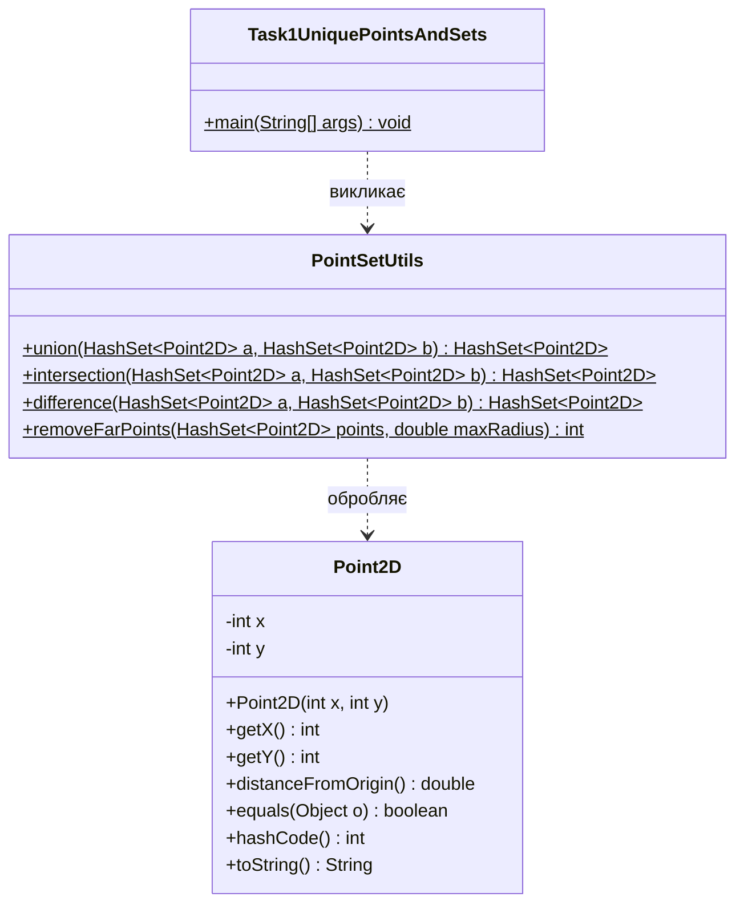
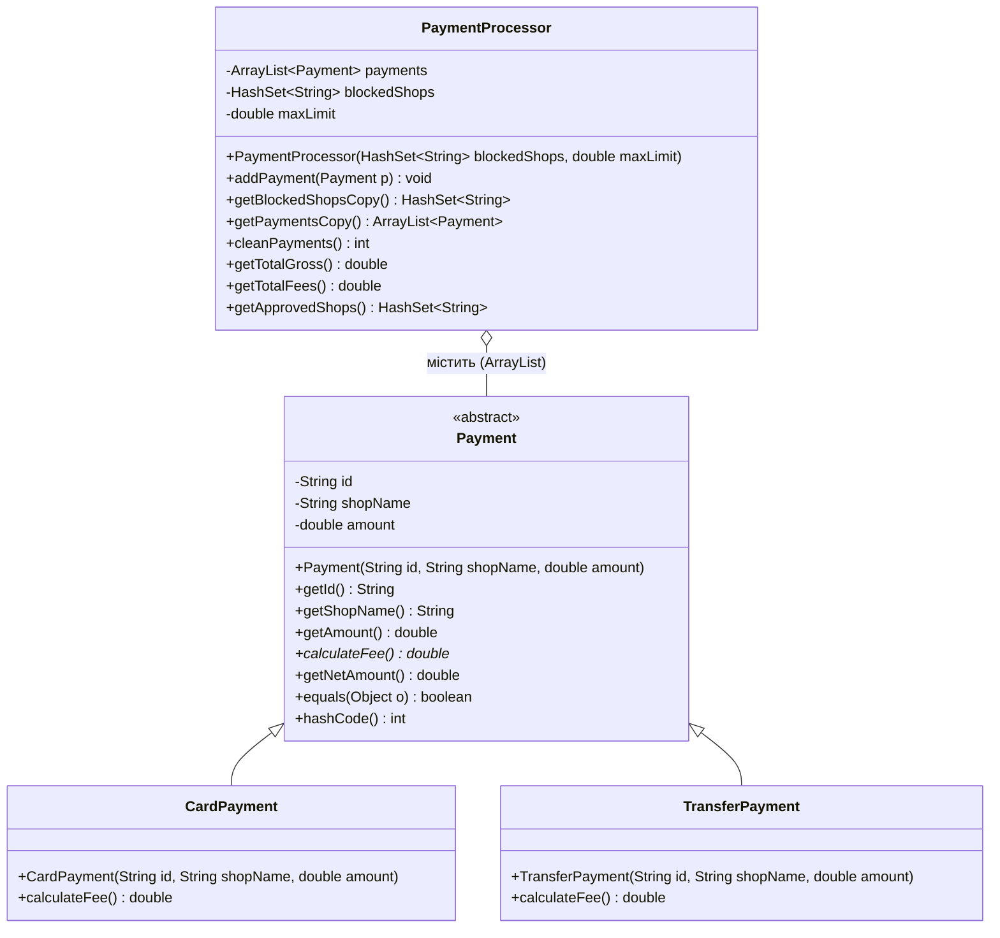
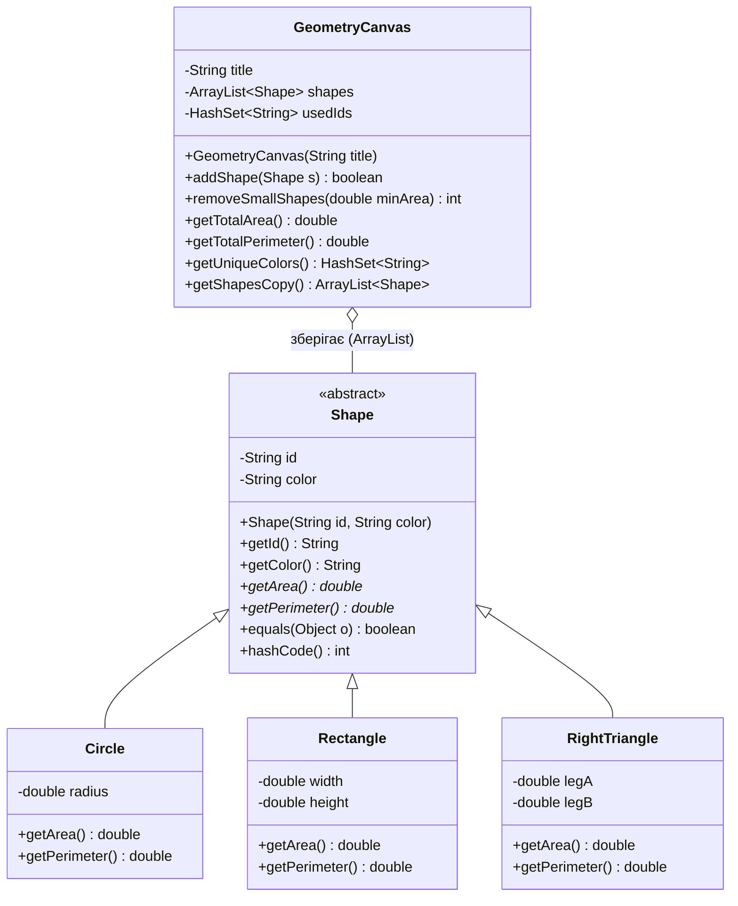
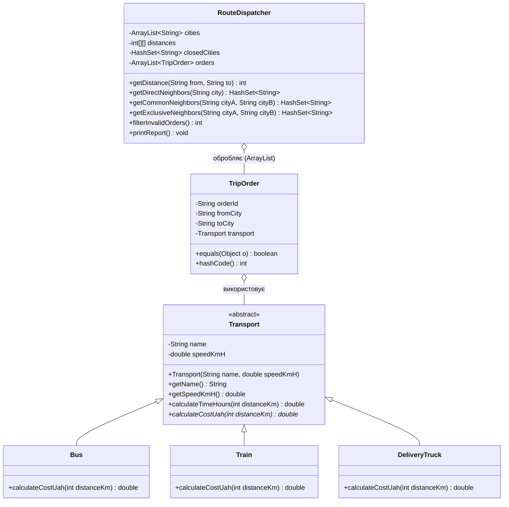
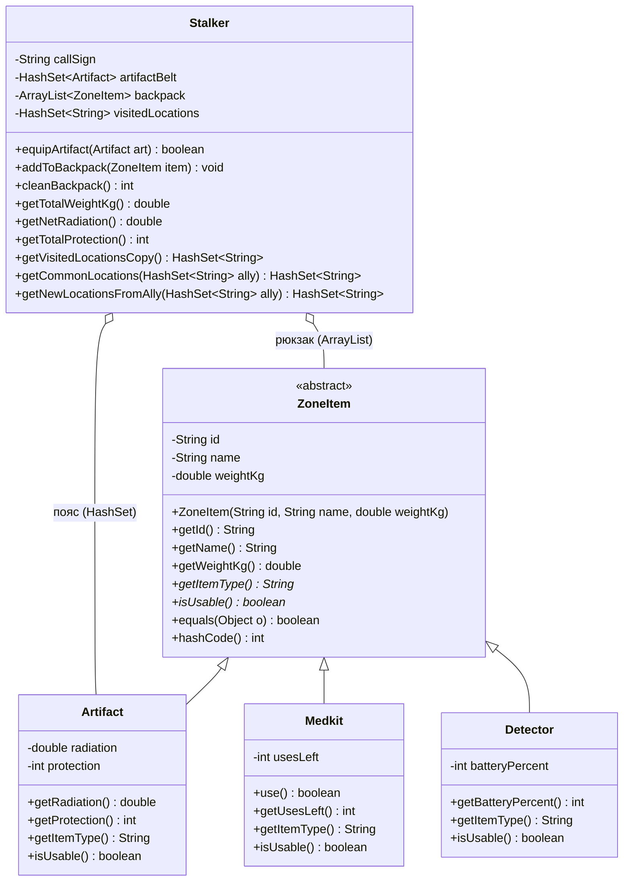

# Домашнє завдання до Практичної роботи №12
## Тема: Списки — 2-га частина (`ArrayList`, `HashSet`, `Iterator` та Повторення ООП)

---

## 📌 Загальна інформація та правила виконання

### 🎯 Мета завдання
Закріпити на практичних задачах роботу зі списком **`ArrayList`**, множиною **`HashSet`** та ітератором **`Iterator`** у поєднанні з фундаментальними принципами ООП:
- **`ArrayList` та `HashSet`:** перетворення списку у множину для видалення дублікатів, швидкий пошук `contains()`, коректна реалізація **`equals()` та `hashCode()`** для власних класів.
- **Операції над множинами:** безпечне (через копію `new HashSet<>(a)`) обчислення об'єднання ($A \cup B$), перетину ($A \cap B$) та різниці ($A \setminus B$).
- **`Iterator`:** безпечний обхід і видалення елементів з `ArrayList` та `HashSet` за допомогою `it.remove()` без `ConcurrentModificationException`.
- **Повторення ООП:** базова **інкапсуляція** (`private` поля, валідація, захисне копіювання `ArrayList`/`HashSet`), **композиція (`HAS-A`)** та **поліморфізм** (спільний базовий клас + різні підкласи в одному `ArrayList`).

---

### ⏰ Дедлайн та обов'язкова здача через GitHub-репозиторій

> [!IMPORTANT]
> - **Спосіб здачі:** Робота здається **виключно через ваш GitHub-репозиторій** (`git add`, `git commit`, `git push`).
> - **Кінцевий термін (Дедлайн):** **до початку наступної пари**.
> - Переконайтеся, що всі файли обраних завдань закомічені, запушені на GitHub та компілюються без жодної помилки (`mvn clean test-compile`).

#### Покроковий алгоритм відправки ДЗ на GitHub:
1. Реалізуйте обрані завдання у пакеті `semester1.practice11.homework` (або `semester1.practice11`).
2. Запустіть метод `main` кожного виконаного завдання і перевірте коректність виведення у консоль.
3. Відкрийте термінал в IntelliJ IDEA (`Alt + F12` / `Option + F12`) та виконайте команди:
   ```bash
   git status
   git add src/main/java/semester1/practice11/
   git commit -m "feat(hw11): implement ArrayList, HashSet, Iterator and OOP homework"
   git push origin main
   ```
4. Перевірте у браузері на GitHub, що ваші файли з'явилися у репозиторії **до початку наступної пари**.

---

### ⚖️ Правила оцінювання та вибору завдань

1. **Максимальна оцінка за домашню роботу — 5 балів.**
2. **Обов'язковий мінімум:** виконати **хоча б 1 завдання** на власний вибір та завантажити його у свій GitHub-репозиторій до початку наступної пари.
3. **Гнучке сумування балів:**
   - Кожне завдання має свою фіксовану «вартість» у балах (від 2 до 5).
   - Якщо ви розв'язуєте декілька завдань, **бали сумуються** (максимальна підсумкова оцінка в журнал — **5 балів**; додаткові завдання слугують «подушкою безпеки» на випадок дрібних недоліків).
4. **Варіанти стратегій виконання:**
   - 🥉 **Базовий рівень (оцінка 2–3):** тільки **Завдання 1** (2 бали) або тільки **Завдання 2** (3 бали).
   - 🥈 **Рівень «Добре» (оцінка 4):** тільки **Завдання 3** (4 бали).
   - 🥇 **Рівень «Відмінно» (оцінка 5):**
     - *Шлях 1:* розв'язати **Завдання 4** (5 балів, Матриця доріг і маршрути) **АБО** творче **Завдання 5** (5 балів, S.T.A.L.K.E.R. 2: Спорядження сталкера).
     - *Шлях 2 (Комбінація легших):* **Завдання 1 + Завдання 2** ($2 + 3 = 5$ балів).
     - *Шлях 3 (Із запасом):* **Завдання 1 + Завдання 3** ($2 + 4 = 6 \to 5$ балів) або **Завдання 2 + Завдання 3** ($3 + 4 = 7 \to 5$ балів).

---

### 📂 Організація класів та пакетів

- **Пакет:** розміщуйте класи у пакеті `semester1.practice11.homework` (або `semester1.practice11`).
- **Окремий клас запуску для кожного завдання:** створіть `.java` файл із закріпленою назвою з таблиці нижче та власним методом `public static void main(String[] args)`. Допоміжні класи можна розміщувати в тому самому файлі (без модифікатора `public`) або в окремих `.java` файлах у тому самому пакеті.

**Закріплені назви класів для завдань:**
| Завдання | Вартість | Назва класу | Напрямок | Короткий зміст |
|:---:|:---:|:---|:---|:---|
| **Завдання 1** | **2 бали** | `Task1UniquePointsAndSets` | 📐 Геометрія та Множини | `Point2D` (`equals`/`hashCode`), `ArrayList` $\to$ `HashSet`, об'єднання/перетин/різниця та фільтрація через `Iterator` |
| **Завдання 2** | **3 бали** | `Task2PaymentFilterAndAudit` | 💼 Фінансовий кейс | Поліморфні платежі (`Payment`), чорний список у `HashSet`, очищення `ArrayList` через `Iterator.remove()`, захисна копія |
| **Завдання 3** | **4 бали** | `Task3GeometryCanvasAndStats` | 📐 Геометрія та ООП | `GeometryCanvas` (композиція): поліморфний `ArrayList<Shape>`, унікальні ID у `HashSet`, фільтр через `Iterator` та порівняння кольорів |
| **Завдання 4** | **5 балів** | `Task4MatrixAndCityNetwork` | 📐 Матриця доріг і Логістика | 2D-масив `int[][]` відстаней, `HashSet` сусідів міст ($A \cap B$, $A \setminus B$), поліморфний `Transport`, фільтрація замовлень через `Iterator` |
| **Завдання 5** | **5 балів** | `Task5StalkerInventorySim` | 🎮 **Творче (S.T.A.L.K.E.R. 2)** | Пояс артефактів (`HashSet`), поліморфний рюкзак (`ArrayList<ZoneItem>`), очищення через `Iterator`, синхронізація КПК (`HashSet`) |

---

## 🧠 5 домашніх завдань на вибір (4 технічно-математичні + 1 творче)

---

### Рівень 1: Базовий (2 бали) — Геометрія та Теорія множин
#### 📝 Завдання 1: Геодезичний радар: Унікальні точки `Point2D`, Операції над `HashSet` та Фільтрація через `Iterator`

- **Клас для виконання:** `Task1UniquePointsAndSets` (файл `Task1UniquePointsAndSets.java`)
- **Рекомендований пакет:** `semester1.practice11.homework` (або `semester1.practice11`)
- **Бали за завдання:** **2 бали**
- **Ключові теми:** `ArrayList`, `HashSet`, інкапсуляція, методи `equals()` та `hashCode()`, неруйнівні операції над множинами ($A \cup B$, $A \cap B$, $A \setminus B$), безпечне видалення через `Iterator.remove()`.

**Контекст:** Два радари **Сенсор A** та **Сенсор B** передають списки координат виявлених точок `ArrayList<Point2D>`. Через відбиття сигналу в обох списках є дублікати. Потрібно прибрати повтори за допомогою `HashSet`, порівняти зони покриття двох радарів (знайти всі точки, спільні точки та точки лише першого радара) і видалити через `Iterator` усі хибні цілі, які знаходяться далі за максимальний радіус дії $R_{\max} = 7.0$.



**Що необхідно зробити:**
1. **Створіть клас `Point2D`:**
   - Приватні поля: `private final int x;` та `private final int y;`.
   - Конструктор та геттери `getX()`, `getY()`.
   - Метод `public double distanceFromOrigin()` повертає відстань від початку координат: $\sqrt{x^2 + y^2}$.
   - Обов'язково перевизначте **`equals(Object o)`** та **`hashCode()`** (`Objects.hash(x, y)`), щоб однакові точки не дублювалися у `HashSet`.
   - Метод `toString()` повертає рядок у форматі `"(x; y)"`.
2. **Створіть клас `PointSetUtils` зі статичними методами:**
   - `union(HashSet<Point2D> a, HashSet<Point2D> b)` — повертає новий `HashSet<Point2D>` ($A \cup B$), не змінюючи `a` і `b`;
   - `intersection(HashSet<Point2D> a, HashSet<Point2D> b)` — повертає новий `HashSet<Point2D>` ($A \cap B$);
   - `difference(HashSet<Point2D> a, HashSet<Point2D> b)` — повертає новий `HashSet<Point2D>` ($A \setminus B$);
   - `removeFarPoints(HashSet<Point2D> points, double maxRadius)` — обходить `points` через **`Iterator<Point2D>`** та видаляє через **`it.remove()`** усі точки, де `distanceFromOrigin() > maxRadius`. Повертає кількість видалених точок.
3. **У методі `main` протестуйте на контрольних даних:**
   - Сирий `ArrayList<Point2D>` Сенсора A: `(0;0), (3;4), (1;2), (3;4), (6;8), (5;0), (1;2)` (7 записів).
   - Сирий `ArrayList<Point2D>` Сенсора B: `(3;4), (5;0), (2;2), (8;6), (2;2), (0;10)` (6 записів).
   - Перетворіть обидва списки на `HashSet<Point2D> setA` та `setB`, виведіть результати всіх трьох операцій над множинами, а потім очистіть об'єднану множину радіусом `maxRadius = 7.0`.

> [!NOTE]
> Оскільки `HashSet` не гарантує порядок виведення елементів, порядок точок у квадратних дужках `[...]` у вашій консолі може відрізнятися — головне, щоб збігалися **кількість** і **склад** точок!

**Очікуваний результат у консолі:**
```text
================ 📡 ГЕОДЕЗИЧНИЙ РАДАР: HASHSET ТА ITERATOR 📡 ================
Сенсор A: отримано 7 точок -> унікальних (HashSet): 5 [(0; 0), (3; 4), (1; 2), (6; 8), (5; 0)]
Сенсор B: отримано 6 точок -> унікальних (HashSet): 5 [(3; 4), (5; 0), (2; 2), (8; 6), (0; 10)]

--- Операції над множинами (HashSet) ---
Об'єднання (A U B) [8]:  [(0; 0), (3; 4), (1; 2), (6; 8), (5; 0), (2; 2), (8; 6), (0; 10)]
Перетин (A ∩ B) [2]:     [(3; 4), (5; 0)]
Різниця (A \ B) [3]:     [(0; 0), (1; 2), (6; 8)]

--- Фільтрація через Iterator (R_max = 7.0) ---
Видалено точок поза радіусом: 3
Залишилось у зоні [5]:   [(0; 0), (1; 2), (2; 2), (3; 4), (5; 0)]
==============================================================================
```

---

### Рівень 2: Середній (3 бали) — Фінансовий кейс
#### 📝 Завдання 2: Платіжний фільтр банку: Поліморфні платежі (`ArrayList`), Чорний список (`HashSet`) та Очищення через `Iterator`

- **Клас для виконання:** `Task2PaymentFilterAndAudit` (файл `Task2PaymentFilterAndAudit.java`)
- **Рекомендований пакет:** `semester1.practice11.homework` (або `semester1.practice11`)
- **Бали за завдання:** **3 бали**
- **Ключові теми:** поліморфізм (`abstract class Payment` + 2 підкласи), композиція (`PaymentProcessor`), інкапсуляція та захисне копіювання `HashSet`, дедуплікація та фільтрація `ArrayList` за один прохід через `Iterator.remove()`.

**Контекст:** У банківську систему надходить список платежів `ArrayList<Payment>` різних типів — оплати карткою та банківські перекази. Клас **`PaymentProcessor`** повинен за один безпечний прохід ітератором очистити список від:
1. Повторно надісланих дублікатів із однаковим `id` (перевіряємо через допоміжний `HashSet<String> seenIds`);
2. Платежів у магазини з чорного списку `HashSet<String> blockedShops`;
3. Платежів, чия сума перевищує дозволений ліміт `maxLimit` (`20000.0` грн).

Після очищення система поліморфно підраховує суму платежів, загальну комісію, чисту суму (нетто) та список унікальних схвалених магазинів у `HashSet<String>`.



**Що необхідно зробити:**
1. **Створіть `abstract class Payment`:**
   - Приватні поля: `private final String id`, `private final String shopName`, `private final double amount` (перевірка в конструкторі: якщо `amount <= 0`, киньте `IllegalArgumentException`).
   - Перевизначте `equals()` і `hashCode()` **тільки за полем `id`**.
   - Абстрактний метод `public abstract double calculateFee();`.
   - Звичайний метод `public double getNetAmount()`, який повертає `amount - calculateFee()`.
2. **Створіть 2 підкласи:**
   - `CardPayment extends Payment` — комісія $1.5\%$ (`getAmount() * 0.015`).
   - `TransferPayment extends Payment` — комісія $2.0\% + 20.0\text{ грн}$ (`getAmount() * 0.02 + 20.0`).
3. **Створіть клас `PaymentProcessor` (Композиція + Інкапсуляція):**
   - Поля: `private ArrayList<Payment> payments = new ArrayList<>();`, `private HashSet<String> blockedShops;` (у конструкторі обов'язково зробіть захисну копію `new HashSet<>(blockedShops)`!), `private double maxLimit;`.
   - Геттери `getBlockedShopsCopy()` та `getPaymentsCopy()` повертають **захисні копії** (`new HashSet<>(...)`, `new ArrayList<>(...)`).
   - Метод `cleanPayments()` обходить `payments` через **`Iterator<Payment>`**:
     - створює локальний `HashSet<String> seenIds = new HashSet<>();`;
     - якщо `!seenIds.add(p.getId())` $\to$ виводить повідомлення про дублікат і викликає `it.remove()`;
     - інакше якщо `blockedShops.contains(p.getShopName())` $\to$ виводить повідомлення про чорний список і викликає `it.remove()`;
     - інакше якщо `p.getAmount() > maxLimit` $\to$ виводить повідомлення про перевищення ліміту і викликає `it.remove()`;
     - повертає кількість видалених платежів.
   - Методи `getTotalGross()`, `getTotalFees()`, `getApprovedShops()` (повертає `HashSet<String>` унікальних назв магазинів серед платежів, що залишилися).
4. **У `main` протестуйте на контрольному наборі** (`blockedShops = {"ScamShop", "FakeStore"}`, `maxLimit = 20000.0`, 7 платежів із прикладу нижче).

**Очікуваний результат у консолі:**
```text
================ 🛡️ БАНКІВСЬКИЙ ПЛАТІЖНИЙ ФІЛЬТР 🛡️ ================
Чорний список магазинів [2]: [ScamShop, FakeStore]
Ліміт одного платежу: 20000.00 грн | Вхідних платежів: 7

--- Очищення черги через Iterator.remove() ---
  ❌ [ДУБЛІКАТ]      P-01 | Rozetka (4000.00 грн) — видалено!
  ❌ [ЧОРНИЙ СПИСОК] P-03 | ScamShop (5000.00 грн) — видалено!
  ❌ [ПОНАД ЛІМІТ]   P-04 | LuxWatch (25000.00 грн) — видалено!

--- Схвалені платежі (залишилось 4) ---
  ✅ P-01 | Rozetka | Сума:  4000.00 | Комісія:  60.00 | Нетто:  3940.00 грн
  ✅ P-02 | Comfy   | Сума: 10000.00 | Комісія: 220.00 | Нетто:  9780.00 грн
  ✅ P-05 | Rozetka | Сума:  2000.00 | Комісія:  30.00 | Нетто:  1970.00 грн
  ✅ P-06 | Allo    | Сума:  5000.00 | Комісія: 120.00 | Нетто:  4880.00 грн

--- Фінансовий підсумок ---
Видалено платежів: 3 | Схвалено: 4
Загальна сума (брутто): 21000.00 грн
Загальна комісія:       430.00 грн
Чиста сума (нетто):     20570.00 грн
Унікальні магазини [3]: [Rozetka, Comfy, Allo]
====================================================================
```

---

### Рівень 3: Поглиблений (4 бали) — Геометрія, Композиція та Поліморфізм
#### 📝 Завдання 3: Геометричне полотно (`GeometryCanvas`): Поліморфні фігури в `ArrayList`, Контроль ID у `HashSet`, Фільтрація через `Iterator` та Порівняння палітр

- **Клас для виконання:** `Task3GeometryCanvasAndStats` (файл `Task3GeometryCanvasAndStats.java`)
- **Рекомендований пакет:** `semester1.practice11.homework` (або `semester1.practice11`)
- **Бали за завдання:** **4 бали**
- **Ключові теми:** поліморфізм (`abstract class Shape` + 3 підкласи), композиція (`GeometryCanvas` об'єднує `ArrayList<Shape>` та `HashSet<String>`), інкапсуляція та захисне копіювання, безпечне видалення через `Iterator.remove()`, операції над множинами (`HashSet`) для порівняння кольорів двох полотен.

**Контекст:** У графічному редакторі полотно **`GeometryCanvas`** містить набір різних геометричних фігур (кола, прямокутники, прямокутні трикутники). Кожна фігура має унікальний код `id` (контролюється через `HashSet<String>`) і колір. Користувач може видалити з полотна всі «дрібні» фігури з площею меншою за поріг `minArea`, підрахувати сумарну площу й периметр, а також порівняти набір унікальних кольорів свого полотна з іншим полотном.



**Що необхідно зробити:**
1. **Створіть `abstract class Shape`:**
   - Приватні поля: `private final String id`, `private final String color`.
   - `equals()` і `hashCode()` за полем `id`.
   - Абстрактні методи `public abstract double getArea();` та `public abstract double getPerimeter();`.
2. **Створіть 3 підкласи з перевіркою додатних розмірів у конструкторі (`> 0`):**
   - `Circle` (`radius`): $S = \pi r^2$, $P = 2 \pi r$.
   - `Rectangle` (`width`, `height`): $S = w \cdot h$, $P = 2(w + h)$.
   - `RightTriangle` (прямокутний трикутник із катетами `legA`, `legB`): $S = \frac{a \cdot b}{2}$, $P = a + b + \sqrt{a^2 + b^2}$.
3. **Створіть клас `GeometryCanvas` (Композиція + Інкапсуляція):**
   - Зберігає `private String title`, `private ArrayList<Shape> shapes = new ArrayList<>();` та `private HashSet<String> usedIds = new HashSet<>();`.
   - `addShape(Shape s)`: якщо `s == null` або `!usedIds.add(s.getId())` — повертає `false` (дублікат ID відхилено!), інакше додає фігуру в `shapes` і повертає `true`.
   - `removeSmallShapes(double minArea)`: обходить `shapes` через **`Iterator<Shape>`**; якщо `s.getArea() < minArea` — видаляє фігуру через **`it.remove()`**, а також видаляє її `id` з `usedIds`! Повертає кількість видалених фігур.
   - `getTotalArea()` та `getTotalPerimeter()` — поліморфно підсумовують площі й периметри всіх фігур.
   - `getUniqueColors()` — збирає й повертає новий `HashSet<String>` усіх унікальних кольорів фігур на полотні.
   - `getShapesCopy()` — повертає захисну копію `new ArrayList<>(shapes)`.
4. **У `main` протестуйте:**
   - Додайте на `canvas1` ("Головне полотно") 6 фігур: `Circle("C-1", "Red", 3.0)`, дублікат `Circle("C-1", "Blue", 5.0)`, `Rectangle("R-1", "Blue", 4.0, 5.0)`, `Rectangle("R-2", "Green", 2.0, 3.0)`, `RightTriangle("T-1", "Red", 3.0, 4.0)`, `RightTriangle("T-2", "Yellow", 6.0, 8.0)`.
   - Виведіть статистику до очищення, потім викличте `removeSmallShapes(10.0)` і виведіть оновлену статистику.
   - Створіть палітру другого полотна `HashSet<String> palette2 = {"Blue", "Yellow", "Purple"}` і знайдіть спільні кольори ($C_1 \cap C_2$), унікальні кольори першого полотна ($C_1 \setminus C_2$) та всі кольори разом ($C_1 \cup C_2$).

**Очікуваний результат у консолі:**
```text
================ 📐 ГЕОМЕТРИЧНЕ ПОЛОТНО: ООП + КОЛЕКЦІЇ 📐 ================
Додавання фігур на 'Головне полотно':
  ✅ Додано: Circle[C-1, Red, r=3.0]
  ⚠️ Відхилено (дублікат ID): C-1
  ✅ Додано: Rectangle[R-1, Blue, 4.0x5.0]
  ✅ Додано: Rectangle[R-2, Green, 2.0x3.0]
  ✅ Додано: RightTriangle[T-1, Red, 3.0x4.0]
  ✅ Додано: RightTriangle[T-2, Yellow, 6.0x8.0]

[ДО ОЧИЩЕННЯ]
  Фігур на полотні: 5 | Сумарна площа: 84.27 | Сумарний периметр: 82.85
  Унікальні кольори [4]: [Red, Blue, Green, Yellow]

>>> Видалення фігур із площею < 10.0 через Iterator.remove()...
  🗑️ Видалено: R-2 (площа 6.00)
  🗑️ Видалено: T-1 (площа 6.00)

[ПІСЛЯ ОЧИЩЕННЯ]
  Фігур на полотні: 3 | Сумарна площа: 72.27 | Сумарний периметр: 60.85
  Унікальні кольори [3]: [Red, Blue, Yellow]

--- Порівняння палітр (HashSet) ---
  Палітра полотна 2 [3]:       [Blue, Yellow, Purple]
  Спільні кольори (C1 ∩ C2):   [Blue, Yellow]
  Тільки на полотні 1 (C1 \ C2): [Red]
  Усі кольори разом (C1 U C2): [Red, Blue, Yellow, Purple]
============================================================================
```

---

### Рівень 4: Високий (5 балів) — Матриця доріг (2D-масив), Множини сусідів та Логістика
#### 📝 Завдання 4: Логістичний диспетчер: Матриця відстаней (`int[][]`), Сусіди міст у `HashSet`, Поліморфний транспорт та Фільтрація рейсів через `Iterator`

- **Клас для виконання:** `Task4MatrixAndCityNetwork` (файл `Task4MatrixAndCityNetwork.java`)
- **Рекомендований пакет:** `semester1.practice11.homework` (або `semester1.practice11`)
- **Бали за завдання:** **5 балів**
- **Ключові теми:** повторення 2D-масивів (`int[][]`), `ArrayList`, `HashSet` (сусіди міст, $A \cap B$, $A \setminus B$, закриті міста, дедуплікація ID), `Iterator.remove()`, інкапсуляція, композиція (`TripOrder`, `RouteDispatcher`) та поліморфізм (`abstract class Transport` + 3 підкласи).

**Контекст:** Логістична компанія керує мережею доріг між містами, заданою **матрицею відстаней `int[][] distances`** (якщо `distances[i][j] > 0` — між містами є пряма дорога такої довжини в км; якщо `0` — прямої дороги немає).
Диспетчер **`RouteDispatcher`** уміє:
1. За 2D-матрицею знаходити множину прямих сусідів будь-якого міста (`HashSet<String>`), а також порівнювати зв'язки двох міст (спільні сусіди $A \cap B$ та унікальні сусіди $A \setminus B$).
2. Приймати список заявок `ArrayList<TripOrder>`, де кожна заявка містить конкретний **поліморфний `Transport`** (`Bus`, `Train`, `DeliveryTruck`).
3. За допомогою **`Iterator<TripOrder>`** відсіювати неможливі заявки (дублікати ID, закриті на ремонт міста з `HashSet<String> closedCities` або відсутність прямої дороги в матриці) та поліморфно розраховувати час і вартість усіх валідних рейсів!



**Що необхідно зробити:**
1. **Створіть `abstract class Transport` та 3 підкласи:**
   - Базовий клас: `private final String name`, `private final double speedKmH`; метод `calculateTimeHours(int distanceKm)` повертає `distanceKm / speedKmH`; абстрактний метод `public abstract double calculateCostUah(int distanceKm);`.
   - `Bus` (швидкість `80.0` км/год): вартість = `distanceKm * 2.5`.
   - `Train` (швидкість `100.0` км/год): вартість = `distanceKm * 1.8 + 150.0`.
   - `DeliveryTruck` (швидкість `70.0` км/год): вартість = `distanceKm * 4.0 + 300.0`.
2. **Створіть клас `TripOrder` (Композиція):**
   - Поля: `private final String orderId`, `private final String fromCity`, `private final String toCity`, `private final Transport transport`.
   - `equals()` і `hashCode()` за полем `orderId`.
3. **Створіть клас `RouteDispatcher` (Інкапсуляція + Композиція):**
   - У конструкторі приймає `ArrayList<String> cities`, `int[][] distances` та `HashSet<String> closedCities` (робіть захисні копії колекцій!).
   - `getDistance(String from, String to)`: знаходить індекси міст через `cities.indexOf(...)`; якщо обидва знайдені — повертає `distances[i][j]`, інакше `0`.
   - `getDirectNeighbors(String city)`: проходить рядок матриці `distances[idx]` і повертає `HashSet<String>` усіх міст, до яких відстань `> 0`.
   - `getCommonNeighbors(String cityA, String cityB)` ($N(A) \cap N(B)$) та `getExclusiveNeighbors(String cityA, String cityB)` ($N(A) \setminus N(B)$).
   - `filterInvalidOrders()`: проходить `orders` через **`Iterator<TripOrder>`** і видаляє через **`it.remove()`**, якщо:
     1. дублікат `orderId` (контроль через `HashSet<String> seenIds`);
     2. місто відправлення або прибуття є в `closedCities`;
     3. `getDistance(from, to) <= 0` (немає прямої дороги).
4. **У `main` протестуйте на матриці $4 \times 4$ для міст `["Київ", "Львів", "Одеса", "Дніпро"]`:**
   ```java
   int[][] distances = {
       {  0, 540, 480, 450}, // Київ
       {540,   0, 790,   0}, // Львів
       {480, 790,   0, 460}, // Одеса
       {450,   0, 460,   0}  // Дніпро
   };
   ```
   - Закриті міста: `{"Одеса"}`.
   - Додайте 5 заявок: `ORD-1` (Київ $\to$ Львів, `Train`), дублікат `ORD-1` (Київ $\to$ Львів, `Bus`), `ORD-2` (Київ $\to$ Одеса, `Bus`), `ORD-3` (Львів $\to$ Дніпро, `DeliveryTruck`), `ORD-4` (Київ $\to$ Дніпро, `DeliveryTruck`).

**Очікуваний результат у консолі:**
```text
================ 🚚 ЛОГІСТИЧНИЙ ДИСПЕТЧЕР: МАТРИЦЯ ТА МЕРЕЖА 🚚 ================
--- 1. Аналіз мережі доріг (2D-масив -> HashSet) ---
  Прямі сусіди міста Київ [3]:   [Львів, Одеса, Дніпро]
  Прямі сусіди міста Львів [2]:  [Київ, Одеса]
  Спільні сусіди Київ ∩ Львів:   [Одеса]
  Тільки з Києва (Київ \ Львів): [Львів, Дніпро]

--- 2. Фільтрація заявок через Iterator.remove() (Закриті міста: [Одеса]) ---
  ❌ [ДУБЛІКАТ]       ORD-1 (Київ -> Львів) — видалено!
  ❌ [МІСТО ЗАКРИТЕ]  ORD-2 (Київ -> Одеса) — видалено!
  ❌ [НЕМАЄ ДОРОГИ]   ORD-3 (Львів -> Дніпро) — видалено!

--- 3. Схвалені рейси (залишилось 2) ---
  ✅ ORD-1 | Київ -> Львів  | 540 км | Train         | Час: 5.40 год | Вартість: 1122.00 грн
  ✅ ORD-4 | Київ -> Дніпро | 450 км | DeliveryTruck | Час: 6.43 год | Вартість: 2100.00 грн

--- Підсумок ---
Видалено заявок: 3 | Схвалено: 2
Загальна відстань: 990 км | Загальна вартість перевезень: 3222.00 грн
=================================================================================
```

---

### Рівень 5: Творчий (5 балів) — Ігровий симулятор 🎮
#### 🎮 Завдання 5: S.T.A.L.K.E.R. 2: Зона Відчуження — Пояс Унікальних Артефактів (`HashSet`), Поліморфний Рюкзак (`ArrayList`) та Ревізія через `Iterator`

- **Клас для виконання:** `Task5StalkerInventorySim` (файл `Task5StalkerInventorySim.java`)
- **Рекомендований пакет:** `semester1.practice11.homework` (або `semester1.practice11`)
- **Бали за завдання:** **5 балів**
- **Ключові теми:** `HashSet` (унікальний пояс артефактів із `equals`/`hashCode` + карта досліджених локацій КПК), `ArrayList` (поліморфний рюкзак `ArrayList<ZoneItem>`), `Iterator.remove()` для викидання непридатного спорядження, інкапсуляція (захисне копіювання), композиція (`Stalker`) та поліморфізм (`abstract class ZoneItem` + 3 підкласи).

> [!TIP]
> **Повна творча свобода сетингу!**
> Ви можете залишити всесвіт **S.T.A.L.K.E.R. 2** або замінити його на будь-яку улюблену гру чи аніме (**Minecraft** — унікальні зачарування та інвентар, **Dota 2** — слоти унікальних аур і рюкзак, **Відьмак 3** — набір еліксирів і трофеїв, **Cyberpunk 2077** — імпланти та спорядження), зберігши структуру класів, `HashSet`, `ArrayList`, `Iterator` та принципи ООП!

**Контекст:** Сталкер із позивним **«Скіф»** готується до походу вглиб Зони. Його спорядження складається з трьох частин:
1. **Пояс артефактів (`HashSet<Artifact>`):** вміщує максимум **4** артефакти, причому два однакові артефакти на пояс не вішаються (унікальність контролюється через `equals()`/`hashCode()` за `id`!). Кожен артефакт дає захист від аномалій і змінює радіаційний фон (наприклад, «Медуза» поглинає `-2.0 мЗв/хв`, а «Душа» фонить `+3.5 мЗв/хв`).
2. **Рюкзак (`ArrayList<ZoneItem>`):** поліморфний список предметів — аптечки (`Medkit`), детектори (`Detector`) тощо. У базового класу `ZoneItem` є поліморфний метод `boolean isUsable()`: для порожньої аптечки (`usesLeft == 0`) або розрядженого детектора (`batteryPercent == 0`) він повертає `false`. Метод **`cleanBackpack()`** за допомогою **`Iterator<ZoneItem>`** автоматично викидає з рюкзака все непридатне спорядження!
3. **КПК Сталкера (`HashSet<String> visitedLocations`):** зберігає відвідані локації Зони. При зустрічі з союзником Скіф синхронізує КПК: знаходить спільні сектори ($A \cap B$) і нові недосліджені точки союзника ($B \setminus A$).



**Що необхідно зробити:**
1. **Створіть `abstract class ZoneItem`:**
   - Приватні поля `id`, `name`, `weightKg` (валідація `weightKg > 0`).
   - `equals()` і `hashCode()` за полем `id`.
   - Абстрактні методи `public abstract String getItemType();` та `public abstract boolean isUsable();`.
2. **Створіть 3 підкласи:**
   - `Artifact`: має `double radiation`, `int protection`; `isUsable()` завжди повертає `true`.
   - `Medkit`: має `int usesLeft`, метод `boolean use()` (зменшує `usesLeft` на 1, якщо `> 0`); `isUsable()` повертає `usesLeft > 0`.
   - `Detector`: має `int batteryPercent` (`0..100`); `isUsable()` повертає `batteryPercent > 0`.
3. **Створіть клас `Stalker` (Інкапсуляція + Композиція):**
   - `equipArtifact(Artifact art)`: перевіряє, що `artifactBelt.size() < 4`, і додає артефакт у `HashSet<Artifact>` (повертає `false`, якщо пояс заповнений або такий артефакт уже є!).
   - `cleanBackpack()`: проходить `backpack` за допомогою **`Iterator<ZoneItem>`** і видаляє через **`it.remove()`** усі предмети, для яких `!item.isUsable()`. Повертає кількість видалених предметів.
   - `getTotalWeightKg()`: сума ваги всіх артефактів на поясі та всіх предметів у рюкзаку.
   - `getNetRadiation()` та `getTotalProtection()`: сумарна радіація та сумарний захист артефактів на поясі.
   - Методи КПК: `getVisitedLocationsCopy()` (захисна копія!), `getCommonLocations(HashSet<String> ally)` ($A \cap B$) та `getNewLocationsFromAlly(HashSet<String> ally)` ($B \setminus A$), не змінюючи власну множину `visitedLocations`.
4. **У `main` проведіть демонстрацію:**
   - Пояс: спробуйте надіти `"Медуза"` (`ART-1`, 0.4 кг, -2.0, +15%), `"Душа"` (`ART-2`, 0.5 кг, +3.5, +25%), дублікат `"Медуза"` (`ART-1`), `"Компас"` (`ART-3`, 0.6 кг, +2.5, +40%).
   - Рюкзак: `"Звичайна аптечка"` (0.3 кг, 1 заряд $\to$ використайте `use()` перед ревізією!), `"Армійська аптечка"` (0.4 кг, 2 заряди), `"Детектор Відгук"` (0.5 кг, 0%), `"Детектор Велес"` (0.7 кг, 85%). Запустіть `cleanBackpack()`.
   - КПК: локації Скіфа `{"Залісся", "Кордон", "Звалище", "Янтар"}` та союзника `{"Залісся", "Янтар", "Росток", "Прип'ять"}`.

**Очікуваний результат у консолі:**
```text
================ ☢️ S.T.A.L.K.E.R. 2: СПОРЯДЖЕННЯ СТАЛКЕРА ☢️ ================
Сталкер: Скіф | Максимум слотів на поясі: 4

--- 1. Пояс артефактів (HashSet) ---
  ✅ Надіто: Медуза [0.4 кг | Радіація: -2.0 мЗв/хв | Захист: +15%]
  ✅ Надіто: Душа   [0.5 кг | Радіація: +3.5 мЗв/хв | Захист: +25%]
  ⚠️ Відхилено (дублікат!): Медуза (ART-1) вже є на поясі!
  ✅ Надіто: Компас [0.6 кг | Радіація: +2.5 мЗв/хв | Захист: +40%]

--- 2. Ревізія рюкзака через Iterator.remove() ---
  🗑️ Викинуто [Аптечка]:  Звичайна аптечка (непридатна: 0 зарядів)
  🗑️ Викинуто [Детектор]: Детектор Відгук (непридатний: батарея 0%)
  Підсумок ревізії: видалено 2 предмети, у рюкзаку залишилось 2.

--- 3. Загальний стан сталкера ---
  • Пояс: 3 артефакти | Сумарний захист: 80% | Радіація: +4.00 мЗв/хв
  • Рюкзак: Армійська аптечка (2 заряди), Детектор Велес (85%)
  • Загальна вага спорядження: 2.60 кг

--- 4. Синхронізація КПК (HashSet) ---
  Локації Скіфа [4]:          [Залісся, Кордон, Звалище, Янтар]
  Локації союзника [4]:       [Залісся, Янтар, Росток, Прип'ять]
  Спільні локації (A ∩ B):    [Залісся, Янтар]
  Нові цілі розвідки (B \ A): [Росток, Прип'ять]
==============================================================================
```

---

## 📊 Інструкція для викладача: Методика оцінювання

### 1. Зведена таблиця балів та охоплення компетенцій

| Завдання | Клас для перевірки | Макс. бал | Напрям | Які компетенції теми №11 перевіряються |
|:---|:---|:---:|:---|:---|
| **Завдання 1** | `Task1UniquePointsAndSets` | **2** | 📐 Геометрія | `ArrayList` $\to$ `HashSet`, `equals`/`hashCode`, $A \cup B, A \cap B, A \setminus B$, `Iterator.remove()` |
| **Завдання 2** | `Task2PaymentFilterAndAudit` | **3** | 💼 Фінанси | Поліморфізм (`Payment`), композиція, захисна копія `HashSet`/`ArrayList`, фільтрація `Iterator.remove()` |
| **Завдання 3** | `Task3GeometryCanvasAndStats` | **4** | 📐 Геометрія / ООП | `GeometryCanvas` (композиція), поліморфізм 3 фігур, контроль ID у `HashSet`, `Iterator.remove()`, операції з кольорами |
| **Завдання 4** | `Task4MatrixAndCityNetwork` | **5** | 📐 Матриця / Логістика | 2D-масив `int[][]`, `HashSet` сусідів ($A \cap B, A \setminus B$), поліморфний `Transport`, `Iterator.remove()` |
| **Завдання 5** | `Task5StalkerInventorySim` | **5** | 🎮 **Творче (RPG)** | `HashSet` (пояс + КПК), поліморфний `ArrayList<ZoneItem>`, `Iterator.remove()`, інкапсуляція та композиція |

---

### 2. Формула підсумкової оцінки та приклади розрахунку

$$\text{Підсумкова оцінка} = \min\left(5,\; \sum \text{Бали за виконані завдання} - \text{Штрафи}\right)$$

- **Приклад А:** Студент виконав **Завдання 4** (5 балів) або **Завдання 5** (5 балів) без зауважень $\implies \mathbf{5.0\text{ балів}}$.
- **Приклад Б:** Студент виконав **Завдання 1** (2 бали) + **Завдання 2** (3 бали) $= \mathbf{5.0\text{ балів}}$.
- **Приклад В:** Студент виконав **Завдання 2** (3 бали) + **Завдання 3** (4 бали), але забув захисне копіювання `HashSet` (штраф $-0.5$) $\implies \min(5, 3 + 4 - 0.5) = \mathbf{5.0\text{ балів}}$ («подушка безпеки» спрацювала!).

---

### 3. Експрес-алгоритм перевірки GitHub-репозиторію (1–2 хвилини)

1. **Крок 1. GitHub та компіляція:** перевірте час коміту (до початку наступної пари) та виконайте `mvn clean test-compile`.
2. **Крок 2. `HashSet` та `equals()`/`hashCode()`:** переконайтеся, що у власних класах (`Point2D`, `Payment`, `Shape`, `TripOrder`, `ZoneItem`) перевизначені **обидва** методи `equals()` та `hashCode()`, а операції над множинами працюють із копіями.
3. **Крок 3. `Iterator.remove()`:** перевірте, що видалення елементів виконується саме через **`Iterator`** і **`it.remove()`**, а не видаленням напряму в `for-each`.
4. **Крок 4. ООП та запуск `main`:** перевірте `private` поля, захисні копії, поліморфізм і звірте числа в консолі з контрольними тестами нижче.

---

### 4. Чек-поінти по кожному завданню

#### 🔍 Завдання 1 (`Task1UniquePointsAndSets`):
- [ ] `Point2D` має `private` поля `x, y` та коректні `equals()` і `hashCode()`.
- [ ] `union`, `intersection`, `difference` повертають нові `HashSet<Point2D>`, не змінюючи `setA` та `setB`.
- [ ] `removeFarPoints` використовує `Iterator<Point2D>` і `it.remove()`.

#### 🔍 Завдання 2 (`Task2PaymentFilterAndAudit`):
- [ ] `Payment` — `abstract class` із `equals`/`hashCode` за `id` та поліморфним `calculateFee()`.
- [ ] `PaymentProcessor` робить захисні копії `blockedShops` та `payments`.
- [ ] `cleanPayments()` за один прохід `Iterator<Payment>` прибирає дублікати, чорний список і платежі понад ліміт.

#### 🔍 Завдання 3 (`Task3GeometryCanvasAndStats`):
- [ ] Коректні формули площі й периметра для `Circle`, `Rectangle`, `RightTriangle`.
- [ ] `GeometryCanvas` не дозволяє додати дублікат `id` (через `HashSet<String> usedIds`).
- [ ] `removeSmallShapes` видаляє фігури через `Iterator<Shape>` (і прибирає їхній `id` з `usedIds`).
- [ ] Коректно виконуються операції над множинами кольорів ($C_1 \cap C_2$, $C_1 \setminus C_2$, $C_1 \cup C_2$).

#### 🔍 Завдання 4 (`Task4MatrixAndCityNetwork`):
- [ ] Коректне читання сусідів і відстаней із 2D-масиву `int[][] distances`.
- [ ] `getCommonNeighbors` ($A \cap B$) та `getExclusiveNeighbors` ($A \setminus B$) працюють через `HashSet` без псування даних.
- [ ] `filterInvalidOrders()` через `Iterator<TripOrder>` відсіює дублікати, закриті міста й маршрути без прямої дороги.
- [ ] Поліморфний розрахунок часу й вартості для `Bus`, `Train`, `DeliveryTruck`.

#### 🔍 Завдання 5 (`Task5StalkerInventorySim`):
- [ ] Пояс `HashSet<Artifact>` відхиляє дублікат артефакту (працюють `equals`/`hashCode`) і перевіряє ліміт 4 слоти.
- [ ] Рюкзак `ArrayList<ZoneItem>` очищається через `Iterator<ZoneItem>` із поліморфним викликом `item.isUsable()`.
- [ ] КПК (`HashSet<String>`) повертає захисну копію та коректно знаходить $A \cap B$ і $B \setminus A$.

---

### 5. Штрафна шкала (Penalty Guide)

| Порушення | Штраф | Причина застосування |
|:---|:---:|:---|
| **Код не компілюється або не завантажений на GitHub до початку пари** | **0 за роботу** | Базова вимога здачі ДЗ |
| **Відсутні `equals()` або `hashCode()` для об'єктів у `HashSet`** | **-1.5** | Порушення базового механізму унікальності `HashSet` |
| **Видалення без `Iterator.remove()` або виліт `ConcurrentModificationException`** | **-1.5** | Ігнорування ключової підтеми заняття |
| **Операції над множинами (`addAll`/`retainAll`/`removeAll`) псують вхідні множини** | **-0.5** | Втрата вихідних даних через відсутність копії |
| **Відсутнє захисне копіювання `ArrayList`/`HashSet` або `public` поля** | **-0.5** | Порушення базової інкапсуляції |
| **Залито службові теки `target/` або `.idea/` у GitHub** | **-0.5** | Порушення гігієни Git-репозиторію |

---

### 6. Контрольні тестові випадки (Test Cases) для швидкої перевірки

1. **Завдання 1 (`Task1UniquePointsAndSets`):**
   - $|A| = 5$, $|B| = 5 \implies |A \cup B| = \mathbf{8}$, $|A \cap B| = \mathbf{2}$, $|A \setminus B| = \mathbf{3}$.
   - Фільтрація $R_{\max} = 7.0$ видаляє **3** точки `(6;8), (8;6), (0;10)`, залишає **5** точок.
2. **Завдання 2 (`Task2PaymentFilterAndAudit`):**
   - Із 7 платежів видаляється **3** (`P-01` дублікат, `P-03` чорний список, `P-04` понад ліміт).
   - Залишається **4** платежі: брутто = **`21000.00 грн`**, комісія = **`430.00 грн`**, нетто = **`20570.00 грн`**, унікальних магазинів = **3**.
3. **Завдання 3 (`Task3GeometryCanvasAndStats`):**
   - До очищення (5 фігур): площа = **`84.27`**, периметр = **`82.85`**, кольорів = **4**.
   - Після `removeSmallShapes(10.0)`: видалено **2** (`R-2`, `T-1`), залишилось **3** фігури, площа = **`72.27`**, периметр = **`60.85`**.
   - Палітри: $C_1 \cap C_2 = \mathbf{2}$ (`Blue, Yellow`), $C_1 \setminus C_2 = \mathbf{1}$ (`Red`), $C_1 \cup C_2 = \mathbf{4}$.
4. **Завдання 4 (`Task4MatrixAndCityNetwork`):**
   - Сусіди Києва = **3**, Львова = **2**, спільні = **1** (`Одеса`), тільки Києва = **2** (`Львів, Дніпро`).
   - Із 5 заявок видалено **3** (`ORD-1` дублікат, `ORD-2` закрите місто, `ORD-3` немає дороги); залишилось **2** (`ORD-1`, `ORD-4`): відстань = **`990 км`**, вартість = **`3222.00 грн`** (`1122.00 + 2100.00`).
5. **Завдання 5 (`Task5StalkerInventorySim`):**
   - Пояс: **3** артефакти (дублікат «Медузи» відхилено), захист = **`80%`**, радіація = **`+4.00 мЗв/хв`**.
   - Рюкзак: `cleanBackpack()` видаляє **2** предмети; загальна вага = **`2.60 кг`**.
   - КПК: $A \cap B = \mathbf{[\text{Залісся}, \text{Янтар}]}$, $B \setminus A = \mathbf{[\text{Росток}, \text{Прип'ять}]}$.

---

### 7. Шаблони швидкого зворотного зв'язку (Feedback Snippets)

- 🌟 **Відмінно (5/5):** *«Чудова робота! Коректно використано `ArrayList` та `HashSet`, перевизначено `equals()`/`hashCode()`, видалення виконано безпечно через `Iterator.remove()`. Інкапсуляція, композиція та поліморфізм реалізовані чисто і зрозуміло. Оцінка: 5/5!»*
- 👍 **Добре (з незначними зауваженнями):** *«Основну логіку реалізовано правильно. Зверніть увагу: перед операціями над множинами (`addAll`/`retainAll`/`removeAll`) створюйте копію `new HashSet<>(a)`, а в геттерах повертайте захисну копію колекції.»*
- ⚠️ **Потребує доопрацювання:** *«Є критичне зауваження по темі №11: не перевизначено `equals()`/`hashCode()` для об'єктів у `HashSet` (або видалення виконується без `Iterator.remove()`). Виправте ці моменти та оновіть коміт у GitHub.»*
