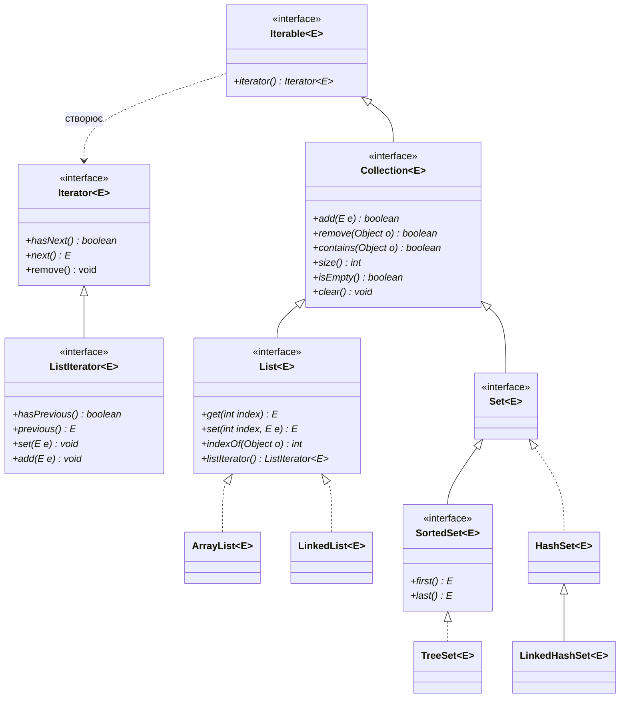
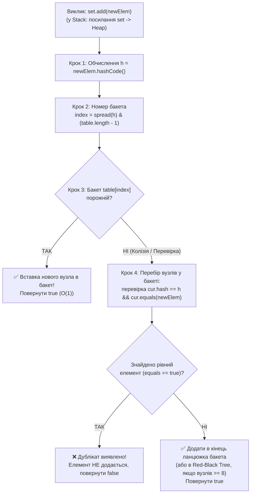
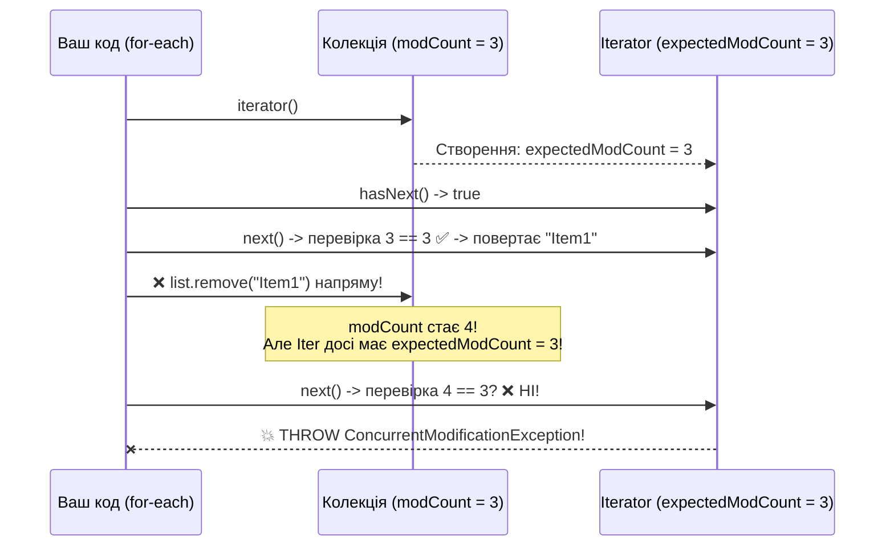

# Практична робота №12: Списки — 2-га частина (Множина `Set`, Ітератор `Iterator` / `Iterable` та Повторення минулих тем)

## 🎯 Мета роботи
- **Глибоко опанувати Множини (`Set`, `HashSet`, `LinkedHashSet`, `TreeSet`) як логічне доповнення до Списків (`List`):**
  - Зрозуміти принципову різницю між **Списком (`List`)** (індексована послідовність, де дозволені дублікати) та **Множиною (`Set`)** (колекція унікальних елементів без індексів).
  - Розібратися, як **`HashSet`** працює «під капотом» у пам'яті **Stack / Heap**: хеш-таблиця (*Hash Table*), бакети (*buckets*), обчислення `hashCode()`, розв'язання колізій через `equals()`, зв'язні списки та червоно-чорні дерева (*Red-Black Trees*) в Java 8+.
  - Вивчити три головні реалізації інтерфейсу `Set`: **`HashSet`** (швидкість $O(1)$, довільний порядок), **`LinkedHashSet`** (швидкість $O(1)$, збереження порядку додавання) та **`TreeSet`** (автоматичне сортування, $O(\log n)$).
  - Засвоїти **контракт `equals()` та `hashCode()`** для власних ООП-класів і навчитися виконувати класичні **математичні операції над множинами** в Java: об'єднання ($A \cup B$), перетин ($A \cap B$), різниця ($A \setminus B$), симетрична різниця ($A \triangle B$) та перевірка підмножини ($A \subseteq B$).
  - Навчитися вільно конвертувати структури **`List <-> Set`** для миттєвої дедуплікації даних та прискорення пошуку `contains()` з $O(n)$ до $O(1)$.
- **Досконало вивчити Ітератор (`Iterator<E>`, `Iterable<E>`, `ListIterator<E>`):**
  - Зрозуміти, чому для обходу колекцій без індексів (наприклад, `HashSet`) або колекцій зі складним доступом за індексом (`LinkedList`) звичайний цикл `for (int i = 0; ...)` не працює або є критично повільним.
  - Розібратися, як працює інтерфейс **`Iterator<E>`** (`hasNext()`, `next()`, `remove()`) та як цикл **`for-each`** під капотом компілюється у виклики `Iterable.iterator()`.
  - Зрозуміти механізм ***Fail-Fast*** (`modCount` vs `expectedModCount`) і причину виникнення **`ConcurrentModificationException`** при спробі видалити елемент зі списку чи множини під час циклу `for-each`.
  - Опанувати безпечне видалення під час обходу через **`iterator.remove()`**, сучасний **`collection.removeIf(...)`** та двонаправлений обхід списків через **`ListIterator<E>`** (`hasPrevious()`, `previous()`, `set()`, `add()`).
  - Навчитися робити власні класи-контейнери сумісними з циклом `for-each`, реалізуючи інтерфейс **`Iterable<T>`**.
- **Систематизувати й повторити минулі теми курсу в єдиній архітектурі:**
  - Поєднати колекції (`List`, `Set`, `Iterator`) з ключовими концепціями попередніх практичних робіт: масивами, циклами, `Math`, інкапсуляцією, конструкторами, **захисним копіюванням колекцій**, наслідуванням (`extends`, `super`), абстрактними класами (`abstract`), інтерфейсами (`interface`, `implements`), динамічним поліморфізмом, оператором **`instanceof` (Pattern Matching)** та модифікатором **`final`**.
- **Закріпити культуру роботи з Git та GitHub:** розв'язати 40 практичних завдань і вчасно відправити код у власний репозиторій (дедлайн — **до початку наступної пари**).

---

## 📚 1. Теоретичні відомості

### 1.1. Місце `List`, `Set` та `Iterator` в ієрархії Java Collections Framework (JCF)

На минулому етапі ви вже познайомилися зі списками (`List`, `ArrayList`, `LinkedList`) — динамічними контейнерами, які прийшли на зміну звичайним масивам фіксованої довжини. Але в реальній розробці дуже часто виникають два нові виклики:
1. **Як гарантувати, що в колекції не буде дублікатів**, і миттєво перевіряти, чи є елемент у базі серед мільйона записів? $\implies$ Для цього створено **Множину (`Set`)**!
2. **Як однаково обходити й безпечно очищати БУДЬ-ЯКУ колекцію** (`ArrayList`, `LinkedList`, `HashSet`, `TreeSet` або власну структуру), навіть якщо у неї немає індексів `[i]`? $\implies$ Для цього створено **Ітератор (`Iterator` / `Iterable`)**!

Погляньте на архітектурну карту інтерфейсів та класів **Java Collections Framework**:



> [!NOTE]
> Зверніть увагу на вершину ієрархії! Інтерфейс **`Collection<E>`** успадковується від **`Iterable<E>`**. Це означає, що **кожен `List` і кожен `Set` гарантовано вміють видавати `Iterator`**, і тому будь-яку колекцію можна обходити циклом `for-each`!

---

### 1.2. Множина (`Set`): Природа, Реалізації та Пам'ять Stack / Heap

#### 🎫 Аналогія з реального життя: Список гостей на конференції vs Черга до каси
- **Список (`List`)** — це **черга до каси або історія покупок**. Одна й та сама людина може стати в чергу двічі (дублікати дозволені), і кожен має чіткий порядковий номер (`index = 0, 1, 2...`).
- **Множина (`Set`)** — це **список унікальних бейджів учасників на вході** або **математична множина** $\{1, 2, 3\}$. Якщо учасник із таким самим ID намагається зареєструватися вдруге, система просто каже `false` («ви вже у множині!») і не додає копію. У математичній множині немає поняття «елемент номер 2» — важливий лише сам факт приналежності: $x \in S$ або $x \notin S$.

#### Порівняння `List` vs `Set`

| Критерій | `List<E>` (`ArrayList`, `LinkedList`) | `Set<E>` (`HashSet`, `LinkedHashSet`, `TreeSet`) |
| :--- | :--- | :--- |
| **Дублікати елементів** | ✅ **Дозволені** (`["Java", "Java"]` має розмір 2) | ❌ **Заборонені** (`["Java", "Java"]` збереже лише одну `"Java"`, розмір 1) |
| **Доступ за індексом** | ✅ Є `get(i)`, `set(i, val)`, `remove(i)` | ❌ **Немає індексів!** Не можна написати `set.get(0)` |
| **Швидкість пошуку `contains(x)`** | $O(n)$ — перебирає елементи по черзі (повільно на великих даних) | **$O(1)$** для `HashSet`/`LinkedHashSet` або **$O(\log n)$** для `TreeSet` |
| **Порядок елементів** | Завжди зберігає порядок вставки / індекси | Залежить від реалізації (хаотичний / порядок вставки / відсортований) |
| **Значення `add(x)`** | Зазвичай повертає `true` | Повертає `true`, якщо елемент новий, і **`false`**, якщо такий елемент уже був! |

---

#### Три головні реалізації `Set` у Java: `HashSet` vs `LinkedHashSet` vs `TreeSet`

| Характеристика | `HashSet<E>` | `LinkedHashSet<E>` | `TreeSet<E>` |
| :--- | :--- | :--- | :--- |
| **Внутрішня структура** | Хеш-таблиця (всередині — `HashMap`) | Хеш-таблиця + двозв'язний список | Червоно-чорне дерево (*Red-Black Tree*, `TreeMap`) |
| **Порядок елементів** | ❌ **Не гарантований** (залежить від `hashCode()`) | ✅ **Порядок додавання** (*Insertion Order*) | ✅ **Автоматично відсортований** (за зростанням або `Comparator`) |
| **Складність `add`, `remove`, `contains`** | **$O(1)$** (в середньому — найшвидший!) | **$O(1)$** (трохи більше пам'яті на зв'язки) | **$O(\log n)$** (підтримує баланс дерева) |
| **Підтримка `null`** | ✅ Дозволяє один `null` | ✅ Дозволяє один `null` | ❌ **Забороняє `null`** (`NullPointerException` при порівнянні!) |
| **Що вимагає від класу `E`?** | Коректні `hashCode()` та `equals()` | Коректні `hashCode()` та `equals()` | `Comparable<E>` або переданий `Comparator<E>` |
| **Коли обирати?** | У 90% випадків, коли потрібна максимальна швидкість і унікальність | Коли потрібна унікальність + збереження порядку (наприклад, історія унікальних переглядів) | Коли елементи мають завжди бути відсортовані (рейтинги, діапазони, `first()`, `last()`) |

---

#### Як `HashSet` працює під капотом у пам'яті Stack та Heap?

Уявіть величезну **камеру схову на 16 пронумерованих шафок (бакетів — *buckets*)**. Коли ви викликаєте `set.add(element)`, `HashSet` НЕ порівнює новий елемент з усіма іншими підряд! Замість цього він:
1. Викликає **`element.hashCode()`** — отримує ціле число (цифровий «відбиток» об'єкта).
2. Обчислює номер шафки (індекс бакета в масиві `table`): `bucketIndex = hash & (capacity - 1)`.
3. Заглядає **тільки в цю одну шафку**:
   - Якщо шафка порожня — кладе об'єкт туди за $O(1)$!
   - Якщо в шафці вже лежать об'єкти (це називається **хеш-колізією**), `HashSet` перевіряє кожного з них через **`equals()`**.
   - Якщо `equals()` повернув `true` — це **дублікат**! Новий елемент відкидається, `add()` повертає `false`.
   - Якщо `equals()` повернув `false` для всіх у шафці — новий елемент додається у цей бакет (у зв'язний список; а якщо в одному бакеті в Java 8+ накопичується $> 8$ елементів, список автоматично перетворюється на збалансоване червоно-чорне дерево!).



> [!IMPORTANT]
> **Золотий контракт `equals()` та `hashCode()` (Питання №1 на всіх Java-співбесідах!):**
> 1. Якщо `a.equals(b) == true`, то **`a.hashCode()` ОБОВ'ЯЗКОВО мусить дорівнювати `b.hashCode()`!**
> 2. Зворотне НЕ обов'язкове: якщо `a.hashCode() == b.hashCode()`, об'єкти **можуть бути різними** (це колізія, яку остаточно розсудить `equals()`).
> 3. Якщо ви створили власний клас (`Student`, `Point2D`, `Product`) і кладете його в `HashSet`, ви **ЗОБОВ'ЯЗАНІ перевизначити обидва методи (`equals` і `hashCode`)**! Інакше `Object.equals()` порівнюватиме лише адреси в пам'яті (`==`), і `HashSet` прийме два однакові об'єкти як різні!

Порівняйте **некоректний** та **правильний** підхід:

```java
import java.util.HashSet;
import java.util.Objects;
import java.util.Set;

// ❌ ПОГАНИЙ КОД: не перевизначено equals() та hashCode()!
class BadPoint {
    int x, y;
    BadPoint(int x, int y) { this.x = x; this.y = y; }
}

// ✅ ПРАВИЛЬНИЙ КОД: незмінні final поля + коректні equals() та hashCode()!
class GoodPoint {
    private final int x;
    private final int y;

    public GoodPoint(int x, int y) {
        this.x = x;
        this.y = y;
    }

    @Override
    public boolean equals(Object o) {
        if (this == o) return true;
        if (!(o instanceof GoodPoint other)) return false; // Pattern Matching instanceof!
        return this.x == other.x && this.y == other.y;
    }

    @Override
    public int hashCode() {
        return Objects.hash(x, y);
    }

    @Override
    public String toString() {
        return "(" + x + "; " + y + ")";
    }
}

// Перевірка:
Set<BadPoint> badSet = new HashSet<>();
badSet.add(new BadPoint(3, 4));
badSet.add(new BadPoint(3, 4));
System.out.println(badSet.size());  // ❌ Виведе 2! Дублікат проліз у множину!

Set<GoodPoint> goodSet = new HashSet<>();
goodSet.add(new GoodPoint(3, 4));
goodSet.add(new GoodPoint(3, 4));
System.out.println(goodSet.size()); // ✅ Виведе 1! Дублікат відхилено!
```

---

#### Математичні операції над множинами в Java (`Set` API)

Інтерфейс `Set` має вбудовані методи, які реалізують базову теорію множин. **Увага:** ці методи **модифікують** множину, на якій викликаються! Тому, щоб не зіпсувати вихідні дані $A$ і $B$, **завжди створюйте копію** `Set<T> result = new HashSet<>(setA);`!

| Математична операція | Позначення | Код на Java (безпечно, через копію) | Що потрапляє у результат |
| :--- | :---: | :--- | :--- |
| **Об'єднання** (*Union*) | $A \cup B$ | `Set<T> u = new HashSet<>(a);`<br>`u.addAll(b);` | Усі унікальні елементи, які є в $A$ **або** в $B$ |
| **Перетин** (*Intersection*) | $A \cap B$ | `Set<T> i = new HashSet<>(a);`<br>`i.retainAll(b);` | Лише ті елементи, які є **одночасно** і в $A$, і в $B$ |
| **Різниця** (*Difference*) | $A \setminus B$ | `Set<T> d = new HashSet<>(a);`<br>`d.removeAll(b);` | Елементи, які є в $A$, але **відсутні** в $B$ |
| **Симетрична різниця** | $A \triangle B$ | `(A \cup B) \setminus (A \cap B)` | Елементи, які є в $A$ або в $B$, але **не в обох разом** |
| **Перевірка підмножини** | $B \subseteq A$ | `a.containsAll(b)` | `true`, якщо кожен елемент із $B$ присутній в $A$ |

> [!TIP]
> **Швидка дедуплікація `ArrayList` в один рядок!**
> - Прибрати дублікати без збереження порядку: `List<String> unique = new ArrayList<>(new HashSet<>(rawList));`
> - Прибрати дублікати **зі збереженням початкового порядку**: `List<String> uniqueOrdered = new ArrayList<>(new LinkedHashSet<>(rawList));`
> - Прибрати дублікати і **відразу відсортувати**: `List<String> uniqueSorted = new ArrayList<>(new TreeSet<>(rawList));`

---

### 1.3. Ітератор (`Iterator<E>`, `Iterable<E>`, `ListIterator<E>`) та `ConcurrentModificationException`

#### 🔖 Аналогія з реального життя: Закладка-вказівник у книзі
Уявіть, що ви читаєте різні джерела інформації:
- Книгу з пронумерованими сторінками (`ArrayList`);
- Сувій, який треба розгортати послідовно (`LinkedList`);
- Мішок з унікальними фішками лото, де немає нумерації (`HashSet`).

**Ітератор (`Iterator`)** — це **універсальний курсор (помічник)**, який стає перед першим елементом будь-якої колекції і відповідає лише на три прості команди:
1. **`boolean hasNext()`** — *«Чи залишився попереду ще хоча б один елемент?»* (нічого не зсуває!).
2. **`E next()`** — *«Переступи на наступний елемент і поверни його мені!»* (якщо елементів більше немає, кине `NoSuchElementException`).
3. **`void remove()`** — *«Безпечно видали щойно отриманий елемент із колекції!»* (можна викликати лише **один раз** після кожного `next()`, інакше — `IllegalStateException`).

#### Як цикл `for-each` працює під капотом?
Коли ви пишете зручний цикл `for-each`:
```java
for (String lang : languages) {
    System.out.println(lang);
}
```
Компілятор `javac` автоматично переписує його у **байт-код із використанням `Iterator`**:
```java
Iterator<String> it = languages.iterator();
while (it.hasNext()) {
    String lang = it.next();
    System.out.println(lang);
}
```

#### Пастка №1: `ConcurrentModificationException` (*Fail-Fast* механізм)

Чому програма **падає з помилкою `ConcurrentModificationException`**, якщо ви намагаєтеся видалити елемент через `list.remove(item)` або `set.remove(item)` усередині циклу `for-each`?

Усередині колекції (наприклад, `ArrayList` або `HashSet`) живе прихований лічильник змін **`modCount`** — щоразу, коли ви викликаєте `add()` чи `remove()` самої колекції, `modCount` збільшується на `+1`.
Коли створюється `Iterator`, він запам'ятовує поточне значення у своєму полі **`expectedModCount = modCount`**. Перед кожним викликом `next()` ітератор звіряє: *«Чи не змінив хтось колекцію за моєю спиною?»*



> [!CAUTION]
> **НІКОЛИ не змінюйте структуру колекції (через `collection.add(...)` або `collection.remove(...)`) під час активного обходу в `for-each` або через `Iterator`!**
> Якщо вам потрібно видаляти елементи під час проходу, у вас є два законні та безпечні шляхи:
> 1. **Класичний `Iterator.remove()`** — він видаляє елемент і сам синхронізує `expectedModCount = modCount`!
> 2. **Сучасний `collection.removeIf(item -> умова)`** (Java 8+) — лаконічно й безпечно!

Порівняємо в коді:

```java
List<Integer> scores = new ArrayList<>(List.of(45, 88, 32, 95, 59, 76));

// ❌ ПОГАНИЙ КОД — кине ConcurrentModificationException!
/*
for (Integer s : scores) {
    if (s < 60) {
        scores.remove(s); // 💥 Зміна списку під час for-each!
    }
}
*/

// ✅ ПРАВИЛЬНИЙ КОД №1: Безпечне видалення через Iterator.remove()
Iterator<Integer> it = scores.iterator();
while (it.hasNext()) {
    Integer current = it.next();
    if (current < 60) {
        it.remove(); // ✅ Ітератор сам оновлює курсор та expectedModCount!
    }
}

// ✅ ПРАВИЛЬНИЙ КОД №2: Сучасний removeIf (Java 8+)
// scores.removeIf(s -> s < 60);
```

---

#### `ListIterator<E>`: Супер-ітератор спеціально для `List`

Якщо звичайний `Iterator` уміє рухатися тільки вперед (`hasNext`/`next`) і видаляти (`remove`), то для списків (`ArrayList`, `LinkedList`) існує розширений інтерфейс **`ListIterator<E>`** (отримується через `list.listIterator()` або `list.listIterator(startIndex)`):
- Рух **уперед і назад**: `hasNext()`, `next()`, `hasPrevious()`, `previous()`;
- Отримання індексів: `nextIndex()`, `previousIndex()`;
- Повноцінна безпечна модифікація на льоту: `remove()`, **`set(E newVal)`** (заміна поточного елемента), **`add(E newVal)`** (вставка нового елемента прямо в позицію курсора!).

#### Порівняння способів обходу колекцій

| Спосіб обходу | Працює з `List`? | Працює з `Set`? | Безпечне видалення? | Заміна / Вставка елементів? | Рух назад? |
| :--- | :---: | :---: | :---: | :---: | :---: |
| Класичний `for (int i = 0; i < n; i++)` | ✅ (але $O(n^2)$ на `LinkedList`!) | ❌ Ні (немає індексів) | ⚠️ Небезпечно (зсув індексів!) | ✅ `list.set(i, v)` | ✅ (`i--`) |
| Цикл `for-each` (`for (T x : col)`) | ✅ | ✅ | ❌ **Кидає `CME`!** | ❌ | ❌ |
| **`Iterator<T>`** | ✅ | ✅ | ✅ **`it.remove()`** | ❌ | ❌ |
| **`ListIterator<T>`** | ✅ | ❌ Тільки для `List` | ✅ **`lit.remove()`** | ✅ `set()` і `add()` | ✅ `previous()` |
| **`removeIf(Predicate)`** | ✅ | ✅ | ✅ Ідеально для фільтрації | ❌ | ❌ |

---

#### Власний клас із підтримкою `for-each`: реалізація `Iterable<T>`

Ви можете навчити будь-який власний ООП-клас (наприклад, `TeamRoster`, `Playlist`, `NumericRange`) працювати в циклі `for (Item x : myContainer)`! Для цього достатньо реалізувати інтерфейс **`Iterable<T>`** та його єдиний метод `public Iterator<T> iterator()`:

```java
import java.util.Iterator;
import java.util.NoSuchElementException;

public class StepRange implements Iterable<Integer> {
    private final int start;
    private final int end;
    private final int step;

    public StepRange(int start, int end, int step) {
        if (step <= 0) throw new IllegalArgumentException("Крок має бути > 0");
        this.start = start;
        this.end = end;
        this.step = step;
    }

    @Override
    public Iterator<Integer> iterator() {
        return new Iterator<>() {
            private int current = start;

            @Override
            public boolean hasNext() {
                return current <= end;
            }

            @Override
            public Integer next() {
                if (!hasNext()) throw new NoSuchElementException();
                int value = current;
                current += step;
                return value;
            }
        };
    }
}

// Тепер StepRange працює у for-each, наче справжня колекція Java!
// for (int x : new StepRange(10, 30, 5)) { System.out.print(x + " "); } // 10 15 20 25 30
```

---

### 1.4. Повторення минулих тем: Синергія ООП, Поліморфізму та Колекцій

У реальних Java-проєктах колекції `List`, `Set` та `Iterator` **ніколи не існують у вакуумі** — вони працюють разом із усіма концепціями, які ми опанували у Практиках №1–10!

| Попередня тема курсу | Як вона інтегрується зі Списками, Множинами та Ітератором |
| :--- | :--- |
| **Інкапсуляція та Захисне копіювання** *(Практики 8–9)* | Якщо клас зберігає `private final Set<String> tags`, геттер **НЕ повинен** повертати пряме посилання `return tags;`! Інакше зовнішній код зможе викликати `obj.getTags().clear()`! Правильно: `return new HashSet<>(tags);` або `Collections.unmodifiableSet(tags)`. |
| **Композиція (`HAS-A`)** *(Практика 9)* | Замість жорстких масивів фіксованого розміру `Order[]` об'єкти-контейнери тепер містять `List<Order>` (історія) та `Set<String>` (унікальні коди/теги). |
| **Абстрактні класи та Інтерфейси** *(Практики 9–10)* | Поліморфна колекція `List<AbstractShape>` або `Set<Payable>` дозволяє зберігати об'єкти різних підкласів в одному контейнері й обробляти їх через єдиний `Iterator`! |
| **`instanceof` та Pattern Matching** *(Практика 10)* | Під час ітерації `while (it.hasNext()) { Unit u = it.next(); if (u instanceof Expirable e && e.isExpired()) it.remove(); }` ми фільтруємо об'єкти за їхньою динамічною роллю (`CAN-DO`). |
| **Ключове слово `final`** *(Практика 10)* | Поля, які беруть участь в `equals()` та `hashCode()` (наприклад, `private final String id`), **критично важливо робити `final`**! Інакше при зміні поля об'єкт «загубиться» в хеш-таблиці `HashSet`! |
| **Масиви, Цикли та `Math`** *(Практики 2–5)* | Перетворення масивів у колекції (`Arrays.asList(...)`, `List.of(...)`), чисельні формули, обчислення метрик, матриць і геометрії на основі наборів унікальних елементів. |

> [!WARNING]
> **Пам'ятайте про пастку `final` для колекцій!**
> Оголошення `private final Set<String> roles = new HashSet<>();` означає лише те, що змінна `roles` **завжди вказуватиме на той самий об'єкт `HashSet` у Heap**. Але додавати (`roles.add(...)`) та видаляти (`roles.remove(...)`) елементи всередині цієї множини все одно можна! Щоб захистити вміст від зовнішньої зміни, використовуйте захисне копіювання в конструкторі й геттері.

---

### 1.5. Поширені помилки та підводні камені новачків

1. **💥 Видалення елемента з `List` або `Set` усередині `for-each`:**
   - *Помилка:* `for (String s : list) { if (s.isEmpty()) list.remove(s); }` $\implies$ миттєвий крах із **`ConcurrentModificationException`**.
   - *Виправлення:* використовуйте явний `Iterator` і його метод `it.remove()` або `list.removeIf(String::isEmpty)`.
2. **👻 Забуті `equals()` та `hashCode()` для власних класів у `HashSet`:**
   - *Помилка:* створили `class Student { String name; }` без перевизначення `equals`/`hashCode` і поклали двох студентів з однаковим ім'ям у `HashSet` — обидва потрапили всередину, а `set.contains(new Student("Іван"))` повертає `false`!
   - *Виправлення:* завжди генеруйте або реалізуйте `equals()` та `hashCode()` узгоджено (в IntelliJ IDEA: `Alt + Insert` / `Cmd + N` $\to$ `equals() and hashCode()`).
3. **🕳️ Мутація поля, що бере участь у `hashCode()`, ПІСЛЯ додавання об'єкта у `HashSet`:**
   - *Помилка:* додали `User` з `id = "A1"` у `HashSet` (він ліг у бакет №5), а потім змінили `user.setId("B9")` (тепер хеш вказує на бакет №11). Виклик `set.contains(user)` та `set.remove(user)` шукатиме у бакеті №11 і **не знайде власний об'єкт** — це класичний витік пам'яті!
   - *Виправлення:* робіть ключові поля об'єкта `private final` (незмінними), або видаляйте об'єкт із `Set` перед зміною і додавайте назад після неї.
4. **🧨 `NullPointerException` у `TreeSet` або `ClassCastException` без `Comparable`:**
   - *Помилка:* спроба додати `null` у `TreeSet` (кине `NullPointerException`) або додати свій клас `Product` у `new TreeSet<>()`, коли `Product` не реалізує `Comparable<Product>` і не передано `Comparator` (кине `ClassCastException` під час виконання!).
   - *Виправлення:* для `TreeSet` ніколи не додавайте `null`, а для власних класів реалізуйте `Comparable<T>` або передайте компаратор `new TreeSet<>(Comparator.comparing(...))`.
5. **🔄 Виклик `it.next()` двічі за одну ітерацію циклу `while (it.hasNext())`:**
   - *Помилка:*
     ```java
     // ❌ ПОМИЛКА!
     while (it.hasNext()) {
         if (it.next().startsWith("A")) {
             System.out.println(it.next()); // Зсуне курсор ще раз і може кинути NoSuchElementException!
         }
     }
     ```
   - *Виправлення:* викликайте `it.next()` **рівно один раз** за ітерацію і зберігайте результат у локальну змінну: `String item = it.next();`.
6. **⚠️ Виклик `it.remove()` до `it.next()` або двічі підряд:**
   - *Помилка:* виклик `it.remove()` на початку циклу (до першого `next()`) або повторний `it.remove()` без проміжного `next()` миттєво кидає **`IllegalStateException`**.
   - *Виправлення:* суворе правило: кожному `it.remove()` має передувати рівно один виклик `it.next()`.

---

### 1.6. Робота з Git та GitHub (Алгоритм здачі)

> [!IMPORTANT]
> **Дедлайн здачі практичної та домашньої роботи на GitHub:** **до початку наступної пари**.
> Усі зміни мають бути закомічені та відправлені у ваш віддалений репозиторій, а проєкт повинен безпомилково компілюватися командою `mvn clean test-compile`.

Короткий щоденний алгоритм роботи у терміналі IntelliJ IDEA (`Alt + F12` / `Option + F12`):
```bash
# 1. Перевірити змінені та нові файли
git status

# 2. Додати файли Практичної роботи №11 до індексу (Staging Area)
git add src/main/java/semester1/practice11/

# 3. Зафіксувати коміт зі зрозумілим повідомленням
git commit -m "feat(practice11): implement Set, Iterator and OOP review tasks"

# 4. Відправити коміти на GitHub
git push origin main
```

---

## 💻 2. Практичні завдання (40 завдань)

Розміщуйте розв'язання у пакеті `semester1.practice11` (у файлі `Practice11.java` або допоміжних класах поруч). Кожен блок містить **8 послідовних завдань** від базового синтаксису до комплексної архітектури.

---

### Блок 1: Основи Множин (`Set`, `HashSet`, `LinkedHashSet`, `TreeSet`) та зв'язок зі Списками (Завдання 1–8)

#### Завдання 1: Перша множина унікальних мов програмування (`HashSet` Basics)
1. Створіть `Set<String> langs = new HashSet<>();`.
2. Додайте по черзі елементи: `"Java"`, `"Python"`, `"C++"`, `"Java"`, `"Kotlin"`, `"Python"`, виводячи в консоль булевий результат кожного виклику `langs.add(...)`.
3. Виведіть розмір множини (`size()`), перевірте наявність `"Java"` і `"Rust"` через `contains(...)`, видаліть `"C++"` і виведіть фінальний вміст множини.

#### Завдання 2: Порівняння трьох реалізацій `Set` (`HashSet` vs `LinkedHashSet` vs `TreeSet`)
1. Дано масив міст України: `String[] cities = {"Львів", "Київ", "Одеса", "Дніпро", "Харків", "Київ", "Львів", "Чернівці"};`.
2. Помістіть ці самі елементи у три різні множини: `HashSet<String>`, `LinkedHashSet<String>` та `TreeSet<String>`.
3. Виведіть усі три множини в консоль та у коментарі поясніть різницю в порядку виведення кожного рядка.

#### Завдання 3: Миттєва дедуплікація `ArrayList` із збереженням порядку (`List <-> Set`)
1. Створіть `List<String> rawLogs` із 12 IP-адресами, серед яких є повтори (наприклад, `"192.168.1.10"` трапляється 3 рази).
2. Напишіть метод `public static List<String> deduplicatePreserveOrder(List<String> input)`, який використовує `LinkedHashSet<String>` і повертає новий `ArrayList<String>` без дублікатів у початковому порядку появи.
3. Виведіть кількість записів «до» і «після» та кількість відкинутих дублікатів.

#### Завдання 4: Пошук першого повторюваного елемента у потоці транзакцій
1. Дано список кодів банківських чеків `List<String> receiptIds`.
2. Напишіть метод `public static String findFirstDuplicate(List<String> ids)`:
   - Створіть `Set<String> seen = new HashSet<>();`;
   - Обходьте список; якщо `!seen.add(id)` (метод `add` повернув `false`), негайно поверніть цей `id` як перший знайдений дублікат;
   - Якщо всі елементи унікальні — поверніть `null`.
3. Перевірте роботу методу на списку з дублікатами та на унікальному списку.

#### Завдання 5: Статистика унікальних слів у тексті (`TreeSet` + нормалізація)
1. Задайте рядок-абзац тексту з розділовими знаками та різним регістром (наприклад, `"Java is fast, Java is safe! Collections: List, Set, and Iterator."`).
2. Очистіть текст від розділових знаків, переведіть у нижній регістр, розбийте на слова (`split("\\s+")`) та помістіть у `TreeSet<String>`.
3. Виведіть: загальну кількість слів у тексті, кількість унікальних слів, перше й останнє слово за алфавітом (`first()`, `last()`) та відсоток лексичного різноманіття $\frac{\text{unique}}{\text{total}} \cdot 100\%$.

#### Завдання 6: Контроль унікальності промокодів (`Set<String>`) та перевірка `null`
1. Продемонструйте поведінку `null` у різних множинах:
   - Додайте `null` у `HashSet<String>` та `LinkedHashSet<String>` (переконайтеся, що розмір збільшується на 1, а повторний `null` ігнорується).
   - У блоці `try-catch (NullPointerException e)` продемонструйте, що спроба додати `null` у `TreeSet<String>` кидає виняток.
2. Напишіть безпечний метод `registerPromoCode(Set<String> activeCodes, String code)`, який відхиляє `null` або порожні рядки, переводить код у верхній регістр і повертає `true` лише для нових промокодів.

#### Завдання 7: Діапазони температур у `TreeSet` (`NavigableSet` методи)
1. Створіть `TreeSet<Double> temperatures` з 10 вимірами температури датчика (наприклад, `-4.5, 0.0, 12.3, 18.7, 22.1, 25.0, 31.4, 36.6, 40.2, 15.5`).
2. Використовуючи можливості `TreeSet` (`first()`, `last()`, `headSet(20.0)`, `tailSet(25.0)`, `subSet(15.0, 32.0)`, `ceiling(20.0)`, `floor(20.0)`), виведіть:
   - мінімальну та максимальну температуру;
   - усі значення нижче $20^\circ\text{C}$;
   - усі значення у комфортному діапазоні $[15^\circ\text{C}; 32^\circ\text{C})$;
   - найближчі сусідні виміри до $20.0^\circ\text{C}$.

#### Завдання 8: Бенчмарк швидкості пошуку `contains()`: `ArrayList` ($O(n)$) проти `HashSet` ($O(1)$)
1. Заповніть `List<Integer> arrayList` та `Set<Integer> hashSet` однаковими $100\,000$ цілими числами від $0$ до $99\,999$.
2. Виміряйте за допомогою `System.nanoTime()` час виконання $10\,000$ запитів `contains(...)` (для чисел від $90\,000$ до $99\,999$ та відсутніх чисел) на `ArrayList` і на `HashSet`.
3. Виведіть час обох тестів у мілісекундах та обчисліть, у скільки разів `HashSet` виявився швидшим!

---

### Блок 2: Теорія множин та Контракт `equals()` / `hashCode()` (Завдання 9–16)

#### Завдання 9: Калькулятор математичних множин (`SetMathUtils`)
1. Створіть утилітний клас `SetMathUtils` із 4 узагальненими (`<T>`) статичними методами, які **НЕ змінюють** передані аргументи `setA` і `setB`:
   - `union(Set<T> a, Set<T> b)` — об'єднання $A \cup B$;
   - `intersection(Set<T> a, Set<T> b)` — перетин $A \cap B$;
   - `difference(Set<T> a, Set<T> b)` — різниця $A \setminus B$;
   - `symmetricDifference(Set<T> a, Set<T> b)` — симетрична різниця $A \triangle B = (A \cup B) \setminus (A \cap B)$.
2. Перевірте роботу всіх 4 методів на множинах $A = \{1, 2, 3, 4, 5\}$ та $B = \{4, 5, 6, 7, 8\}$ і переконайтеся, що вихідні множини `a` і `b` залишилися незмінними!

#### Завдання 10: Індекс схожості Жаккара (*Jaccard Similarity*) для рекомендаційної системи
1. У машинному навчанні схожість двох множин тегів/інтересів $A$ і $B$ оцінюється за формулою **коефіцієнта Жаккара**:
   $$J(A, B) = \frac{|A \cap B|}{|A \cup B|} \in [0; 1]$$
   (якщо обидві множини порожні, $J = 1.0$).
2. Створіть множини навичок трьох кандидатів (`Java`, `SQL`, `Git`, `Docker`, `Spring`, `Python`) та множину вимог вакансії.
3. Обчисліть коефіцієнт Жаккара (у відсотках) кожного кандидата з вакансією та виведіть, яких саме навичок не вистачає кожному (`vacancy \ candidate`).

#### Завдання 11: Перевірка прав доступу через підмножини (`containsAll`)
1. Опишіть систему ролей ІТ-сервісу: множина дозволів `Set<String> userPermissions` (наприклад, `"READ"`, `"WRITE"`, `"EXPORT"`) та множина необхідних дозволів для операції `Set<String> requiredPermissions`.
2. Напишіть метод `boolean hasAccess(Set<String> userPerms, Set<String> requiredPerms)` через `containsAll(...)` та метод `Set<String> getMissingPermissions(...)` через різницю множин.
3. Протестуйте 3 сценарії: повний доступ, часткова нестача прав та порожня множина вимог.

#### Завдання 12: Власний клас `Point2D` та експеримент з `equals()` / `hashCode()`
1. Створіть два класи точок з полями `private final int x, y`:
   - `BrokenPoint2D` — **без** перевизначення `equals()` і `hashCode()`;
   - `ValidPoint2D` — з коректними `equals()`, `hashCode()` (`Objects.hash(x, y)`) та `toString()`.
2. Додайте по 4 точки `{(0,0), (3,4), (0,0), (3,4)}` у `HashSet<BrokenPoint2D>` та `HashSet<ValidPoint2D>`.
3. Виведіть розміри обох множин та результат `contains(new ValidPoint2D(3, 4))`, наочно підтвердивши критичність контракту `equals/hashCode`.

#### Завдання 13: Реєстр студентів за унікальним номером залікової книжки (`StudentRecord`)
1. Створіть клас `StudentRecord` із полями `private final String studentId`, `private String fullName`, `private double gpa`.
2. Реалізуйте `equals()` та `hashCode()` **виключно за полем `studentId`** (оскільки `studentId` — це незмінний первинний ключ, а ПІБ чи середній бал можуть змінюватися).
3. Додайте 5 записів у `HashSet<StudentRecord>`, включно з двома об'єктами з однаковим `studentId`, але різним `gpa`. Переконайтеся, що дублікат відхилено.

#### Завдання 14: Пастка змінюваного ключа в `HashSet` (Демонстрація втрати об'єкта)
1. Створіть клас `MutableTag` з **НЕфінальним** полем `private String label`, де `equals()` і `hashCode()` залежать від `label`.
2. Додайте `MutableTag t = new MutableTag("java")` у `HashSet<MutableTag>`. Перевірте `set.contains(t)` (має бути `true`).
3. Викличте `t.setLabel("kotlin")` прямо коли об'єкт лежить у множині!
4. Перевірте `set.contains(t)` та `set.remove(t)` — зафіксуйте в консолі, що об'єкт «зник» для хеш-таблиці, хоча `set.size()` досі дорівнює `1`! Покажіть правильний спосіб безпечного оновлення (`remove` -> зміна -> `add`).

#### Завдання 15: Сортування власних об'єктів у `TreeSet` (`Comparable` та `Comparator`)
1. Створіть клас `ServerNode implements Comparable<ServerNode>` із полями `private final String hostName`, `private final int pingMs`, `private final double cpuLoad`.
2. Реалізуйте `compareTo`: сортування за зростанням `pingMs`, а при однаковому пінгу — за `hostName` (щоб різні сервери з однаковим пінгом **не вважалися дублікатами** у `TreeSet`!).
3. Створіть два `TreeSet<ServerNode>`: перший із природним порядком (`Comparable`), другий із власним `Comparator` за спаданням `cpuLoad` (і далі за `hostName`). Виведіть обидва рейтинги.

#### Завдання 16: Множина векторів-напрямків: Аналіз ортогональних пар (`Vector2D`)
1. Створіть незмінний (`final`) клас `IntVector2D` (`private final int dx, dy`) з коректними `equals()`, `hashCode()`, `dotProduct(IntVector2D other)` та `norm()`.
2. Зберіть масив векторів із повторами у `Set<IntVector2D>` (видаливши дублікати).
3. Знайдіть усі унікальні пари перпендикулярних ненульових векторів ($\vec{u} \cdot \vec{v} = 0$) та виведіть їх у консоль.

---

### Блок 3: Ітератор (`Iterator`, `ListIterator`), `ConcurrentModificationException` та Безпечна фільтрація (Завдання 17–24)

#### Завдання 17: Класичний обхід `List` та `Set` за допомогою `Iterator<T>`
1. Створіть `List<String> planetsList` та `Set<String> planetsSet` з назвами планет Сонячної системи.
2. Напишіть універсальний метод `public static <T> void printViaIterator(Iterable<T> collection, String title)`, який обходить будь-яку колекцію через `Iterator<T>` (`while (it.hasNext())`) і нумерує елементи `1. ...`, `2. ...`.
3. Викличте цей один метод по черзі для `ArrayList`, `HashSet`, `LinkedHashSet` та `TreeSet`.

#### Завдання 18: Відтворення та знешкодження `ConcurrentModificationException`
1. Створіть `List<Integer> numbers = new ArrayList<>(List.of(10, 15, 22, 33, 40, 55, 60));`.
2. У блоці `try-catch (ConcurrentModificationException e)` навмисно спробуйте видалити непарні числа через `numbers.remove(n)` всередині циклу `for-each`, перехопіть виняток і виведіть діагностичне повідомлення.
3. Потім виконайте коректне видалення всіх непарних чисел на свіжій копії списку за допомогою `Iterator<Integer>` та `it.remove()`. Виведіть фінальний список.

#### Завдання 19: Очищення `HashSet` від прострочених сесій через `Iterator.remove()`
1. Створіть клас `UserSession` (`private final String token`, `private final int idleMinutes`, `equals/hashCode` за `token`).
2. Заповніть `Set<UserSession> activeSessions` 7 сесіями з різним часом простою (від 2 до 120 хвилин).
3. Напишіть метод `public static int purgeExpiredSessions(Set<UserSession> sessions, int maxIdleMinutes)`, який через `Iterator<UserSession>` безпечно видаляє всі сесії з `idleMinutes > maxIdleMinutes` і повертає кількість видалених сесій.

#### Завдання 20: Двонаправлений обхід списку через `ListIterator<T>` (Прямий і Зворотний хід)
1. Створіть `List<String> stations = new ArrayList<>(List.of("Вокзальна", "Університет", "Театральна", "Хрещатик", "Арсенальна"));`.
2. Отримайте `ListIterator<String> lit = stations.listIterator();`.
3. Пройдіть список спочатку вперед (`hasNext`/`next`), друкуючи індекс `previousIndex()` та назву станції, а потім — тим самим ітератором **у зворотному напрямку** (`hasPrevious`/`previous`), друкуючи зворотний маршрут поїзда!

#### Завдання 21: Модифікація списку «на льоту» через `ListIterator.set()` та `ListIterator.add()`
1. Створіть `List<String> commands = new ArrayList<>(List.of("START", "LOAD", "ERROR_TEMP", "PROCESS", "STOP"));`.
2. За допомогою `ListIterator<String>` за один прохід:
   - якщо елемент дорівнює `"ERROR_TEMP"` — замініть його на `"RETRY"` через `lit.set("RETRY")`;
   - відразу після елемента `"LOAD"` — вставте новий крок `"VALIDATE"` через `lit.add("VALIDATE")`.
3. Виведіть оновлений список команд і перевірте правильний порядок: `[START, LOAD, VALIDATE, RETRY, PROCESS, STOP]`.

#### Завдання 22: Сучасна фільтрація через `removeIf()` проти явного `Iterator`
1. Створіть `List<Double> sensorReadings` із 12 значень, серед яких є викиди (`Double.NaN`, від'ємні значення та значення $> 100.0$).
2. Напишіть два методи очищення:
   - `cleanWithIterator(List<Double> data)` — через цикл `while (it.hasNext())` з `it.remove()` та підрахунком кількості видалених викидів;
   - `cleanWithRemoveIf(List<Double> data)` — в один рядок через `data.removeIf(v -> v == null || Double.isNaN(v) || v < 0 || v > 100.0)`.
3. Переконайтеся, що обидва методи дають ідентичний очищений результат, і обчисліть середнє арифметичне валідних показників.

#### Завдання 23: Статистика видалення дублікатів у списку без створення `Set`? Ні — комбінація `Iterator` + `HashSet`!
1. Створіть `List<String> tags = new ArrayList<>(List.of("oop", "java", "set", "java", "iterator", "oop", "list", "set"));`.
2. Напишіть метод `public static int removeDuplicatesInPlace(List<String> list)`:
   - Використовує допоміжний `Set<String> seen = new HashSet<>();` та `Iterator<String> it = list.iterator();`;
   - Якщо `!seen.add(it.next())`, викликає `it.remove()` і збільшує лічильник видалених дублікатів.
3. Переконайтеся, що список змінено **на місці (in-place)** зі збереженням першої появи кожного елемента!

#### Завдання 24: Злиття двох відсортованих списків через два `Iterator` (Елемент алгоритму *Merge Sort*)
1. Дано два відсортовані списки `List<Integer> a = List.of(1, 4, 7, 12, 20)` та `List<Integer> b = List.of(2, 4, 9, 12, 15, 25)`.
2. Використовуючи виключно ітератори (або `ListIterator` з можливістю «підглянути» чи буферизувати поточний елемент), об'єднайте обидва списки в один відсортований список без дублікатів за лінійний час $O(n + m)$ без виклику `Collections.sort()`.
3. Виведіть результат: `[1, 2, 4, 7, 9, 12, 15, 20, 25]`.

---

### Блок 4: Власний `Iterable<T>` та Повторення ключових тем ООП (Завдання 25–32)

#### Завдання 25: Власний числовий діапазон `ArithmeticProgression implements Iterable<Double>`
1. Створіть незмінний клас `ArithmeticProgression implements Iterable<Double>` з полями `private final double first`, `private final double step`, `private final int count` (валідація: `count >= 0`).
2. Реалізуйте `iterator()`, який генерує члени прогресії $a_k = a_0 + k \cdot d$ без зберігання масиву в пам'яті ($O(1)$ пам'яті!).
3. Обійдіть прогресію циклом `for-each`, обчисліть суму елементів і порівняйте з аналітичною формулою $S_n = \frac{n(2a_0 + (n-1)d)}{2}$.

#### Завдання 26: Музичний плейлист `Playlist implements Iterable<Song>` із захисним копіюванням
*(Повторення: Інкапсуляція, Композиція, Захисне копіювання + `Iterable`)*
1. Створіть `final class Song` (`private final String title`, `private final String artist`, `private final int durationSec`, `equals/hashCode` за `title` + `artist`).
2. Створіть `class Playlist implements Iterable<Song>`, який усередині зберігає `private final Set<Song> tracks = new LinkedHashSet<>();` (унікальні треки у порядку додавання!).
3. Забезпечте:
   - геттер `getTracksCopy()`, який повертає **захисну копію** `new LinkedHashSet<>(tracks)`;
   - `iterator()`, який повертає ітератор по копії (або `Collections.unmodifiableSet(tracks).iterator()`), щоб зовнішній код не міг зіпсувати плейлист через `it.remove()`;
   - підрахунок загальної тривалості через `for (Song s : playlist)`.

#### Завдання 27: Поліморфна колекція фігур `List<AbstractShape>` + `Iterator` + `instanceof`
*(Повторення: Абстрактний клас, Інтерфейс, Поліморфізм, `instanceof` Pattern Matching)*
1. Створіть `abstract class AbstractShape` (`String name`, `abstract double area()`) та інтерфейс `Scalable` (`void scale(double factor)`).
2. Реалізуйте `Circle` (`implements Scalable`), `Rectangle` (`implements Scalable`) та `final class FixedStampSquare` (НЕ реалізує `Scalable`).
3. Помістіть 6 фігур у `List<AbstractShape>`:
   - Через `Iterator<AbstractShape>` видаліть усі фігури, чия площа менша за `15.0`;
   - Для решти фігур перевірте `if (shape instanceof Scalable sc)` і збільште їх у $1.5$ раза;
   - Виведіть оновлені площі.

#### Завдання 28: Банківський портфель із поліморфним обчисленням дохідності (`Set<Asset>` + `final`)
*(Повторення: `interface`, `final` метод, `equals/hashCode`)*
1. Створіть `abstract class FinancialAsset` із `private final String ticker` (унікальний код активу, `equals/hashCode` за `ticker`), `protected double investedAmount`, абстрактним методом `double annualYieldPercent()` та **`final` методом** `double calculateAnnualProfit()`.
2. Реалізуйте підкласи `GovernmentBond` та `TechStock`.
3. Збережіть активи в `Set<FinancialAsset>` (спробуйте додати дублікат за тікером `"NVDA"`), а потім через `Iterator` видаліть усі активи з дохідністю нижче $5\%$ та обчисліть сумарний річний прибуток портфеля.

#### Завдання 29: Ітератор простих чисел `PrimeNumberGenerator implements Iterable<Integer>`
*(Повторення: Цикли, `Math.sqrt`, Алгоритми + Власний `Iterator`)*
1. Створіть клас `PrimeNumberGenerator implements Iterable<Integer>`, який приймає верхню межу `private final int maxLimit`.
2. Реалізуйте власний `Iterator<Integer>`, що на кожному кроці знаходить наступне просте число $\le \text{maxLimit}$ (перевірка дільників до $\sqrt{n}$).
3. У `main` виведіть усі прості числа до $100$ через `for (int p : new PrimeNumberGenerator(100))`, а також зберіть їх у `Set<Integer>` і перевірте гіпотезу Гольдбаха для числа $84$ (чи знайдеться пара $p_1, p_2 \in \text{primes}$ така, що $p_1 + p_2 = 84$).

#### Завдання 30: Фільтруючий Ітератор-декоратор (`FilteredIterator<T>`)
*(Повторення: Дженерики, Композиція, Інтерфейси)*
1. Створіть інтерфейс `ElementFilter<T>` із єдиним методом `boolean accept(T element);`.
2. Створіть клас `FilteredIterator<T> implements Iterator<T>`, який обгортає будь-який інший `Iterator<T>` та `ElementFilter<T>`, і видає лише ті елементи, для яких `filter.accept(elem) == true` (використовуючи внутрішній механізм попереднього пошуку `advance()`).
3. Протестуйте `FilteredIterator` на списку студентів (вибрати лише з `gpa >= 90`) та на множині цілих чисел (вибрати лише кратні 7).

#### Завдання 31: Бібліотечний каталог: Захист від дублікатів ISBN + `TreeSet` за роком видання
*(Повторення: Конструктори, Перевантаження, `toString`, `final`, `HashSet` vs `TreeSet`)*
1. Створіть `final class Book` (`private final String isbn`, `private final String title`, `private final int year`).
2. `equals()` і `hashCode()` реалізуйте за `isbn`.
3. Зберіть книги у `HashSet<Book>` (вилучивши дублікати за ISBN), потім перекладіть унікальні книги у `TreeSet<Book>` із компаратором `(за роком спадання, потім за назвою)` та видаліть через `Iterator` усі книги старіші за 2015 рік.

#### Завдання 32: Ієрархія датчиків розумного дому (`SmartHomeHub implements Iterable<AbstractSensor>`)
*(Повторення: Наслідування, `super`, `abstract`, `interface`, `instanceof`, `Set` + `Iterator`)*
1. Створіть `abstract class AbstractSensor` (`private final String sensorId`, `private boolean active`, `equals/hashCode` за `sensorId`), інтерфейс `Calibratable` (`void calibrate();`) і підкласи `TempSensor`, `MotionSensor`, `SmokeSensor`.
2. Створіть `SmartHomeHub implements Iterable<AbstractSensor>` на базі `LinkedHashSet<AbstractSensor>`.
3. Напишіть методи:
   - `removeOfflineSensors()` — видаляє всі неактивні датчики (`!s.isActive()`) через `Iterator.remove()`;
   - `calibrateAllSupported()` — обходить хаб через `for-each` і калібрує все, що `instanceof Calibratable c`.

---

### Блок 5: Комплексна синергія тем (ІТ, Фінанси, Математика, Інженерія, Ігри + GitHub) (Завдання 33–40)

#### Завдання 33: Граф соціальної мережі: Спільні друзі та Рекомендації (Теорія графів + `Set`)
1. Представте список друзів кожного користувача як `Set<String>` (наприклад, для 4 користувачів: `"Alex"`, `"Maria"`, `"Bohdan"`, `"Olena"`).
2. Напишіть методи:
   - `mutualFriends(Set<String> u1, Set<String> u2)` $\to$ перетин $U_1 \cap U_2$;
   - `suggestedFriends(String user, Set<String> myFriends, Set<String> friendOfFriendSet)` $\to$ $(F \setminus \text{myFriends}) \setminus \{\text{user}\}$;
   - `uniqueNetworkSize(List<Set<String>> allGroups)` $\to$ розмір об'єднання всіх множин.
3. Виведіть рекомендації «Можливо, ви знаєте» для користувача `"Alex"`.

#### Завдання 34: Матричний індекс унікальних значень та очищення 2D-сітки
*(Повторення: 2D-масиви + `TreeSet` + `ListIterator`)*
1. Дано двовимірну цілочисельну матрицю `int[][] matrix` розміром $4 \times 5$.
2. Знайдіть:
   - `TreeSet<Integer>` усіх унікальних елементів матриці (у відсортованому вигляді);
   - елементи, які є одночасно у першому і в останньому рядку матриці (перетин двох `HashSet<Integer>`);
   - список координат `List<String>` усіх нульових елементів і за допомогою `ListIterator` замініть їх у звіті на формат `"[row=r, col=c]"`.

#### Завдання 35: Антиспам-конвеєр електронної пошти (`List<Email>` + `Set<String>` + `Iterator`)
1. Створіть `final class EmailMessage` (`private final String id`, `private final String senderDomain`, `private final String subject`, `private final double spamScore`).
2. Створіть `Set<String> blacklistedDomains` (чорний список доменів) та `List<EmailMessage> inbox` (вхідні листи, включаючи дублікати за `id`).
3. За один прохід через `Iterator<EmailMessage>` очистіть `inbox` від:
   - листів з доменів у `blacklistedDomains` ($O(1)$ перевірка!);
   - листів зі `spamScore >= 0.8`;
   - дублікатів за `id` (використовуючи `Set<String> seenIds`).
4. Виведіть звіт: скільки листів доставлено і скільки відфільтровано за кожною причиною.

#### Завдання 36: Чисельне об'єднання інтервалів на числовій прямій (`TreeSet<Interval>` + `Iterator`)
1. Створіть незмінний клас `Interval implements Comparable<Interval>` (`private final double start, end`, валідація `start <= end`, сортування за `start`, потім `end`).
2. Помістіть 7 відрізків (деякі перетинаються, наприклад $[1; 4], [2; 6], [8; 10], [9; 12], [1; 4]$) у `TreeSet<Interval>`.
3. Пройдіть `TreeSet` за допомогою `Iterator<Interval>` і злийте всі відрізки, що перетинаються, у новий список неперетинних інтервалів (`[1; 6], [8; 12]`) та обчисліть їхню сумарну довжину!

#### Завдання 37: Інженерний диспетчер авіарейсів (`Set<Flight>` + `AbstractAircraft` + `Iterator`)
1. Створіть `abstract class AbstractFlight` (`private final String flightCode`, `private final int delayMinutes`, `equals/hashCode` за `flightCode`) та інтерфейс `InternationalFlight` (`String getDestinationCountry()`).
2. Реалізуйте `DomesticFlight` та `InternationalCharterFlight`.
3. Збережіть розклад у `LinkedHashSet<AbstractFlight>`. Через `Iterator` скасуйте (видаліть) рейси із затримкою $> 180$ хв, а серед активних через `instanceof InternationalFlight` виведіть список унікальних країн призначення у `TreeSet<String>`.

#### Завдання 38: Крипто-портфель: Арбітраж пар та Виявлення аномальних ордерів
1. Створіть `final class TradeOrder` (`private final String orderId`, `private final String pair`, `private final double price`, `private final double volume`, `equals/hashCode` за `orderId`).
2. Дано дві біржі: `Set<String> binancePairs` та `Set<String> krakenPairs`. Знайдіть множину спільних пар для арбітражу ($A \cap B$) та ексклюзивних пар кожної біржі ($A \triangle B$).
3. Пройдіть `List<TradeOrder>` через `Iterator`: видаліть усі ордери, чия торгова пара відсутня у списку арбітражних пар або чий об'єм `volume <= 0`, та порахуйте сумарну ліквідність $\sum (\text{price} \cdot \text{volume})$.

#### Завдання 39: Ігрова Гільдія RPG: Унікальні ефекти, Поліморфні герої та Ітератор кінця ходу
1. Створіть `abstract class RpgHero` (`private final String name`, `protected int hp`, `private final Set<String> activeBuffs = new HashSet<>()`).
2. Створіть інтерфейси `Poisonable` (`boolean isPoisoned()`, `void tickPoison()`) та `Regenerating` (`void healTurn()`).
3. Створіть загін `List<RpgHero> party` (наприклад, `Warrior`, `Mage`, `Ranger`).
4. Змоделюйте 3 ходи бою: на кожному ході проходьте `party` через **`Iterator<RpgHero>`**:
   - застосовуйте унікальні бафи (`Set` гарантує, що баф `"HASTE"` не накладається двічі!);
   - перевіряйте `instanceof Poisonable` та `instanceof Regenerating`;
   - якщо у героя `hp <= 0`, виводьте повідомлення про вибуття та безпечно видаляйте його з загону через `it.remove()`!

#### Завдання 40: Фінальне завдання практики: Архітектурний підсумок та Контрольний Push у GitHub
1. Створіть у `Practice11.java` фінальний інтеграційний блок `runFinalSummary()`, який демонструє синергію всіх 3 підтем заняття:
   - Конвертація сирого списку об'єктів `List<T>` $\to$ унікальна множина `Set<T>` (з власними `equals`/`hashCode`);
   - Виконання щонайменше 2 математичних операцій над множинами (`union` / `intersection` / `difference`);
   - Безпечне очищення колекції через `Iterator.remove()` (та демонстрація роботи власного `Iterable<T>`);
   - Поліморфна обробка об'єктів з використанням `abstract class`, `interface`, `instanceof` та `final`.
2. Перевірте, що весь проєкт компілюється без жодної помилки:
   ```bash
   mvn clean test-compile
   ```
3. Зафіксуйте роботу в Git та відправте у свій GitHub-репозиторій **до початку наступної пари**:
   ```bash
   git status
   git add src/main/java/semester1/practice11/
   git commit -m "feat(practice11): complete 40 tasks on Set, Iterator and OOP review"
   git push origin main
   ```
4. Перевірте у веб-браузері на GitHub, що всі файли практичної роботи №11 успішно завантажені.

---

## 📋 3. Чек-лист самоперевірки студента перед здачею

- [ ] **Розуміння `List` vs `Set`:** Я вмію пояснити, коли обрати `ArrayList`, `HashSet`, `LinkedHashSet` або `TreeSet`, і знаю часову складність пошуку `contains()` у кожному з них.
- [ ] **Контракт `equals()` та `hashCode()`:** У кожному власному класі, який додається в `HashSet` / `LinkedHashSet`, перевизначені обидва методи за незмінними (`final`) ключовими полями.
- [ ] **Безпечні операції над множинами:** Під час обчислення об'єднання (`addAll`), перетину (`retainAll`) та різниці (`removeAll`) я працюю з копіями множин і не псую вихідні дані.
- [ ] **Захист від `ConcurrentModificationException`:** Я ніколи не викликаю `collection.remove(...)` усередині `for-each`, а користуюся `Iterator.remove()` або `removeIf()`.
- [ ] **Повторення ООП та захисне копіювання:** Мої класи інкапсульовані (`private` поля, `final` ключі), повертають захисні копії внутрішніх списків/множин і коректно поєднують `abstract class`, `interface`, поліморфізм та Pattern Matching `instanceof`.
- [ ] **Git та GitHub:** Проєкт безпомилково компілюється (`mvn clean test-compile`), усі зміни закомічені й запушені на GitHub **до початку наступної пари**.
